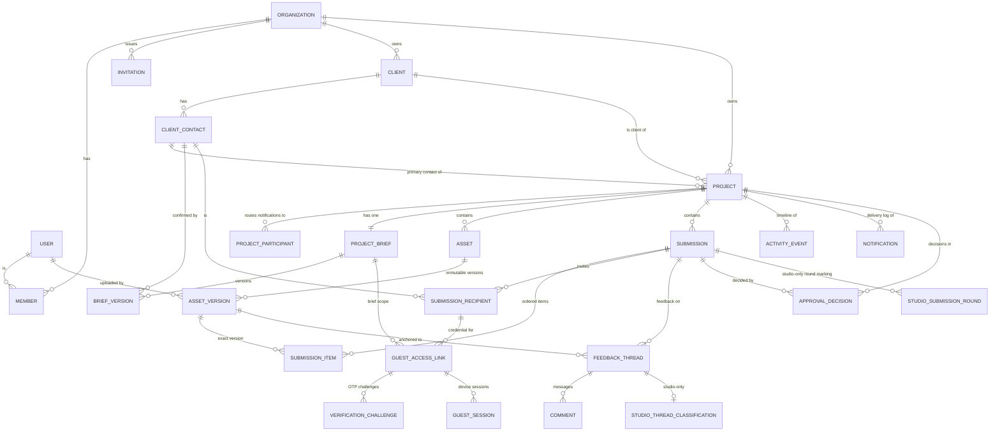
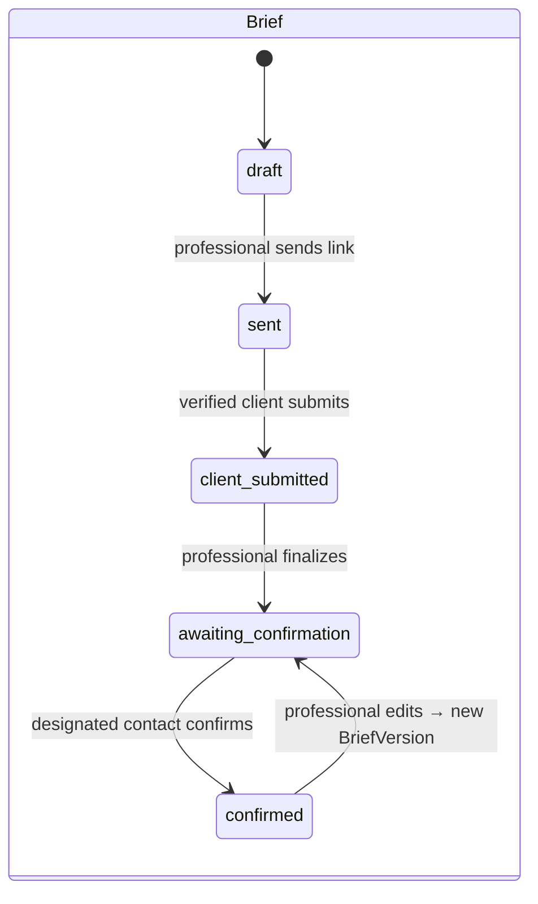
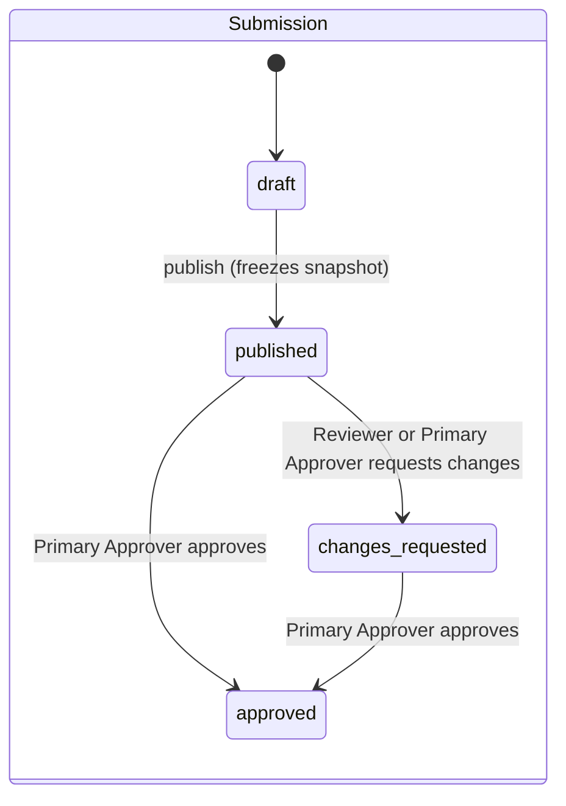
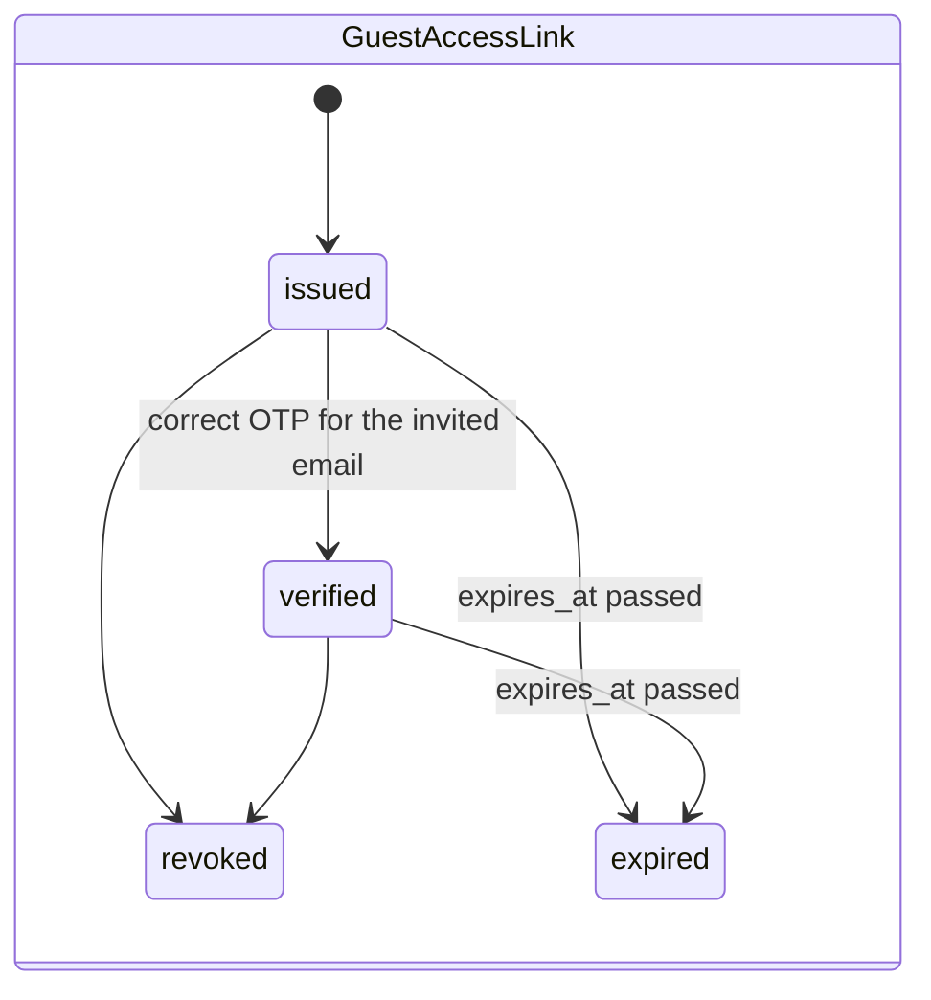
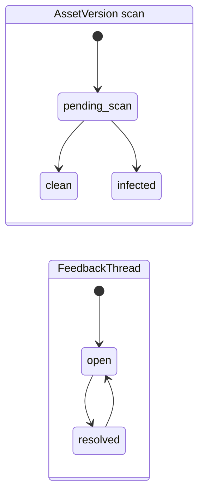

# ADR-0003: Domain model, tenancy and authorization model

- **Status:** Proposed
- **Date:** 2026-11-24
- **Deciders:** Human (accepts), Supervisor (proposes), Security reviewer (must review before acceptance)
- **Requires human acceptance:** **yes** — this ADR governs security, authorization and data handling (operating defaults #7, project-profile escalation triggers)
- **Ticket:** P0-3, `docs/plans/phase-0-foundation.md`
- **Governed by:** ADR-0002 (Accepted, with the local-only amendment). Nothing here changes the accepted stack.
- **Inputs:** `product/SRS.md` v0.1 (Draft, 94 FR / 48 NFR), `product/ProofDesk_Product_Knowledge_Multi_Agent.md` §5.2, §5.4, §6.5, §7, §9 (PK), `product/ux/screens.md` (Draft), `docs/delivery/project-profile.md`

### Binding product-owner decisions applied (2026-11-24)

| SRS OQ | Decision | Where it lands |
|---|---|---|
| **OQ-1** | Both Reviewers and the Primary Approver can request changes; **only the Primary Approver can approve** | §4 rows 28–29, §7 approve trigger |
| **OQ-2** | A feedback category is **required on client-authored threads**, optional on professional replies | §1.1 `feedback_thread.category` `CHECK` |
| **OQ-4** | Guest links **expire after 90 days**; the **studio** resends. **No client self-service resend flow exists** | §1.1, §2, §5 |
| **OQ-5** | A passed due date is **informational only**. No auto-close, no new lifecycle state, no blocking of invited actions | §1.1 (no `closed_at`), §2, §7 |
| **OQ-7** | Professional email verification **gates outbound actions only** (sending a brief, publishing a submission, issuing a guest link), not general workspace access | §4 rows 8, 17, 32 |

**OQ-8 (administrative-correction route) remains unanswered.** Snapshot immutability (§7) is designed on the assumption it is **not** built, with the exact delta if the product owner rules otherwise stated in §7 and §10.

---

## Context

Phase 1 must hold 14 non-negotiable data invariants (PK §5.4) while five actor kinds touch the same tables: Workspace Owner, Workspace Member, verified client Reviewer, verified Primary Approver, and an invited-but-unverified guest. Three of those actors are external and hold no account. Builders will work in parallel across lanes, so the isolation and immutability guarantees cannot depend on each builder remembering a convention.

Three forces shape the design:

1. **A forgotten `WHERE workspace_id = …` must not be able to leak another studio's project.** Phase 1A is a 3–5 studio pilot with real client drawings; one cross-tenant read ends the pilot.
2. **Published submissions and approval evidence are the product's commercial value.** "You approved exactly this" has to survive an app bug, not just a careful code review.
3. **One studio-only field (the Included / Potential scope change classification) must never reach a client.** PK §7.5 and the project profile escalate this specifically. A naming convention plus code review is not a control.

Constraints: single Postgres 17 container, Drizzle ORM with committed SQL migrations, Better Auth with the organization plugin, Next.js server actions and route handlers, **SeaweedFS** as the S3-compatible object store (ADR-0002 second amendment, 2026-11-24), ClamAV, Mailpit, pg-boss. Local only. No managed services, no new dependencies beyond ADR-0002's table.

One SRS open question remains unanswered and is **not** decided here: OQ-8, whether the PK §4.4 administrative-correction route is built. §7 and §10 state the exact delta under either answer. SRS OQ-6 (where the included-rounds allowance is set) is also open but affects only which table holds one nullable integer; it is marked `CONTINGENT`.

---

## Options considered

### A. Tenancy isolation

| Option | Pros | Cons | Verdict |
|---|---|---|---|
| **A1. App-layer scoping only** (ADR-0002's listed alternative) | Simplest; clear errors; no DB role management | A single missing predicate in any of ~40 query sites is a silent cross-tenant leak. No backstop. Denied-path tests only cover the paths someone thought to write | Rejected |
| **A2. Postgres RLS only** | The predicate lives in the database and applies to every statement regardless of query text | Cannot express role rules ("a Member may not invite"); a context-setting bug returns *empty* results, which reads as a product bug and gets "fixed" by widening a query; poor error messages | Rejected alone |
| **A3. Scoped query layer + RLS backstop + composite foreign keys** | Primary enforcement is explicit and debuggable; RLS catches the forgotten predicate; composite FKs make the denormalized `workspace_id` non-forgeable | Three DB roles to manage; every request must run inside a transaction | **Chosen** |
| **A4. Schema per tenant** | Hard isolation | N× migration cost, Drizzle and Better Auth both assume one schema, connection/search_path juggling. Enormous complexity for a 5-studio pilot | Rejected |
| **A5. Database per tenant** | Hardest isolation | Impossible to operate locally at pilot scale; cross-tenant admin queries become a project | Rejected |

### B. Studio-only field boundary

| Option | Pros | Cons | Verdict |
|---|---|---|---|
| **B1. Naming convention + code review** | Zero cost | Relies on discipline. Explicitly ruled insufficient by this ticket | Rejected |
| **B2. Response DTO allow-lists at the guest boundary** | Catches the common case; cheap | A nested include or a `select *` spread still leaks; a new field defaults to leaking unless someone remembers the DTO | Necessary, not sufficient |
| **B3. Studio-only columns moved to a separate `studio` Postgres schema, with `USAGE` revoked from the guest DB role** | A guest-path query touching the field **errors** instead of returning data. Fails closed. Enforced below the application | Studio-only data is one join away for the studio read path | **Chosen as the primary control** |
| **B4. Separate guest service/process** | Strongest | Second deployable, second auth stack, outside ADR-0002's shape. Not justified at pilot scale | Rejected |

Chosen: **B3 as the structural control, with B2 and a CI payload scan layered on top** (§6).

### C. Snapshot immutability

| Option | Pros | Cons | Verdict |
|---|---|---|---|
| **C1. Application-level "don't update published rows"** | Simple | One bad `update()` breaks invariant 5 permanently and silently | Rejected alone |
| **C2. Column-level `GRANT UPDATE (…)` plus `BEFORE UPDATE/DELETE` triggers** | The database rejects the write. Column grants mean the app role physically cannot change frozen columns; triggers cover row deletion and state-transition legality | Triggers are owner-bypassable (see §8 risk R-1) | **Chosen** |
| **C3. Event-sourced submissions** | Immutable by construction | Premature. Rewrites the read model for every screen. PK §13 warns against premature generality | Rejected |
| **C4. Append-only hash chain over approval + activity** | Tamper-*evident*, not just append-only | One extra column and one extra ordering constraint | **Proposed as OQ-A6**, not mandated |

---

## Decision

### 1. Entity–relationship model

`Workspace` is Better Auth's `organization` table; `WorkspaceMembership` is its `member` table (`role ∈ {owner, member}`); `User` is its `user` table. We do not add parallel tables. Everything else is ProofDesk-owned.

**Every tenant-scoped table carries `workspace_id uuid NOT NULL`** — denormalized, never derived at query time — and every parent carries `UNIQUE (workspace_id, id)` so children can reference it with a **composite foreign key**. The composite FK is what makes the denormalized column trustworthy: you cannot attach an `asset_version` from workspace B to a `submission` in workspace A, because no row satisfies both halves of the key. Where a row must also stay inside one project, the FK carries `project_id` too.



Tables prefixed `STUDIO_` live in the separate `studio` Postgres schema (§6). `GUEST_SESSION` is an infrastructure table, the guest analogue of Better Auth's `session`, and carries no domain concept — see OQ-A3.

#### 1.1 Column sketch, keys and mutability

Illustrative only. The migration ticket owns the real DDL.

| Table | Key columns | Tenant column | Mutability |
|---|---|---|---|
| `client` | `id`, `name`, `notes` | `workspace_id` | mutable |
| `client_contact` | `id`, `client_id`, `name`, `email` (lowercased, `UNIQUE (workspace_id, client_id, email)`) | `workspace_id` | mutable; `email` change does **not** retro-change identity on past records (§5.5) |
| `project` | `id`, `client_id`, `name`, `location`, `project_type`, `design_stage`, `custom_stage_label`, `primary_contact_id` | `workspace_id` | mutable. The included-rounds allowance is studio-only and lives in `studio.round_allowance` — `CONTINGENT` SRS OQ-6, see the note below |
| `project_participant` | `id`, `project_id`, `user_id` | `workspace_id` | mutable. **Notification routing only — no authorization meaning in Phase 1** (FR-WS-6, SRS OQ-10). See OQ-A1 |
| `project_brief` | `id`, `project_id` (`UNIQUE`), `state`, `current_version_id` | `workspace_id` | `state` and `current_version_id` mutable; nothing else |
| `brief_version` | `id`, `project_brief_id`, `version_no`, `content jsonb`, `authored_by_kind`, `authored_by_user_id`, `authored_by_contact_id`, `submitted_at`, `confirmed_at`, `confirmed_by_contact_id`, `confirmed_email`, `confirmed_display_name` | `workspace_id` | **`content` immutable once `submitted_at` is set.** `confirmed_*` write-once |
| `asset` | `id`, `project_id`, `name`, `purpose ∈ {design, brief_reference}` | `workspace_id` | mutable. **Deliberately has no `latest_version_id` column** (§5, invariant 4) |
| `asset_version` | `id`, `asset_id`, `project_id`, `version_no` (`UNIQUE (workspace_id, asset_id, version_no)`), `storage_key`, `byte_size`, `content_type`, `sha256`, `page_count`, `scan_state`, `uploaded_by_user_id`, `created_at` | `workspace_id` | **immutable except `scan_state`**, which is monotonic `pending_scan → clean \| infected` and trigger-enforced one-way |
| `submission` | `id`, `project_id`, `round_no`, `title`, `context`, `objective`, `instructions`, `design_stage`, `due_date`, `status`, `published_at`, `snapshot jsonb`, `snapshot_hash` | `workspace_id` | freely mutable while `published_at IS NULL`. After publish: **only `status`** may change. **Per OQ-5 there is no `closed_at` and no `superseded_by` column** — "superseded" is derived (a later published submission exists in the project) and is display-only |
| `submission_item` | `id`, `submission_id`, `asset_version_id`, `sort_index` (`UNIQUE (workspace_id, submission_id, sort_index)`) | `workspace_id` + `project_id` | **no INSERT/UPDATE/DELETE once the parent submission is published** |
| `submission_recipient` | `id`, `submission_id`, `client_contact_id`, `role ∈ {reviewer, primary_approver}`, `invited_email`, `invited_display_name` | `workspace_id` | frozen on publish. `UNIQUE INDEX ... WHERE role='primary_approver'` on `(workspace_id, submission_id)` → at most one; a publish-time check rejects zero |
| `guest_access_link` | `id`, `scope_type ∈ {brief, submission}`, `brief_id`, `submission_recipient_id`, `client_contact_id`, `token_id` (public, `UNIQUE`), `token_hash`, `created_at`, `expires_at NOT NULL` (= `created_at + GUEST_LINK_TTL_DAYS`, **90 days** per OQ-4), `revoked_at`, `revoked_by_user_id`, `verified_at`, `verified_email` | `workspace_id` | only `revoked_at`, `revoked_by_user_id`, `verified_at`, `verified_email` mutable, all write-once. `expires_at` is set once at issue and never extended — a studio resend issues a **new** row |
| `verification_challenge` | `id`, `guest_access_link_id`, `code_hash`, `sent_to_email`, `attempt_count`, `expires_at`, `consumed_at` | `workspace_id` | `attempt_count` and `consumed_at` only |
| `guest_session` | `id`, `guest_access_link_id`, `session_token_hash`, `created_at`, `last_seen_at`, `expires_at`, `revoked_at`, `user_agent_hash` | `workspace_id` | session fields only |
| `feedback_thread` | `id`, `submission_id`, `anchor_type ∈ {overall, asset_location}`, `asset_version_id`, `page_index`, `anchor_x`, `anchor_y`, `page_rotation`, `page_box`, `category ∈ {question, change_request, preference, concern}`, `status ∈ {open, resolved}`, `author_kind`, `author_user_id`, `author_contact_id`, `author_email`, `created_at` | `workspace_id` + `project_id` | **anchor columns, `author_*`, `category` and `created_at` immutable.** Only `status` mutable. Per OQ-2: `CHECK (author_kind <> 'client_recipient' OR category IS NOT NULL)` — required on client-authored threads, nullable on professional-authored ones |
| `comment` | `id`, `thread_id`, `body`, `author_kind`, `author_user_id`, `author_contact_id`, `author_email`, `author_display_name`, `created_at` | `workspace_id` | **append-only; no UPDATE, no DELETE** (see OQ-A5) |
| `approval_decision` | `id`, `project_id`, `submission_id`, `snapshot_hash`, `design_stage`, `asset_version_ids uuid[]`, `decision_type ∈ {approve, changes_requested}`, `note`, `actor_kind`, `actor_submission_recipient_id`, `actor_email`, `actor_display_name`, `created_at` | `workspace_id` | **append-only; no UPDATE, no DELETE** |
| `activity_event` | `id`, `project_id`, `event_type`, `subject_type`, `subject_id`, `actor_kind`, `actor_user_id`, `actor_contact_id`, `actor_email`, `payload jsonb`, `occurred_at` | `workspace_id` | **append-only; no UPDATE, no DELETE** |
| `notification` | `id`, `project_id`, `trigger`, `recipient_kind`, `recipient_email`, `status`, `attempt_count`, `last_error`, `sent_at` | `workspace_id` | mutable. **Explicitly not domain state** (invariant 13) |
| `studio.thread_classification` | `feedback_thread_id` (PK), `classification ∈ {included, potential_scope_change}`, `set_by_user_id`, `set_at` | `workspace_id` | mutable by O/M only |
| `studio.submission_round` | `submission_id` (PK), `counts_as ∈ {included, additional}`, `set_by_user_id`, `set_at` | `workspace_id` | frozen on publish |
| `studio.round_allowance` | `scope ∈ {workspace, project}`, `project_id` (null for workspace scope), `design_stage`, `included_rounds int` | `workspace_id` | mutable. `CONTINGENT` SRS OQ-6 — see below |

**Modelling notes that avoid new entities.** Brief reference images/PDFs (FR-BRF-9) are ordinary `asset` rows with `purpose='brief_reference'`, not a new entity. A Reviewer's request-changes is an `approval_decision` row with `decision_type='changes_requested'` — one audit trail, one source for `submission.status` — constrained so that `decision_type='approve'` requires `actor_submission_recipient_id` to be that submission's `primary_approver` (§4, OQ-A2).

**Included-rounds allowance (`CONTINGENT` SRS OQ-6).** The SRS recommends per-project; the UX draft puts a per-stage *default* in the workspace settings screen (P14) and shows the allowance on the project overview (P7). `studio.round_allowance` carries a `scope` discriminator so that either answer, or both (workspace default + project override), is a row rather than a migration. It sits in the `studio` schema because PK §4.6 and `product/ux/screens.md` §0 both class the allowance and the round marking as studio-only.

**Unresolvable-pointer rule (invariant 4).** `asset` has no `latest_version_id` and no `current_version_no`. "Latest" is computed as `max(version_no)` in the asset-library read path only. There is therefore no column anywhere that a submission could accidentally resolve through.

**Pin fidelity (FR-FBK-3).** `anchor_x`, `anchor_y` are `numeric CHECK (… BETWEEN 0 AND 1)`, relative to the page box recorded in `page_box` (default `'crop'`) at the rotation recorded in `page_rotation`. Storing the box and rotation the author saw is what lets a different viewport, zoom or pdf.js version reproduce the same point rather than approximating it.

### 2. Lifecycle state machines



A transition out of `confirmed` creates a **new** `brief_version`; the confirmed row is never touched (FR-BRF-7).



`draft` is the only deletable state. Nothing re-enters `draft`. There is **no edge back from `approved`**; a further round is a new Submission (invariant 9).

**Per OQ-5 this machine has exactly four states and no more.** A passed due date adds no state and no edge: it is a rendered comparison of `due_date` to now, it never blocks a comment, a reply, a change request or an approval, and no job closes anything. "Superseded" is likewise not a state — it is derived from the existence of a later published submission in the project and is read-only presentation (UX P13, C7). What makes an older round read-only for a guest is link scope, not submission state: a guest may write only to the submission their link names (§3, §5).



`revoked` and `expired` are terminal and distinct from `invalid` (no such token) — the three distinct dead ends PK §6.5, FR-GST-8 and UX C8 require. Per OQ-4 `expires_at` is always set, at 90 days, so `expired` is a live state from day one. Both terminal states are exits, not retry loops: the only route back is a studio resend (operation 32), which creates a **new** link row. There is no client-initiated transition out of `revoked` or `expired` anywhere in the design.



Only `clean` is previewable or downloadable (FR-AST-9). Thread status flips freely; messages never change. `approval_decision` has no state machine — it is append-only.

### 3. Tenancy enforcement

Four layers. Layers 1 and 2 are both mandatory; neither is allowed to stand alone.

**Layer 0 — identity.** `workspace_id` is read from the Better Auth server session (professional) or from the `guest_access_link` row resolved from the guest cookie. A `workspaceId`, `projectId` or `submissionId` in a request body or query string is **never** a source of tenancy; it is only ever a filter applied *inside* an already-scoped context. (FR-WS-4, NFR-SEC-1.)

**Layer 1 — a scoped query layer (primary).** There is exactly one module that owns the Drizzle client, and it exports no usable handle. The only way to reach the database is:

```ts
// db/tenant.ts — the only export; the raw drizzle client is not exported
export async function withProfessionalTenant<T>(
  session: ProfessionalSession,
  fn: (tx: TenantTx) => Promise<T>,
): Promise<T>;

export async function withGuestTenant<T>(
  guest: ResolvedGuestContext, // derived from guest_access_link, never from the request
  fn: (tx: GuestTx) => Promise<T>,
): Promise<T>;
```

Each opens a transaction on the matching connection pool and, as its first statement, sets the request context:

```sql
SET LOCAL app.workspace_id         = $1;
SET LOCAL app.workspace_role       = $2;  -- 'owner' | 'member'        (professional only)
SET LOCAL app.workspace_verified   = $3;  -- 'true' | 'false'          (professional only, OQ-7)
SET LOCAL app.guest_link_id        = $4;  -- (guest only)
SET LOCAL app.guest_contact_id     = $5;  -- the invited ClientContact (guest only)
SET LOCAL app.guest_scope_kind     = $6;  -- 'brief' | 'submission'    (guest only)
SET LOCAL app.guest_scope_id       = $7;  -- the one brief or submission the link names
SET LOCAL app.guest_verified       = $8;  -- 'true' | 'false'          (guest only)
```

`SET LOCAL` is transaction-scoped, so the context cannot survive into another request's use of a pooled connection, and it remains correct if a transaction-mode pooler is introduced at hosting time. `TenantTx` exposes repositories whose builders inject the `workspace_id` predicate, so the common path is also explicit and debuggable.

**Layer 2 — Postgres RLS (the backstop that catches a forgotten predicate).** Every tenant-scoped table has `ENABLE ROW LEVEL SECURITY` and `FORCE ROW LEVEL SECURITY`, with:

```sql
CREATE POLICY ws_isolation ON submission
  USING      (workspace_id = current_setting('app.workspace_id', true)::uuid)
  WITH CHECK (workspace_id = current_setting('app.workspace_id', true)::uuid);
```

Three runtime DB roles, none of which owns any table:

| Role | Used by | Notes |
|---|---|---|
| `proofdesk_migrator` | migrations only, never the running app | table owner, DDL |
| `proofdesk_app` | professional requests + the pg-boss worker | RLS applies; column-level `UPDATE` grants only (§5) |
| `proofdesk_guest` | guest requests only | RLS applies with extra scope predicates; **no `USAGE` on schema `studio`**; no privileges at all on `client`, `client_contact`, `project_participant`, `notification`, `activity_event`, `asset`, `member`, `invitation` or the Better Auth tables; column-level `SELECT` only on `organization (id, name, logo)` and `project (id, workspace_id, name, location, project_type)` |

**The guest read/write asymmetry (UX C7 vs C4).** A guest needs to *read* across submissions — C7 shows the rounds that contact was invited to — but may *write* only to the one submission their link names. That is two policies, not one:

```sql
-- read: any published submission this contact was invited to, in this workspace
CREATE POLICY guest_read ON submission FOR SELECT TO proofdesk_guest USING (
  workspace_id = current_setting('app.workspace_id', true)::uuid
  AND published_at IS NOT NULL
  AND EXISTS (SELECT 1 FROM submission_recipient sr
              WHERE sr.submission_id = submission.id
                AND sr.client_contact_id = current_setting('app.guest_contact_id', true)::uuid)
);
-- write targets (feedback_thread, comment, approval_decision): the scoped submission only
--   AND submission_id = current_setting('app.guest_scope_id', true)::uuid
--   AND current_setting('app.guest_verified', true) = 'true'
```

Drafts are unreachable (`published_at IS NOT NULL`), a non-invited round is absent rather than denied (UX C7), and an older round is readable but unwritable without any submission state being involved. `asset_version` carries the same shape: a guest may select a version only where a `submission_item` of a submission they were invited to references it, which is what keeps unselected assets and out-of-snapshot versions off every guest surface.

**Why a forgotten `WHERE` cannot leak.** The predicate is evaluated by Postgres on every statement against these tables, irrespective of the SQL the ORM produced. `current_setting('app.workspace_id', true)` returns `NULL` when unset, the comparison is `NULL`, the policy is not satisfied, and the statement sees **zero rows** and can insert nothing. The failure mode of a missing context is therefore an empty result, never a full table. The guest role additionally fails closed on studio-only data with a *permission error*, which is noisy rather than silent.

**Why Layer 2 alone was rejected, restated:** an empty result set is an ambiguous signal. A builder debugging "my list is empty" can widen the application query and feel successful. Layer 1 makes the intent explicit so the bug surfaces as a context bug; Layer 2 makes the consequence of getting it wrong harmless.

**Layer 3 — composite foreign keys (cross-table forgery).** RLS protects rows; composite FKs protect *relationships*. `submission_item (workspace_id, project_id, submission_id) → submission (workspace_id, project_id, id)` and `(workspace_id, project_id, asset_version_id) → asset_version (workspace_id, project_id, id)` make it structurally impossible to stitch a submission to another workspace's or another project's file, even for the migrator role.

**Layer 4 — role and verification checks in the service layer.** RLS expresses tenancy, not roles. Owner-only and Primary-Approver-only rules live in the service layer (§4), with three DB backstops:

- `member` write policies require `current_setting('app.workspace_role') = 'owner'`;
- guest write policies on `feedback_thread`, `comment` and `approval_decision` require `current_setting('app.guest_verified') = 'true'`, so invariant 11 has a database backstop rather than only a middleware check;
- **per OQ-7**, the three outbound operations — issuing a guest link, sending a brief, publishing a submission — require `current_setting('app.workspace_verified') = 'true'`. `guest_access_link` `INSERT` and the publish path carry that predicate. Everything else in the workspace is reachable by an unverified professional, which is what OQ-7 answer (b) asks for: setup is never blocked, but nothing leaves the workspace unverified.

**Enforceable completeness check.** A CI test reads the Drizzle schema and asserts, for every table not on a short explicit allow-list (`user`, `session`, `account`, `verification`, `organization`): `workspace_id` exists and is `NOT NULL`; `UNIQUE (workspace_id, id)` exists; RLS is enabled and forced; at least one policy exists. **A builder cannot add a tenant table without isolation and have CI stay green.**

### 4. Role and recipient permission matrix

Actors: **O** Owner · **M** Member · **R** verified Reviewer · **PA** verified Primary Approver for *that* submission · **U** invited guest holding a valid link, not yet verified · **X** everyone else (anonymous, forwarded-link holder, another workspace's user, a holder of a revoked or expired link). **X is denied everywhere and is omitted from the table.**

R, PA and U are scoped to the one brief or submission their link names. "Allow" for them always means *within that scope*.

| # | Operation class | O | M | R | PA | U |
|---|---|:-:|:-:|:-:|:-:|:-:|
| 1 | Create workspace | ✅ | ✅ | ❌ | ❌ | ❌ |
| 2 | Invite / remove a workspace member, change member role | ✅ | ❌ | ❌ | ❌ | ❌ |
| 3 | Edit workspace settings | ✅ | ❌ | ❌ | ❌ | ❌ |
| 4 | View workspace members | ✅ | ✅ | ❌ | ❌ | ❌ |
| 5 | CRUD Client and ClientContact | ✅ | ✅ | ❌ | ❌ | ❌ |
| 6 | CRUD Project, set stage, set primary contact | ✅ | ✅ | ❌ | ❌ | ❌ |
| 7 | List / read projects of own workspace | ✅ | ✅ | ❌ | ❌ | ❌ |
| 8 | Prepare and send a brief; issue a brief guest link | ✅ † | ✅ † | ❌ | ❌ | ❌ |
| 9 | Read the invited brief page | ✅ | ✅ | ✅ | ✅ | ✅ |
| 10 | Submit a brief | ✅ | ✅ | ✅ | ✅ | ❌ |
| 11 | Confirm a finalized BriefVersion | ❌ | ❌ | only the designated contact | only the designated contact | ❌ |
| 12 | Upload an Asset / a new AssetVersion | ✅ | ✅ | brief references only | brief references only | ❌ |
| 13 | Read the asset library and full version history | ✅ | ✅ | ❌ | ❌ | ❌ |
| 14 | Preview / download an AssetVersion | ✅ | ✅ | only versions in an invited submission | same as R | ❌ |
| 15 | Create / edit / delete a **draft** Submission | ✅ | ✅ | ❌ | ❌ | ❌ |
| 16 | Preview the guest experience of a draft | ✅ | ✅ | ❌ | ❌ | ❌ |
| 17 | Publish a Submission | ✅ † | ✅ † | ❌ | ❌ | ❌ |
| 18 | Mutate a **published** Submission snapshot | ❌ | ❌ | ❌ | ❌ | ❌ |
| 19 | Read a published Submission | ✅ | ✅ | ✅ | ✅ | ✅ (read-only) |
| 20 | Read the invited project's submission history | ✅ | ✅ | ✅ invited items only | ✅ invited items only | ❌ |
| 21 | Create a FeedbackThread (pin or overall) | ✅ | ✅ | ✅ | ✅ | ❌ |
| 22 | Reply to a thread | ✅ | ✅ | ✅ | ✅ | ❌ |
| 23 | Read threads and comments on the submission | ✅ | ✅ | ✅ | ✅ | ✅ (read-only) |
| 24 | Edit or delete someone else's comment | ❌ | ❌ | ❌ | ❌ | ❌ |
| 25 | Mark a thread open / resolved | ✅ | ✅ | ❌ | ❌ | ❌ |
| 26 | Read or write the Included / Potential-scope-change classification | ✅ | ✅ | ❌ | ❌ | ❌ |
| 27 | Read or write the included/additional round marking | ✅ | ✅ | ❌ | ❌ | ❌ |
| 28 | **Request changes** on a published submission | ❌ | ❌ | **✅** | **✅** | ❌ |
| 29 | **Approve** a published submission | ❌ | ❌ | **❌** | **✅** | ❌ |
| 30 | Edit or delete an ApprovalDecision | ❌ | ❌ | ❌ | ❌ | ❌ |
| 31 | Revoke a guest link | ✅ | ✅ | ❌ | ❌ | ❌ |
| 32 | Issue / resend a guest link (studio-initiated; **the only route out of an expired or revoked link**) | ✅ † | ✅ † | ❌ | ❌ | ❌ |
| 33 | Request an OTP for own invited address | ❌ | ❌ | ✅ | ✅ | ✅ |
| 34 | Read the project activity timeline | ✅ | ✅ | ❌ | ❌ | ❌ |
| 35 | Edit or delete an ActivityEvent | ❌ | ❌ | ❌ | ❌ | ❌ |
| 36 | Read the notification delivery log | ✅ | ✅ | ❌ | ❌ | ❌ |

**† Outbound actions (rows 8, 17, 32) additionally require a verified professional email**, per OQ-7 answer (b). No other row is gated on professional verification: an unverified professional can create the workspace, the client, the project and the assets, and can build a draft submission. They cannot send anything to a client. The gate is one `requireVerifiedProfessional` guard plus the `app.workspace_verified` RLS predicate (§3 Layer 4).

**There is no guest row for "request a new link".** Per OQ-4 the studio resends (row 32). Rows 33's OTP resend is a *re-send of the verification code* for an already-valid link, not a re-issue of the link, and it is the only guest-initiated credential action in the product.

**Rows 28 and 29 are the binding product-owner decision of 2026-11-24.** Request-changes is open to Reviewer and Primary Approver; approving is exclusive to the Primary Approver. Enforcement is three-deep: the service layer resolves the actor's `submission_recipient.role`; a `CHECK` on `approval_decision` requires `decision_type <> 'approve' OR actor_kind = 'client_recipient'`; and a `BEFORE INSERT` trigger rejects `decision_type='approve'` unless `actor_submission_recipient_id` is the row in `submission_recipient` with `role='primary_approver'` for that submission. A compromised or buggy service layer still cannot store an approval by a reviewer.

**Rows 2–7, 13, 25–27, 34, 36 are denied to R/PA/U structurally**, because `proofdesk_guest` has no privileges on `client`, `project_participant`, `notification`, `member`, `activity_event` or schema `studio` — those requests fail with a permission error rather than an authorization decision.

**Satisfaction of the named invariants.** Invariant 2 — rows 1–7 plus Layer 4's `app.workspace_role` backstop; invariant 10 — every R/PA/U cell is scope-limited by the `guest_access_link` row (§5); invariant 11 — the whole U column is read-only, with the DB backstop on guest write policies; invariant 12 — rows 26 and 27.

### 5. Guest access: token and OTP design

**Link token.** `token_id` = 16 random bytes; `token_secret` = 32 random bytes (**256 bits**) from `crypto.randomBytes`. Both base64url. The URL carries `/g/<token_id>.<token_secret>`. Stored: `token_id` plaintext (a non-secret, indexed lookup key) and `token_hash = sha256(token_secret)`. **No usable secret is stored.** Comparison is `crypto.timingSafeEqual`. SHA-256 rather than a password KDF is correct here: the input has 256 bits of entropy, so there is nothing to brute-force, and we want the lookup cheap. The split id/secret shape gives an O(1) indexed lookup instead of a table scan over hashes, and removes the timing signal of a sequential compare.

**Token never rests in a URL.** `GET /g/<token>` validates, mints a guest session, sets the cookie, and `302`s to a token-free path (`/review/<submissionId>` or `/brief/<briefId>`). Guest pages send `Referrer-Policy: no-referrer`, and the request logger redacts the `/g/` path segment. This closes token leakage via Referer, browser history, screenshots and shared logs — the most likely real-world failure for emailed links.

**Guest session.** `guest_session` row with `session_token_hash = sha256(random 32 bytes)`. Cookie: `HttpOnly`, `SameSite=Lax` (so the emailed top-level GET still works while cross-site POSTs do not), `Secure` and `__Host-` prefix outside localhost, `Path=/`, idle lifetime from config. Guest POSTs additionally require an `Origin`/`Sec-Fetch-Site` check (NFR-SEC-4). Every request re-reads `guest_access_link` and re-derives authority; **no claim is trusted from the cookie except the session id** (NFR-SEC-5).

**Scoping (invariant 10).** A link row names exactly one `scope_type` + scope id and exactly one `submission_recipient_id` (or `client_contact_id` for a brief). The resolved `ResolvedGuestContext` is built *only* from that row: workspace, project, scope, recipient and role. A `submissionId` in the request is compared to the resolved scope and rejected on mismatch. Cross-submission use, token mutation and scope substitution are all the same denial.

**OTP.** 6 digits via `crypto.randomInt(0, 1_000_000)` (rejection-free, no modulo bias), zero-padded. Stored as `HMAC-SHA256(pepper, challenge_id || code)` where the pepper is a server secret supplied as an environment variable (name only: `GUEST_OTP_PEPPER`). A keyed hash rather than a bare hash is what matters here, because 10⁶ is trivially enumerable from a database dump alone; the pepper lives outside the database. A memory-hard KDF was considered and rejected as unnecessary given a 10-minute TTL and a 5-attempt cap. Parameters, all configuration (`GUEST_OTP_TTL_MINUTES`, `GUEST_OTP_MAX_ATTEMPTS`, `GUEST_OTP_RESEND_WINDOW_SECONDS`): 10 minutes, 5 attempts, per-link and per-IP resend rate limits (NFR-SEC-3). Issuing a new challenge consumes any outstanding one, so only one code is ever live per link.

**The verification gate (invariant 11, FR-GST-3).** The OTP is sent **only** to `submission_recipient.invited_email`, read from the database. **The guest verification form has no email field.** A forwarded-link holder therefore has nothing to supply and no path to an identity: the code goes to the original recipient's inbox. That is a structural answer to FR-GST-6, not a validation rule. On success, `guest_access_link.verified_at` and `verified_email` are written once, and `app.guest_verified` becomes `'true'` for subsequent transactions, which is what the guest write RLS policies require.

**Identity.** The verified invited email is the client identity (FR-GST-5). It is copied onto `comment.author_email`, `approval_decision.actor_email` and `brief_version.confirmed_email` at write time, so later edits to `client_contact.email` cannot retroactively rewrite who said or approved what (invariant 14).

**Revocation.** `revoked_at` set by O/M. Guest RLS policies include `revoked_at IS NULL AND (expires_at IS NULL OR expires_at > now())`, so a revoked link sees zero rows and can write nothing even if a handler forgot to check. Presigned SeaweedFS download URLs (presigned `GET`) are issued for ≤ 5 minutes and only after the authorization check, which bounds the one credential we cannot individually revoke (ADR-0002 consequence, NFR-SEC-5). Uploads use **presigned `PUT`**, not a presigned POST policy, per the ADR-0002 second amendment; the authorization model is unaffected because either way the storage key is minted server-side after the tenancy and role check, and the `asset_version` row is inserted with `scan_state='pending_scan'` before the client receives the URL. Notification recipient selection joins live link state, so a revoked recipient stops receiving email (FR-NTF-3).

**Expiry — 90 days, studio resends (OQ-4, answered).** `guest_access_link.expires_at` is `NOT NULL`, set once at issue to `created_at + GUEST_LINK_TTL_DAYS` with the shipped value **90 days**. It is never extended and never recomputed; a studio resend (operation 32) **inserts a new link row and sets `revoked_at` on the old one in the same transaction**, so a resend both restores access and invalidates the previous URL. Expiry is enforced in the guest RLS predicate alongside revocation, so an expired link sees zero rows and writes nothing even if a handler forgets to check — the same mechanism, not a second one.

**There is deliberately no client self-service resend.** No unauthenticated resend endpoint exists, no guest screen offers one, and the three dead-end states (`invalid`, `expired`, `revoked`) are terminal pages with no retry affordance, which matches UX C8. The only guest-initiated credential action in the product is requesting the OTP for an already-valid link. This matters as a security property, not just a scope one: an unauthenticated "email me a new link" endpoint would be an email-enumeration oracle and a free mail-sending primitive, and we now do not have to defend one.

`GUEST_LINK_TTL_DAYS` stays a named configuration value (name only; no value in the repository outside `.env.example`) so that the pilot can shorten it without a migration. Lengthening it does not extend links already issued.

**Threats considered.**

| Threat | Mitigation |
|---|---|
| Token enumeration | 256-bit secret; indexed id lookup; constant-time compare; rate limit on `/g/*` |
| Token leaked via Referer / history / logs | Token exchanged for a cookie then redirected away; `Referrer-Policy: no-referrer`; log redaction |
| Forwarded link used by another person | Code is sent only to the stored invited address; no email input exists |
| OTP brute force | 6 digits, 10 minutes, 5 attempts, per-link and per-IP limits, single live challenge |
| OTP hashes leaked with a DB dump | Keyed HMAC with a pepper held outside the database |
| Cross-submission / scope escalation | Scope resolved solely from the link row; request-supplied ids only compared |
| Revocation or expiry not taking effect, or cached-page writes | Authority re-derived per request; `revoked_at` **and** `expires_at` both in the RLS predicate; ≤ 5-minute presigned URLs |
| Email enumeration / free mail-sending via a "resend my link" endpoint | No such endpoint exists (OQ-4); only the studio re-issues links |
| A 90-day link outliving the engagement | Studio revocation (operation 32 / 31) is the intended control; expiry is the backstop, not the primary one |
| Guest session theft via XSS | `HttpOnly`; nonce-based CSP (repo web rules); no token in the DOM |
| Cross-site forgery of a guest write | `SameSite=Lax` + `Origin`/`Sec-Fetch-Site` check |
| Studio-only field leaking to a guest | `proofdesk_guest` has no `USAGE` on schema `studio` (§6) |
| Unverified guest writing | Guest write RLS requires `app.guest_verified = 'true'` |
| Tenant inference from error text | Uniform denial response; "not found" and "not authorized" are indistinguishable (NFR-SEC-10) |
| Infected file served | Only `scan_state='clean'` is signable for download (FR-AST-9) |

### 6. The studio-only field boundary

Four layers; the first is the control, the rest are depth.

`product/ux/screens.md` §0 defines the guest field boundary as a hard UI rule and lists more than the classification. Those items split into two mechanisms, and both are structural:

| Forbidden on a guest surface (UX §0) | Mechanism |
|---|---|
| Included / Potential scope change classification | `studio` schema, no `USAGE` for `proofdesk_guest` (below) |
| Round allowance, round counts, included/additional marker | same |
| Client record fields, other contacts' email addresses | no privileges on `client`, `client_contact` (§3). The guest's own invited email comes from `submission_recipient.invited_email` |
| Workspace member names and emails, workspace settings | no privileges on `member`, `invitation`, Better Auth tables; column-level `SELECT` on `organization (id, name, logo)` only |
| Drafts, unselected assets, out-of-snapshot versions, other submissions | the guest read/write policies in §3 |
| Activity entries the guest was not party to | no privileges on `activity_event` — the guest has no timeline surface at all |
| Guest tokens or OTP values for anyone | only hashes are stored; no privileges on `verification_challenge`, and `guest_access_link` is read through the resolver, not a guest query |

1. **Physical separation.** Every studio-only datum lives in the `studio` Postgres schema: `studio.thread_classification`, `studio.submission_round` and `studio.round_allowance`. No studio-only column exists on any guest-readable table.
2. **Privilege (the structural guarantee).** `REVOKE ALL ON SCHEMA studio FROM proofdesk_guest;` and no grants on its tables. A guest-path query that reaches for the classification — through a join, a `select *`, a careless spread or a future ORM relation — raises `permission denied for schema studio`. The request **fails loudly**; it cannot partially succeed and emit the field. This is the property a convention cannot provide.
3. **Type boundary.** The guest connection is constructed with a *different* Drizzle schema object (`schema.guest.ts`) that does not import the `studio` tables, so the field is not expressible in a guest query at compile time. Guest responses are produced only by Zod output schemas declared `.strict()` in `app/guest/dto/`, so an extra key is a runtime error, not a silent pass-through.
4. **CI assertions.** (a) A denied-path test executes `select * from studio.thread_classification` as `proofdesk_guest` and asserts a permission error, and repeats it for every table in the schema. (b) A test walks every guest route's response, recursively, and asserts that no key from a forbidden list (`classification`, `countsAs`, `counts_as`, `scopeClassification`, `includedRounds`, `roundAllowance`, …) appears at any depth (NFR-PRIV-1). (c) A schema test asserts no table outside `studio` carries a studio-only column name. (d) A privilege test asserts `proofdesk_guest` holds no privilege on the table list above.

**The studio's guest preview (UX P11) is the canary.** P11 renders from the guest read model so a leak shows up there first. It runs under a professional session, so it executes the *guest read-model query builders and guest `.strict()` DTOs* under `proofdesk_app` with an explicit preview context, rather than under `proofdesk_guest` (which cannot see a draft). Layer 2 is therefore absent in preview while layers 1, 3 and 4 hold — which is exactly why preview must never receive studio data by prop, and why the §6 (b) payload scan must run against the preview route too.

This satisfies invariant 12 and SRS FR-GST-9 / NFR-PRIV-1, and generalizes: any future studio-only field is added to the `studio` schema and inherits all four layers for free.

### 7. Snapshot integrity

**Canonical snapshot.** At publish, inside one transaction: validate exactly one `primary_approver`, validate every selected `asset_version.scan_state='clean'`, build a canonical JSON document (explicit field list, keys sorted, UTC ISO-8601 timestamps, no serialization-time values) containing the asset-version ids with their file metadata, display order, title, context, objective, instructions, design stage, recipients with roles and invited emails, due date and review settings; write it to `submission.snapshot`; write `snapshot_hash = sha256(canonical)`; set `published_at` and `status='published'`; insert the `activity_event`; enqueue the notifications. `snapshot` and `snapshot_hash` are the stable reference FR-APV-2 requires.

**API level.** No route or server action accepts a mutation of a submission with `published_at IS NOT NULL`, other than the status transitions in §2. Publish is idempotent on `published_at`.

**Database level — this is the layer that holds when the API is wrong.**

```sql
-- column-level privilege: the app role physically cannot write frozen columns
REVOKE UPDATE, DELETE ON submission, submission_item, submission_recipient FROM proofdesk_app;
GRANT  UPDATE (status) ON submission TO proofdesk_app;
-- `status` is the ONLY writable column on a published submission. Per OQ-5 there is no
-- closed_at and no superseded_by column, so the allow-list is one column wide.

-- drafts stay editable; published rows freeze
CREATE TRIGGER submission_freeze BEFORE UPDATE OR DELETE ON submission
  FOR EACH ROW EXECUTE FUNCTION reject_published_submission_change();
-- raises unless OLD.published_at IS NULL, or the only changed columns are the allow-list
-- and the status transition is one of the §2 edges

CREATE TRIGGER submission_item_freeze BEFORE INSERT OR UPDATE OR DELETE ON submission_item
  FOR EACH ROW EXECUTE FUNCTION reject_if_parent_published();
-- identical trigger on submission_recipient

CREATE TRIGGER append_only BEFORE UPDATE OR DELETE ON approval_decision  -- and comment, activity_event
  FOR EACH ROW EXECUTE FUNCTION reject_always();

CREATE TRIGGER asset_version_freeze BEFORE UPDATE OR DELETE ON asset_version
  FOR EACH ROW EXECUTE FUNCTION allow_only_monotonic_scan_state();
-- pending_scan → clean|infected, one way; every other column and DELETE rejected
```

`DELETE` is additionally revoked outright from `proofdesk_app` on `asset_version`, `brief_version`, `submission`, `submission_item`, `submission_recipient`, `comment`, `approval_decision` and `activity_event`. A draft submission is deleted through a `SECURITY DEFINER` function that refuses when `published_at IS NOT NULL` — the one narrow exception, so that "delete my draft" does not require a general DELETE grant (OQ-A4).

**OQ-5 strengthens this.** Because a passed due date produces no state change and supersession is derived rather than stored, the post-publish write surface of a submission is a single column. That is the narrowest form invariant 5 can take in this stack, and it means the `submission_freeze` trigger has one allow-listed column to reason about instead of three.

**Invariants covered.** 3 (`asset_version` frozen but for the monotonic scan state) · 4 (`submission_item.asset_version_id` plus no latest-version pointer anywhere) · 5 (column grants + freeze triggers) · 8 (`approval_decision.snapshot_hash` + `asset_version_ids`, `NOT NULL`, inserted in the same transaction as the decision) · 14 (`UPDATE`/`DELETE` revoked and trigger-rejected on all append-only tables).

**OQ-8 — the administrative-correction route. Designed as NOT built, per the supervisor's recommendation.** There is no route, no column-grant exception and no trigger exception for editing a published submission. If the product owner decides to build it, the change is additive and the invariant survives: add one append-only table `submission_correction (submission_id, corrected_fields jsonb, reason, corrected_by_user_id, created_at, prev_snapshot_hash)`; the original `submission` row and its `snapshot` are **still never updated**; read models compose original + corrections, and the guest UI must display that a correction exists; one new `activity_event` type; one new `ApprovalDecision` consideration — an approval recorded against `snapshot_hash` H remains an approval of H, and a correction after approval must be surfaced as such rather than folded in. **No trigger, grant or policy changes.** Cost: roughly one builder ticket plus a security review, plus a product decision on whether a corrected submission can still be approved. It also adds a new entity, which is outside PK §5.2 and therefore needs an explicit product-owner scope change.

### 8. Cross-lane interfaces

So frontend and backend builders can work in parallel, the route namespaces and their contracts are fixed now:

| Namespace | Auth source | DB role | Response shape |
|---|---|---|---|
| `app/(studio)/**` server actions | Better Auth session | `proofdesk_app` | studio DTOs; may include `studio.*` data |
| `app/api/guest/**` + `app/(guest)/**` | guest session cookie → `guest_access_link` | `proofdesk_guest` | `.strict()` guest DTOs only, from `app/guest/dto/` |
| `app/(studio)/…/preview` (UX P11) | Better Auth session | `proofdesk_app` | **guest** `.strict()` DTOs, built by the guest read model with a preview context (§6) |
| `worker/**` (pg-boss) | job payload carries `workspaceId` | `proofdesk_app` | none |

A studio DTO and a guest DTO for the same entity are **separate types in separate modules**. Neither imports the other. Guest DTO modules may not import anything from the `studio` schema module — enforced by an ESLint `no-restricted-imports` boundary rule and by (3) in §6. These two namespaces and three contracts are the parallelization seam: the guest review canvas can be built against the guest DTO types before the studio inbox exists, and vice versa.

---

## 9. Invariant → mechanism → test

Every row needs **both** an allowed-path and a denied-path test (project profile G2/G3, NFR-OBS-4).

| # | Invariant (PK §5.4) | Enforcing mechanism | Allowed-path test | Denied-path test |
|---|---|---|---|---|
| 1 | Workspace is the tenant boundary | `workspace_id NOT NULL` on every tenant table + `UNIQUE (workspace_id, id)` + RLS policy + composite FKs + the CI schema completeness test (§3) | A record created inside `withProfessionalTenant` is readable in that workspace | `INSERT` with no `app.workspace_id` set, and `INSERT` with a mismatched `workspace_id`, are both rejected; the CI schema test fails on a table added without `workspace_id` or RLS |
| 2 | Every project operation verifies workspace membership and role | Session-derived `workspace_id` (never request-supplied) + RLS + `app.workspace_role` backstop on `member` writes + the §4 matrix in the service layer | Owner and Member each succeed on their allowed rows of §4 | Workspace-B Member requesting an A project / asset / submission / thread / file by id is denied on **every** operation class; a Member invoking invite or remove (row 2) is denied; a request-supplied `workspaceId` that differs from the session is ignored and denied |
| 3 | Asset is logical; AssetVersion is immutable history | `asset_version_freeze` trigger, `DELETE` revoked, no mutable columns but monotonic `scan_state` | Upload a replacement → v2 exists, v1 byte-identical with its original uploader and timestamp | Direct `UPDATE` of `storage_key` / `sha256` / `version_no`, direct `DELETE`, and `clean → pending_scan` are each rejected at the DB |
| 4 | SubmissionItems reference exact AssetVersion ids | `submission_item.asset_version_id` + composite FK + **no latest-version pointer column exists** | A published submission renders exactly the frozen versions | Upload v2 after publish → the published submission still resolves v1; a schema test asserts no `latest_version*` / `current_version*` column exists on `asset` |
| 5 | A published Submission snapshot is immutable | Column-level `GRANT UPDATE (status)` — one column only (OQ-5), `submission_freeze`, `reject_if_parent_published` on items and recipients, API with no mutation route | Publish stores every FR-SUB-8 field; a legal `published → approved` transition succeeds | Every mutation route and every direct `UPDATE`/`DELETE` of items, order, instructions, stage, recipients, due date, `snapshot` or `snapshot_hash` is rejected, and `snapshot_hash` is unchanged afterwards. A submission whose due date has passed is still writable by its invited recipients (OQ-5) and still immutable as a snapshot |
| 6 | Thread location bound to the exact AssetVersion and page/coords | Immutable anchor columns (no `UPDATE` grant), composite FK to `asset_version`, `CHECK` on coordinate range, `page_rotation` + `page_box` stored | A pin re-renders at the same page location at a different zoom, viewport and rotation | Re-pointing `asset_version_id`, `page_index`, `anchor_x` or `anchor_y` is rejected; a coordinate outside [0,1] is rejected; a cross-project `asset_version_id` violates the composite FK |
| 7 | Comments on older versions stay there; no migration | Thread→`asset_version_id` is immutable; there is no migration code path | After v2 is published in a follow-up, v1 threads are still on v1 at their original coordinates | No v1 thread appears on v2, and no route exists that rebinds a thread |
| 8 | ApprovalDecision references one exact published snapshot | `snapshot_hash NOT NULL` + `asset_version_ids NOT NULL` + FK to `submission`, written in the approval transaction | Approval history resolves the exact submission, exact versions, verified email and name, timestamp (FR-HST-4) | Inserting an approval with a null, empty or non-matching `snapshot_hash`, or against an unpublished submission, is rejected |
| 9 | A new Submission has no inherited approval | No approval column on `submission`; approval exists only as an `approval_decision` row keyed to one `submission_id` | A follow-up submission reports an awaiting-decision state | Publishing a follow-up after an approval yields zero `approval_decision` rows for it; no copy path exists |
| 10 | Guest tokens scoped, unguessable, revocable, recipient-limited | 256-bit secret, hashed, id/secret split; scope resolved solely from the link row; `revoked_at` **and** the 90-day `expires_at` inside the guest RLS predicate | Recipient A's link reaches exactly submission A with A's role; A can read an earlier round they were invited to, read-only | Altered token, another submission's id, a cross-scope id, a revoked link (including a reload, an in-page navigation and a previously loaded form POST), a link past 90 days, and a write to a round other than the link's scope are each denied, with `revoked` / `expired` / `invalid` reported as distinct terminal states and no retry affordance. A test asserts no unauthenticated link-resend endpoint exists |
| 11 | Email verification before any guest mutation or approval | Server gate on every guest write + guest write RLS requires `app.guest_verified = 'true'`; OTP sent only to the stored invited address, with no email input in the form | A verified R/PA can comment, reply, submit/confirm a brief, request changes; PA can approve. An unverified holder can read the invited page (FR-GST-3, UX C1) | **Every** guest write endpoint denies an unverified identity with a verification-required state; and with the service check stubbed out, the DB policy still rejects the write. Separately (OQ-7): an unverified **professional** is denied on issuing a guest link, sending a brief and publishing, and allowed everywhere else |
| 12 | Studio-only fields never returned to guest endpoints | `studio` schema + `USAGE` revoked from `proofdesk_guest` + the privilege list in §6 + separate guest Drizzle schema + `.strict()` guest DTOs + CI payload scan | O/M can read and set the classification, the round marking and the allowance | `select` on `studio.*` as `proofdesk_guest` raises a permission error; `proofdesk_guest` holds no privilege on `client`, `client_contact`, `member`, `activity_event`, `notification`; no guest response payload — **including the P11 preview route** — contains a forbidden key at any nesting depth; the ESLint boundary rule fails on a guest DTO importing the studio schema |
| 13 | Domain state is authoritative; notifications and projections are not | `notification` is a separate table with no FK from any domain table; the domain write, the `activity_event` and the pg-boss job are enqueued in **one** transaction; delivery failure only updates `notification.status` | A comment / publication / approval persists, and a notification row and a job exist | With Mailpit stopped: the domain record persists, the UI reports success for the domain action, `notification.status='failed'` is retried, and the domain row is unchanged |
| 14 | Audit history is not silently rewritten | `UPDATE`/`DELETE` revoked from `proofdesk_app` and trigger-rejected on `approval_decision`, `activity_event`, `comment`, `brief_version` (post-submit), `asset_version`; verified identity copied at write time | A new version, submission or decision leaves every prior row unchanged | `UPDATE` and `DELETE` on an `approval_decision` and an `activity_event` are rejected at the API **and** at the DB; changing `client_contact.email` does not alter any historical `author_email` / `actor_email`. **See §10 risk R-1: this is append-only, not tamper-*evident*** |

---

## 10. Consequences

**Becomes easier.** Builders cannot forget tenancy: the only database handle requires a tenant context, and the schema CI test blocks a table that lacks isolation. The guest and studio lanes become independently buildable behind two DTO namespaces. Guest leakage of a studio-only field becomes a loud permission error instead of a quiet payload. "Prove it is immutable" becomes a DDL assertion rather than a code review.

**Becomes harder.** Three DB roles and a migration/runtime role split must exist before the first feature migration. Every request must run in a transaction, which the codebase has to make the only option. Local developer ergonomics suffer slightly: a missing `SET LOCAL` presents as an empty list, so the error message from `withProfessionalTenant` must be explicit when the context is absent. Studio reads of the classification need a cross-schema join. Postgres becomes genuinely load-bearing for correctness, which raises the switching cost away from it to near-prohibitive — an acceptable trade given ADR-0002.

**How we would reverse it.** Dropping RLS and the triggers is a single down-migration, but it removes the only backstop for invariants 1, 5 and 14 and would need a new ADR plus a security review. Reversing the `studio` schema split means folding three small tables back into their parents, which also reopens invariant 12.

### Follow-up tickets this unblocks

Accepting this ADR makes these Ready, and they are genuinely independent of each other:

| Ticket | Unblocked by |
|---|---|
| **F-1. Tenancy foundation:** three DB roles, the `withProfessionalTenant` / `withGuestTenant` module, the RLS policy helper, the schema completeness CI test | §3 |
| **F-2. Core schema migration:** workspace → client → project → brief → asset tables, composite FKs, immutability triggers, column grants | §1, §7 (needs OQ-8) |
| **F-3. Guest credential module:** token issue/resolve/revoke, cookie exchange redirect, OTP issue/verify, rate limits | §5 |
| **F-4. Submission publish transaction:** canonical snapshot serializer + hash + freeze triggers | §7 |
| **F-5. Studio schema + boundary:** `studio` schema, grants, guest Drizzle schema split, ESLint boundary rule, the three CI assertions | §6 |
| **F-6. Permission matrix as code:** a single table-driven policy module plus the 36 × 5 allowed/denied test matrix | §4 |
| **F-7. Approval + append-only history:** `approval_decision`, `activity_event`, triggers, the approve/request-changes services | §4, §7 |

**Parallelization.** F-1 is the only hard prerequisite; F-3, F-5 and F-6 then run concurrently, and F-2 → F-4 → F-7 forms the serial spine. Within the operating-defaults cap, that is three builders on the critical path and no shared files between lanes except the schema module, which F-2 owns.

### SRS open questions: answered, and where they landed

**Answered 2026-11-24 and designed to concretely — no longer parameterised:**

| SRS OQ | Answer | Concrete in |
|---|---|---|
| **OQ-1** | Reviewers and the Primary Approver may request changes; only the Primary Approver may approve | §4 rows 28–29; `approval_decision` `CHECK` + approve trigger (§7) |
| **OQ-2** | Category required on client-authored threads, optional on professional replies | `feedback_thread.category` with `CHECK (author_kind <> 'client_recipient' OR category IS NOT NULL)`; `category` is immutable (§1.1) |
| **OQ-4** | 90-day expiry; the studio resends; no client self-service | `expires_at NOT NULL` from `GUEST_LINK_TTL_DAYS=90`; resend inserts a new row and revokes the old; no unauthenticated resend endpoint (§1.1, §2, §5) |
| **OQ-5** | Informational only | No `closed_at`, no `superseded_by` column, four submission states, post-publish write surface = `status` alone (§1.1, §2, §7) |
| **OQ-7** | Gates outbound actions only | `app.workspace_verified` predicate on guest-link issue, brief send and publish; nothing else (§3 Layer 4, §4 rows 8/17/32) |

**Still contingent:**

| SRS OQ | Contingent sections | Parameter that absorbs the answer |
|---|---|---|
| **OQ-8** administrative correction (**unanswered**) | §7, the whole immutability design | Designed as **not built**. If built: one new append-only `submission_correction` table plus read-model composition, with **no** trigger, grant or policy change — but a new entity outside PK §5.2, so it needs a product-owner scope change. **Must be settled before F-4 merges** |
| **OQ-6** included-rounds allowance location (non-blocking) | §1.1 `studio.round_allowance` | The `scope` discriminator absorbs workspace-default, per-project, or both. No migration under any answer |

---

## 11. Invariant I could not fully enforce

**Invariant 14, in its strongest reading.** Everything in §7 makes history **append-only against the application**: `proofdesk_app` has no `UPDATE`/`DELETE` privilege and the triggers reject the write. It does **not** make history **tamper-evident against a database administrator**. The `proofdesk_migrator` role — which is the founder's own psql session locally — can `ALTER TABLE … DISABLE TRIGGER`, rewrite an `approval_decision`, and re-enable it, leaving no trace. PK §7.3 asks for "append-only **or** otherwise tamper-evident", so the letter is met, but I will not claim tamper-evidence that does not exist. The cheapest honest fix is OQ-A6 below. I am stating this plainly rather than counting invariant 14 as fully covered.

**Partial, and stated as such:** invariant 2's *role* half has no complete database backstop. RLS expresses tenancy well and cannot express the full §4 matrix; only `member` writes and the guest-verified gate have DB-level backstops. Rows 2, 3, 25, 26, 27 and 29 of the matrix rely on the service layer plus — for row 29 only — a dedicated trigger. The mitigation is F-6's exhaustive 36 × 5 test matrix, which is a test, not a structural control.

---

## 12. Open questions for the product owner

### Blocking (a Phase 0 or Wave 1 ticket cannot merge without an answer)

**OQ-A1 — SRS OQ-8 (the administrative-correction route) must be decided before F-4 merges.**
The only SRS question still open, and the only one that touches the immutability design. §7 states the delta precisely. Options: (a) confirm it is not built in Phase 1 — F-4 ships as designed; (b) build it, which requires a new entity outside PK §5.2 and therefore an explicit scope change, plus a mandatory security review.
**Recommendation: (a), matching the supervisor's recommendation.** It is the clearest route to breaking invariant 5 (risk R-9), the normal route (publish a new submission) already satisfies PK §4.4, and §7 keeps the option open additively so deciding (b) later costs one ticket rather than a redesign.

**OQ-A2 — Is a Reviewer's request-changes stored as an `ApprovalDecision` row with `decision_type='changes_requested'`?**
Your 2026-11-24 decision made request-changes available to Reviewers. PK §4.7 frames `ApprovalDecision` as the Primary Approver's record, so a Reviewer's row sits slightly oddly in it.
Options: (a) one `approval_decision` table for both decision types, with any recipient as actor and a trigger restricting `approve` to the Primary Approver — one audit trail, one source for `submission.status`; (b) a separate entity for reviewer change-requests — a new entity outside PK §5.2.
**Recommendation: (a).** It is what §1, §4 and §9 are written against, adds no entity, and the approver-exclusivity rule is still enforced in the database.

### Non-blocking (my assumption stands unless you say otherwise)

**OQ-A3 — A `guest_session` infrastructure table.** ADR-0002 accepted an HttpOnly guest session cookie; PK §5.2 lists no GuestSession entity. Options: (a) a `guest_session` table, the guest analogue of Better Auth's `session`, carrying no domain concept and giving per-device revocation; (b) a signed stateless cookie with no table, which cannot be revoked per device and relies entirely on link revocation. **Recommendation: (a)**, labelled infrastructure, exactly as Better Auth's own `session` table is.

**OQ-A4 — Can a professional delete a never-published draft submission?** Nothing in the product docs says. **Recommendation: yes**, through a narrow `SECURITY DEFINER` function that refuses when `published_at IS NOT NULL`. A published submission remains undeletable by anyone.

**OQ-A5 — Are comments editable or deletable by their author?** FR-FBK-13's wording ("cannot be created or modified by anyone other than its own author identity") can be read as implying an author *may* modify. No PK section provides an edit requirement, and an editable comment weakens invariant 14. **Recommendation: no edit and no delete in Phase 1** — `comment` is append-only at the DB, and FR-FBK-13 is read as an authorship rule rather than an edit grant. `product/ux/screens.md` C5 reaches the same conclusion and raises it as its own open question 4; the two should be answered together.

**OQ-A6 — Add a hash chain to approval evidence?** See §11. Options: (a) nothing — append-only only; (b) a `prev_hash` column on `approval_decision` only, chaining each decision to the previous one in the workspace, computed inside the approval transaction; (c) chain `activity_event` as well. **Recommendation: (b).** It is one column and about twenty lines, it makes the evidence that carries commercial weight genuinely tamper-evident, and it stops short of (c), which would serialize every write in a workspace.

**OQ-A7 — Confirm `ProjectParticipant` carries no authorization meaning in Phase 1.** It exists in PK §5.2, but FR-WS-6 and SRS OQ-10's assumption give every Member identical project access, so the table's only job is answering "which professionals does FR-NTF-1 notify". **Recommendation: confirm notification-routing only.** Giving it authorization meaning would be the granular per-project permission matrix that PK §9 excludes.

**OQ-A8 — Brief reference files as `asset` rows with `purpose='brief_reference'`.** Avoids an entity outside PK §5.2 and inherits versioning, scanning and the download authorization path. The side effect: brief references appear in the asset table and must be filtered out of the design-asset library UI. **Recommendation: confirm**, with the library filtered by `purpose='design'`.

---

## 13. Risks

| ID | Risk | Severity | Mitigation / what I need |
|---|---|---|---|
| **R-1** | **Append-only is not tamper-evident.** The migrator/superuser role can disable triggers and rewrite approval history (§11). Nothing in the accepted stack prevents it | High for the commercial promise, low for pilot likelihood | OQ-A6 option (b). Separately: the hosting ADR should give the app role no DDL rights and keep the migrator credential out of the running system |
| **R-2** | **Every request must run in a transaction.** If any code path reaches a connection outside `withTenant`, Layer 2 fails open on *context*, not on data — `current_setting` is unset so it sees zero rows, which is fail-closed, but the request breaks confusingly | Medium | The raw Drizzle client is never exported; an ESLint rule bans importing it; F-1 ships a test that asserts a query outside a tenant context raises a named error |
| **R-3** | **`SET LOCAL` and connection pooling.** Correct with the local Postgres container and with a transaction-mode pooler. A *session*-mode or statement-level pooler, or a stray `SET` without `LOCAL`, would leak context across requests | Medium, deferred to hosting | Recorded as a constraint for the hosting ADR: transaction-scoped settings only. A test asserts the context is clear on a recycled connection |
| **R-4** | **Better Auth's organization plugin owns `organization` and `member`.** Our RLS and role backstop sit on tables a third-party plugin migrates. A plugin upgrade could alter them | Medium | Pin the version; our policies live in our own migrations, not the plugin's; a CI test asserts RLS is still enabled on `member` after any dependency bump |
| **R-5** | **Presigned GET URLs cannot be revoked individually** (SeaweedFS, as with any S3-compatible store). A URL issued seconds before revocation stays valid for its lifetime | Low, accepted in ADR-0002 | ≤ 5-minute lifetime; issued only after the authorization check; `scan_state='clean'` required; recorded in `activity_event` |
| **R-10** | **SeaweedFS S3 gateway fidelity.** The authorization model depends on presigned `PUT` and presigned `GET` with a short expiry behaving per the S3 signature spec. ADR-0002's second amendment notes presigned POST policy has reported problems; if presigned `PUT` expiry or signature validation also diverges, the 5-minute bound in R-5 is weaker than stated | Medium, and it is a storage-adapter risk rather than a schema one | The bootstrap ticket (P0-6) should include a storage-adapter test that asserts an expired presigned URL is rejected and a tampered signature is rejected. Until that passes, do not treat the 5-minute bound as evidence. Everything else here is enforced in Postgres and is unaffected by the store |
| **R-6** | **RLS adds a planner predicate to every query.** At pilot scale this is immaterial, but index design must include `workspace_id` as the leading column or queries degrade later | Low | Every index on a tenant table leads with `workspace_id`; stated as a convention F-2 owns |
| **R-7** | **The guest DB role multiplies the policy surface.** Guest policies carry four predicates (workspace, scope, not revoked, not expired); one wrong policy is a scoping bug | Medium | One generated policy helper rather than hand-written SQL per table; the §9 row-10 denied-path tests run against each guest-readable table |
| **R-8** | **The ClamAV gate is only as good as its state machine.** `pending_scan` must be the insert default and the only reachable initial state, or an unscanned file becomes downloadable | Medium | Column `DEFAULT 'pending_scan'`, no `INSERT` grant on `scan_state`, the monotonic trigger, plus the FR-AST-9 denied-path test |
| **R-9** | **OQ-8 is the single clearest route to breaking invariant 5.** If the correction route is later built as an in-place edit rather than the append-only table in §7, invariant 5 is gone and the triggers will have to be weakened to allow it | High if built carelessly | §7 specifies the only acceptable shape. Any correction ticket is a mandatory security review under the project-profile G2 rule |

---

## Requires human acceptance

**Yes.** This ADR decides authorization, tenant isolation, guest credential handling and the immutability of approval evidence — operating defaults #7 and all three project-profile escalation triggers. Per P0-3 it also needs a **security review before acceptance**; the security reviewer should focus on §5 (token and OTP), §6 (studio-only boundary), §3 Layer 4 and the §11 statement about invariant 14.

Reviewers should treat §12 OQ-A1 and OQ-A2 as the two answers needed before Wave 1 schema work can merge.
