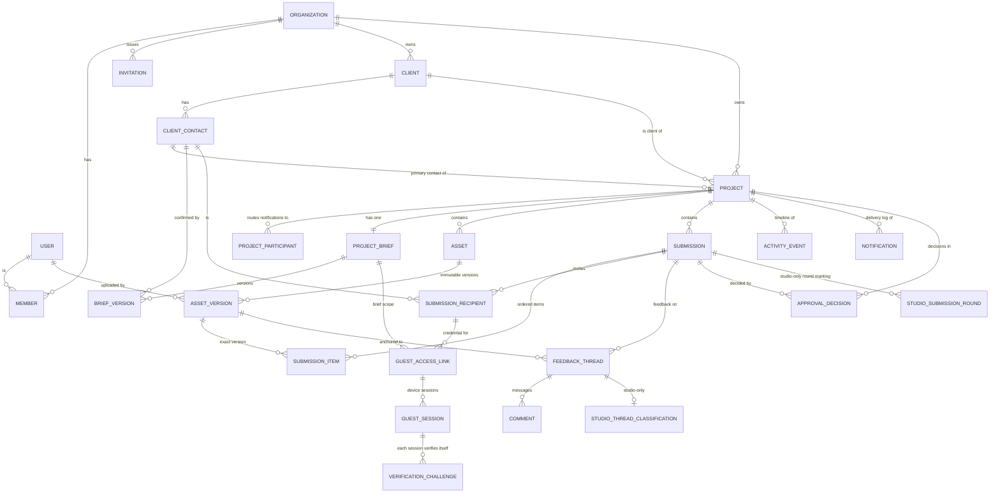
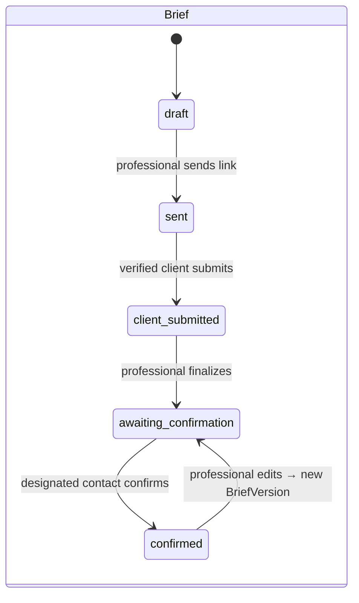
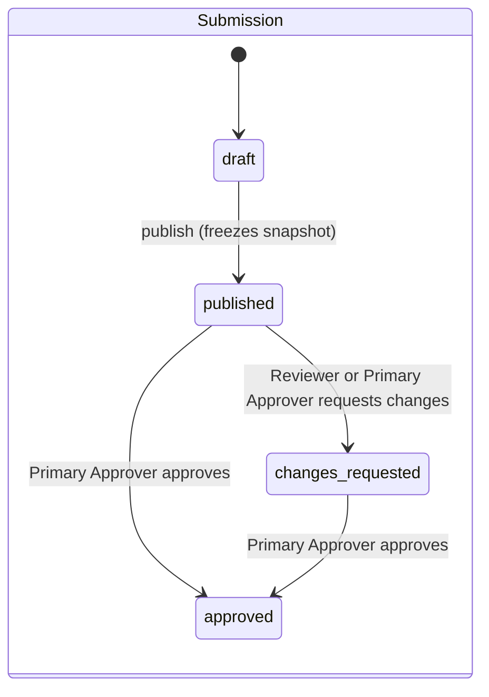
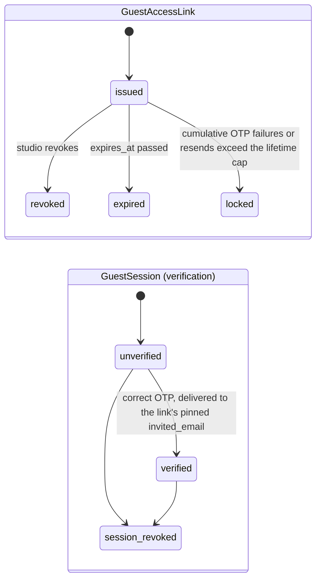
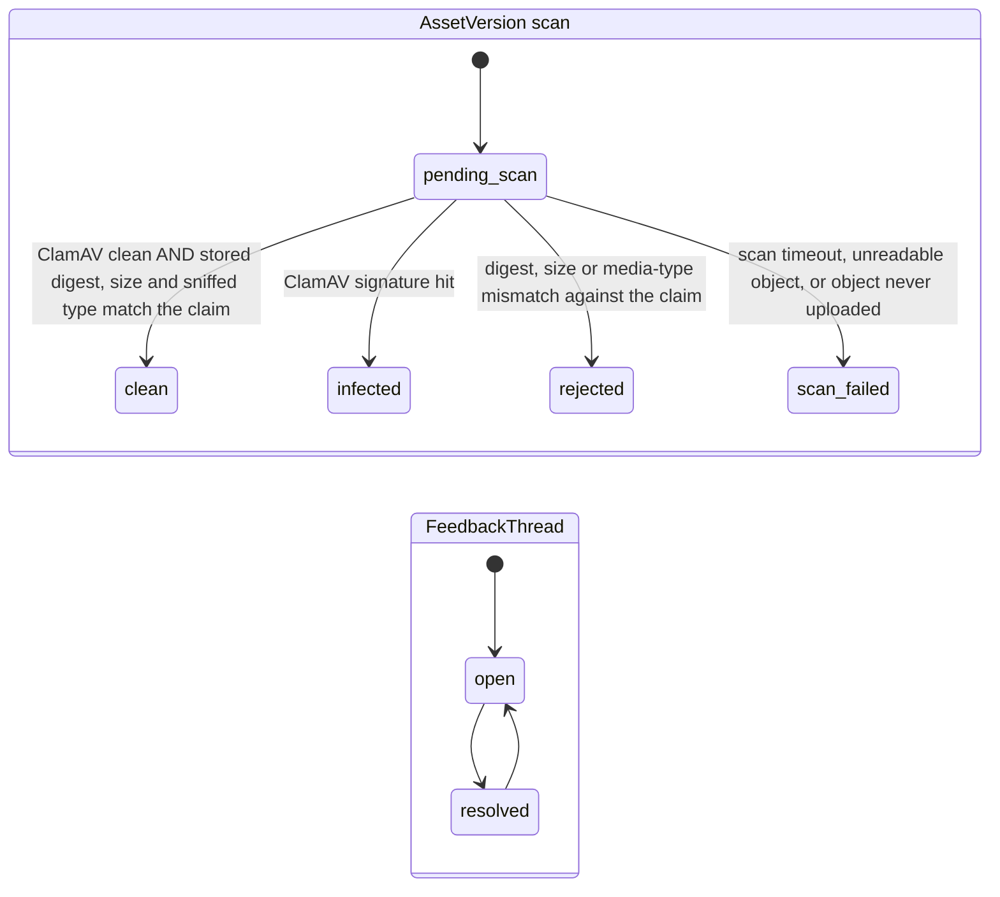

# ADR-0003: Domain model, tenancy and authorization model

- **Status:** Proposed
- **Date:** 2026-11-24
- **Deciders:** Human (accepts), Supervisor (proposes), Security reviewer (must review before acceptance)
- **Requires human acceptance:** **yes** — this ADR governs security, authorization and data handling (operating defaults #7, project-profile escalation triggers)
- **Ticket:** P0-3, `docs/plans/phase-0-foundation.md`
- **Revision:** **round 2**, 2026-11-24. Revised against `SECURITY: FAIL — round 1` (2 CRITICAL · 10 HIGH · 6 MEDIUM · 2 LOW). The finding-by-finding resolution table is **§14**. No role, entity, product feature, permission or dependency was added; the two infrastructure tables touched (`guest_session`, `rate_limit_counter`) are labelled as such, on the OQ-A3 precedent
- **Governed by:** ADR-0002 (Accepted, with the local-only amendment). Nothing here changes the accepted stack.
- **Inputs:** `product/SRS.md` v0.1 (Draft, 94 FR / 48 NFR), `product/ProofDesk_Product_Knowledge_Multi_Agent.md` §5.2, §5.4, §6.5, §7, §9 (PK), `product/ux/screens.md` (Draft), `docs/delivery/project-profile.md`

### Binding product-owner decisions applied (2026-11-24)

| SRS OQ | Decision | Where it lands |
|---|---|---|
| **OQ-1** | Both Reviewers and the Primary Approver can request changes; **only the Primary Approver can approve** | §4 rows 28–29, §7 approve trigger |
| **OQ-2** | A feedback category is **required on client-authored threads**, optional on professional replies | §1.1 `feedback_thread.category` `CHECK` |
| **OQ-4** | Guest links **expire after 90 days**; the **studio** resends. **No client self-service resend flow exists** | §1.1, §2, §5 |
| **OQ-5** | A passed due date is **informational only**. No auto-close, no new lifecycle state, no blocking of invited actions | §1.1 (no `closed_at`), §2, §7 |
| **OQ-7** | Professional email verification **gates outbound actions only** (sending a brief, publishing a submission, issuing a guest link), not general workspace access | §4 rows 8, 17, 32 |

**OQ-8 (administrative-correction route) remains unanswered.** Snapshot immutability (§7) is designed on the assumption it is **not** built, with the exact delta if the product owner rules otherwise stated in §7 and §10.

---

## Context

Phase 1 must hold 14 non-negotiable data invariants (PK §5.4) while five actor kinds touch the same tables: Workspace Owner, Workspace Member, verified client Reviewer, verified Primary Approver, and an invited-but-unverified guest. Three of those actors are external and hold no account. Builders will work in parallel across lanes, so the isolation and immutability guarantees cannot depend on each builder remembering a convention.

Three forces shape the design:

1. **A forgotten `WHERE workspace_id = …` must not be able to leak another studio's project.** Phase 1A is a 3–5 studio pilot with real client drawings; one cross-tenant read ends the pilot.
2. **Published submissions and approval evidence are the product's commercial value.** "You approved exactly this" has to survive an app bug, not just a careful code review.
3. **One studio-only field (the Included / Potential scope change classification) must never reach a client.** PK §7.5 and the project profile escalate this specifically. A naming convention plus code review is not a control.

Constraints: single Postgres 17 container, Drizzle ORM with committed SQL migrations, Better Auth with the organization plugin, Next.js server actions and route handlers, **SeaweedFS** as the S3-compatible object store (ADR-0002 second amendment, 2026-11-24), ClamAV, Mailpit, pg-boss. Local only. No managed services, no new dependencies beyond ADR-0002's table.

One SRS open question remains unanswered and is **not** decided here: OQ-8, whether the PK §4.4 administrative-correction route is built. §7 and §10 state the exact delta under either answer. SRS OQ-6 (where the included-rounds allowance is set) is also open but affects only which table holds one nullable integer; it is marked `CONTINGENT`.

---

## Options considered

### A. Tenancy isolation

| Option | Pros | Cons | Verdict |
|---|---|---|---|
| **A1. App-layer scoping only** (ADR-0002's listed alternative) | Simplest; clear errors; no DB role management | A single missing predicate in any of ~40 query sites is a silent cross-tenant leak. No backstop. Denied-path tests only cover the paths someone thought to write | Rejected |
| **A2. Postgres RLS only** | The predicate lives in the database and applies to every statement regardless of query text | Cannot express role rules ("a Member may not invite"); a context-setting bug returns *empty* results, which reads as a product bug and gets "fixed" by widening a query; poor error messages | Rejected alone |
| **A3. Scoped query layer + RLS backstop + composite foreign keys** | Primary enforcement is explicit and debuggable; RLS catches the forgotten predicate; composite FKs make the denormalized `workspace_id` non-forgeable | Three DB roles to manage; every request must run inside a transaction | **Chosen** |
| **A4. Schema per tenant** | Hard isolation | N× migration cost, Drizzle and Better Auth both assume one schema, connection/search_path juggling. Enormous complexity for a 5-studio pilot | Rejected |
| **A5. Database per tenant** | Hardest isolation | Impossible to operate locally at pilot scale; cross-tenant admin queries become a project | Rejected |

### B. Studio-only field boundary

| Option | Pros | Cons | Verdict |
|---|---|---|---|
| **B1. Naming convention + code review** | Zero cost | Relies on discipline. Explicitly ruled insufficient by this ticket | Rejected |
| **B2. Response DTO allow-lists at the guest boundary** | Catches the common case; cheap | A nested include or a `select *` spread still leaks; a new field defaults to leaking unless someone remembers the DTO | Necessary, not sufficient |
| **B3. Studio-only columns moved to a separate `studio` Postgres schema, with `USAGE` revoked from the guest DB role** | A guest-path query touching the field **errors** instead of returning data. Fails closed. Enforced below the application | Studio-only data is one join away for the studio read path | **Chosen as the primary control** |
| **B4. Separate guest service/process** | Strongest | Second deployable, second auth stack, outside ADR-0002's shape. Not justified at pilot scale | Rejected |

Chosen: **B3 as the structural control, with B2 and a CI payload scan layered on top** (§6).

### C. Snapshot immutability

| Option | Pros | Cons | Verdict |
|---|---|---|---|
| **C1. Application-level "don't update published rows"** | Simple | One bad `update()` breaks invariant 5 permanently and silently | Rejected alone |
| **C2. Column-level `GRANT UPDATE (…)` plus `BEFORE UPDATE/DELETE` triggers** | The database rejects the write. Column grants mean the app role physically cannot change frozen columns; triggers cover row deletion and state-transition legality | Triggers are owner-bypassable (see §8 risk R-1) | **Chosen** |
| **C3. Event-sourced submissions** | Immutable by construction | Premature. Rewrites the read model for every screen. PK §13 warns against premature generality | Rejected |
| **C4. Append-only hash chain over approval + activity** | Tamper-*evident*, not just append-only | One extra column and one extra ordering constraint | **Proposed as OQ-A6**, not mandated |

---

## Decision

### 1. Entity–relationship model

`Workspace` is Better Auth's `organization` table; `WorkspaceMembership` is its `member` table (`role ∈ {owner, member}`); `User` is its `user` table. We do not add parallel tables. Everything else is ProofDesk-owned.

**Every tenant-scoped table carries `workspace_id uuid NOT NULL`** — denormalized, never derived at query time — and every parent carries `UNIQUE (workspace_id, id)` so children can reference it with a **composite foreign key**. The composite FK is what makes the denormalized column trustworthy: you cannot attach an `asset_version` from workspace B to a `submission` in workspace A, because no row satisfies both halves of the key. Where a row must also stay inside one project, the FK carries `project_id` too.



Tables prefixed `STUDIO_` live in the separate `studio` Postgres schema (§6). `GUEST_SESSION` is an infrastructure table, the guest analogue of Better Auth's `session`, and carries no domain concept — see OQ-A3. **A `VERIFICATION_CHALLENGE` hangs off a `GUEST_SESSION`, not off the link** (C-1): verification is a property of the device session that proved the inbox, never of the URL. `rate_limit_counter` is a second, un-tenanted infrastructure table (M-5) and is deliberately absent from the ERD because it holds no domain data.

#### 1.1 Column sketch, keys and mutability

Illustrative only. The migration ticket owns the real DDL.

| Table | Key columns | Tenant column | Mutability |
|---|---|---|---|
| `client` | `id`, `name`, `notes` | `workspace_id` | mutable |
| `client_contact` | `id`, `client_id`, `name`, `email` (lowercased, `UNIQUE (workspace_id, client_id, email)`) | `workspace_id` | mutable; `email` change does **not** retro-change identity on past records (§5.5) |
| `project` | `id`, `client_id`, `name`, `location`, `project_type`, `design_stage`, `custom_stage_label`, `primary_contact_id` | `workspace_id` | mutable. The included-rounds allowance is studio-only and lives in `studio.round_allowance` — `CONTINGENT` SRS OQ-6, see the note below |
| `project_participant` | `id`, `project_id`, `user_id` | `workspace_id` | mutable. **Notification routing only — no authorization meaning in Phase 1** (FR-WS-6, SRS OQ-10). See OQ-A1 |
| `project_brief` | `id`, `project_id`, `state`, `current_version_id`. Uniqueness is `UNIQUE (workspace_id, project_id)` — **never a bare `UNIQUE (project_id)`**, see §3 Layer 3 | `workspace_id` | `state` and `current_version_id` mutable; nothing else |
| `brief_version` | `id`, `project_brief_id`, `version_no`, `content jsonb`, `authored_by_kind`, `authored_by_user_id`, `authored_by_contact_id`, `submitted_at`, `confirmed_at`, `confirmed_by_contact_id`, `confirmed_email`, `confirmed_display_name` | `workspace_id` | **`content` immutable once `submitted_at` is set.** `confirmed_*` write-once |
| `asset` | `id`, `project_id`, `name`, `purpose ∈ {design, brief_reference}` | `workspace_id` | mutable. **Deliberately has no `latest_version_id` column** (§5, invariant 4) |
| `asset_version` | `id`, `asset_id`, `project_id`, `version_no` (`UNIQUE (workspace_id, asset_id, version_no)`), `storage_key`, `claimed_byte_size`, `claimed_content_type`, `claimed_sha256`, `byte_size`, `content_type`, `sha256`, `page_count`, `scan_state`, `uploaded_by_user_id`, `created_at` | `workspace_id` | **immutable except `scan_state` and the four columns the scanner verifies.** The `claimed_*` triple is what the uploader asserted at presign time and is immutable from insert. `sha256`, `byte_size`, `content_type` and `page_count` are **`NULL` at insert** and writable **once**, by the scan worker, only on the `pending_scan → clean` transition (§7, H-7). `scan_state` is monotonic `pending_scan → clean \| infected \| rejected \| scan_failed`, trigger-enforced one-way, with all four non-initial states terminal |
| `submission` | `id`, `project_id`, `round_no`, `title`, `context`, `objective`, `instructions`, `design_stage`, `due_date`, `status`, `published_at`, `snapshot jsonb`, `snapshot_hash` | `workspace_id` | freely mutable while `published_at IS NULL`. After publish: **only `status`** may change. **Per OQ-5 there is no `closed_at` and no `superseded_by` column** — "superseded" is derived (a later published submission exists in the project) and is display-only |
| `submission_item` | `id`, `submission_id`, `asset_version_id`, `sort_index` (`UNIQUE (workspace_id, submission_id, sort_index)`) | `workspace_id` + `project_id` | **no INSERT/UPDATE/DELETE once the parent submission is published** |
| `submission_recipient` | `id`, `submission_id`, `client_contact_id`, `role ∈ {reviewer, primary_approver}`, `invited_email`, `invited_display_name` | `workspace_id` | frozen on publish. `UNIQUE INDEX ... WHERE role='primary_approver'` on `(workspace_id, submission_id)` → at most one; a publish-time check rejects zero |
| `guest_access_link` | `id`, `scope_type ∈ {brief, submission}`, **`project_id NOT NULL`**, `brief_id`, `submission_recipient_id`, `client_contact_id`, **`invited_email NOT NULL`**, **`invited_display_name`**, `token_id` (public, `UNIQUE (workspace_id, token_id)` plus a global `UNIQUE (token_id)` — see the note below), `token_hash`, `created_at`, `expires_at NOT NULL` (= `created_at + GUEST_LINK_TTL_DAYS`, **90 days** per OQ-4), `revoked_at`, `revoked_by_user_id`, **`failed_verification_count int NOT NULL DEFAULT 0`**, **`resend_count int NOT NULL DEFAULT 0`**, **`verification_locked_at`**, **`first_verified_at`** (audit only) | `workspace_id` | only `revoked_at`, `revoked_by_user_id`, `verification_locked_at`, `first_verified_at` (all write-once) and the two monotonic counters are mutable, **and only through the §5 resolver functions** — neither app role holds any table privilege on this table (H-2). `invited_email` / `invited_display_name` / `project_id` are **pinned at issue** and immutable, for both scope types (M-3). `expires_at` is set once at issue and never extended — a studio resend issues a **new** row. **`first_verified_at` is an audit fact and is never an authority for anything** (C-1) |
| `verification_challenge` | `id`, `guest_access_link_id`, **`guest_session_id NOT NULL`**, `code_hash`, `sent_to_email`, `attempt_count`, `expires_at`, `consumed_at` | `workspace_id` | `attempt_count` and `consumed_at` only, written only through the §5 resolver functions. A challenge is bound to **one guest session**, so a code issued to session A can never verify session B |
| `guest_session` | `id`, `guest_access_link_id`, `session_token_hash`, `created_at`, `last_seen_at`, `expires_at`, `revoked_at`, `user_agent_hash`, **`verified_at`**, **`verified_email`**, **`verified_display_name`** | `workspace_id` | session fields only; `verified_*` are **write-once and are the sole authority for guest write capability** (C-1). Infrastructure table (OQ-A3) |
| `rate_limit_counter` | `bucket_key` (PK), `window_started_at`, `count` | **none — deliberately not tenant-scoped** | Infrastructure table (M-5). It must be writable **before** any tenant context exists, so it carries no `workspace_id` and is on the §3 CI allow-list with that reason recorded. Owned by the migrator; **neither app role holds any privilege on it**; written only through `pd_rate_limit_consume()` (§5) |
| `feedback_thread` | `id`, `submission_id`, `anchor_type ∈ {overall, asset_location}`, `asset_version_id`, `page_index`, `anchor_x`, `anchor_y`, `page_rotation`, `page_box`, `category ∈ {question, change_request, preference, concern}`, `status ∈ {open, resolved}`, `author_kind`, `author_user_id`, `author_contact_id`, `author_email`, `created_at` | `workspace_id` + `project_id` | **anchor columns, `author_*`, `category` and `created_at` immutable.** Only `status` mutable. Per OQ-2: `CHECK (author_kind <> 'client_recipient' OR category IS NOT NULL)` — required on client-authored threads, nullable on professional-authored ones |
| `comment` | `id`, `thread_id`, `body`, `author_kind`, `author_user_id`, `author_contact_id`, `author_email`, `author_display_name`, `created_at` | `workspace_id` | **append-only; no UPDATE, no DELETE** (see OQ-A5) |
| `approval_decision` | `id`, `project_id`, `submission_id`, `snapshot_hash`, `design_stage`, `asset_version_ids uuid[]`, `decision_type ∈ {approve, changes_requested}`, `note`, `actor_kind`, `actor_submission_recipient_id`, `actor_email`, `actor_display_name`, `created_at` | `workspace_id` | **append-only; no UPDATE, no DELETE** |
| `activity_event` | `id`, `project_id`, `event_type`, `subject_type`, `subject_id`, `actor_kind`, `actor_user_id`, `actor_contact_id`, `actor_email`, `payload jsonb`, `occurred_at` | `workspace_id` | **append-only; no UPDATE, no DELETE** |
| `notification` | `id`, `project_id`, `trigger`, `recipient_kind`, `recipient_email`, `status`, `attempt_count`, `last_error`, `sent_at` | `workspace_id` | mutable. **Explicitly not domain state** (invariant 13) |
| `studio.thread_classification` | `id`, `feedback_thread_id`, `classification ∈ {included, potential_scope_change}`, `set_by_user_id`, `set_at`. PK `(workspace_id, id)`; `UNIQUE (workspace_id, feedback_thread_id)`; composite FK `(workspace_id, feedback_thread_id) → feedback_thread (workspace_id, id)` | `workspace_id` | mutable by O/M only |
| `studio.submission_round` | `id`, `submission_id`, `counts_as ∈ {included, additional}`, `set_by_user_id`, `set_at`. PK `(workspace_id, id)`; `UNIQUE (workspace_id, submission_id)`; composite FK to `submission (workspace_id, id)` | `workspace_id` | frozen on publish |
| `studio.round_allowance` | `id`, `scope ∈ {workspace, project}`, `project_id` (null for workspace scope), `design_stage`, `included_rounds int`. PK `(workspace_id, id)`; `UNIQUE (workspace_id, scope, project_id, design_stage)`; composite FK to `project (workspace_id, id)` | `workspace_id` | mutable. `CONTINGENT` SRS OQ-6 — see below |

**All three `studio` tables are ordinary tenant-scoped tables** and are in no way exempt from §3: `workspace_id NOT NULL`, `UNIQUE (workspace_id, id)`, `ENABLE` + `FORCE ROW LEVEL SECURITY`, a `ws_isolation` policy, and `workspace_id`-prefixed keys. Round 1's H-5 was right that the previous sketch's bare single-column PKs were a cross-tenant unique-violation oracle on the three tables holding the one field the project profile escalates by name. The §3 CI completeness test now walks schema `studio` as well as `public`, so this is a schema law rather than a sentence in an ADR.

**Modelling notes that avoid new entities.** Brief reference images/PDFs (FR-BRF-9) are ordinary `asset` rows with `purpose='brief_reference'`, not a new entity. A Reviewer's request-changes is an `approval_decision` row with `decision_type='changes_requested'` — one audit trail, one source for `submission.status` — constrained so that `decision_type='approve'` requires `actor_submission_recipient_id` to be that submission's `primary_approver` (§4, OQ-A2).

**Included-rounds allowance (`CONTINGENT` SRS OQ-6).** The SRS recommends per-project; the UX draft puts a per-stage *default* in the workspace settings screen (P14) and shows the allowance on the project overview (P7). `studio.round_allowance` carries a `scope` discriminator so that either answer, or both (workspace default + project override), is a row rather than a migration. It sits in the `studio` schema because PK §4.6 and `product/ux/screens.md` §0 both class the allowance and the round marking as studio-only.

**Unresolvable-pointer rule (invariant 4).** `asset` has no `latest_version_id` and no `current_version_no`. "Latest" is computed as `max(version_no)` in the asset-library read path only. There is therefore no column anywhere that a submission could accidentally resolve through.

**Pin fidelity (FR-FBK-3).** `anchor_x`, `anchor_y` are `numeric CHECK (… BETWEEN 0 AND 1)`, relative to the page box recorded in `page_box` (default `'crop'`) at the rotation recorded in `page_rotation`. Storing the box and rotation the author saw is what lets a different viewport, zoom or pdf.js version reproduce the same point rather than approximating it.

### 2. Lifecycle state machines



A transition out of `confirmed` creates a **new** `brief_version`; the confirmed row is never touched (FR-BRF-7).



`draft` is the only deletable state. Nothing re-enters `draft`. There is **no edge back from `approved`**; a further round is a new Submission (invariant 9).

**Per OQ-5 this machine has exactly four states and no more.** A passed due date adds no state and no edge: it is a rendered comparison of `due_date` to now, it never blocks a comment, a reply, a change request or an approval, and no job closes anything. "Superseded" is likewise not a state — it is derived from the existence of a later published submission in the project and is read-only presentation (UX P13, C7). What makes an older round read-only for a guest is link scope, not submission state: a guest may write only to the submission their link names (§3, §5).



**The link machine has no `verified` state (C-1).** Verification is a state of the **guest session**, shown as the second machine. A link is a scoped, revocable, expiring *addressing* credential; it is never, at any point in its 90-day life, a proof of identity. Every newly minted `guest_session` starts `unverified` and must pass its own OTP challenge, whatever any earlier session on the same link did. `guest_access_link.first_verified_at` records that the inbox was proved at least once, for the studio's activity timeline, and is read by nothing that makes an authorization decision.

`revoked`, `expired` and `locked` are terminal link states, and are distinct from `invalid` (no such token) — PK §6.5, FR-GST-8 and UX C8 require three distinct dead ends, and `locked` reuses the existing C8 **rate-limited** dead end rather than adding a product surface (H-6). There is no transition out of any of them; the only route forward is a studio resend (operation 32), which inserts a new link row. Per OQ-4 `expires_at` is always set, at 90 days, so `expired` is a live state from day one. There is no client-initiated transition out of `revoked`, `expired` or `locked` anywhere in the design.



Only `clean` is previewable, downloadable or selectable into a submission (FR-AST-9). Thread status flips freely; messages never change. `approval_decision` has no state machine — it is append-only.

**Four scan outcomes, all terminal, and `pending_scan` is never re-entered (L-1).** Round 1 was right that a two-outcome machine leaves a timed-out scan, an unreadable object and a never-used presigned PUT resting permanently in `pending_scan`, indistinguishable in the UI from "scanning now". `scan_failed` and `rejected` give those a home and give `screens.md`'s upload-failure/retry state something to render. **Retry is a new `asset_version`, not a transition back to `pending_scan`** — which keeps the trigger strictly monotonic and means a stuck scan can never be resolved by a builder inventing a `clean` fallback. `rejected` is the H-7 digest/type-mismatch outcome and is a security result, not a transport error: it means the bytes in storage are not the bytes the row describes.

### 3. Tenancy enforcement

Four layers. Layers 1 and 2 are both mandatory; neither is allowed to stand alone.

**Layer 0 — identity, and the root-claim rule.** A transaction is opened with exactly **one** claim, and everything else about it is derived **inside the database** from that claim:

| Lane | The one root claim | Everything else |
|---|---|---|
| Professional | `user_id` from the Better Auth server session, plus the active `organization_id` | `workspace_id`, role and email-verified status are re-derived from `member` and `user` in the same transaction (M-2) |
| Guest | `guest_session.id`, resolved from the HttpOnly cookie's hashed token | workspace, project, scope, recipient, **verified status and verified email** are derived from the session row and its link row by the §5 resolver (C-1, C-2, H-3) |
| Preview (P11) | the professional claim, plus `app.preview_submission_id` | read-only by construction: there is no guest session, so every guest write policy is unsatisfiable (H-10) |
| Worker | the **subject row's id**, from the job payload | `workspace_id` is resolved from that row through a `SECURITY DEFINER` lookup. **The payload never carries a `workspaceId`** (H-4) |

A `workspaceId`, `projectId` or `submissionId` in a request body, query string **or job payload** is **never** a source of tenancy; it is only ever a filter applied *inside* an already-scoped context, and it is only ever compared against the derived value. (FR-WS-4, NFR-SEC-1.) Round 1's H-4 was correct that the previous worker contract broke this rule in the one lane that has no human in front of it, which made RLS validate the payload's claim against itself.

**Layer 1 — a scoped query layer (primary).** There is exactly one module that owns the Drizzle client, and it exports no usable handle. The only way to reach the database is:

```ts
// db/tenant.ts — the only export; the raw drizzle client is not exported
export async function withProfessionalTenant<T>(
  session: ProfessionalSession,
  fn: (tx: TenantTx) => Promise<T>,
): Promise<T>;

export async function withGuestTenant<T>(
  guestSessionId: string, // the ONLY input; the context is derived in the database
  fn: (tx: GuestTx) => Promise<T>,
): Promise<T>;

export async function withPreviewTenant<T>(                 // P11 only (§6, H-10)
  session: ProfessionalSession,
  draftSubmissionId: string,
  fn: (tx: GuestTx) => Promise<T>,                          // guest read model, guest DB role
): Promise<T>;

export async function withWorkerTenant<T>(                  // §8, H-4
  subject: { type: WorkerSubjectType; id: string },         // NO workspaceId
  fn: (tx: TenantTx) => Promise<T>,
): Promise<T>;
```

Each opens a transaction on the matching connection pool and, as its first statements, sets the request context. **Context is set with `set_config`, never with `SET LOCAL … = $n`** (M-1): Postgres `SET` does not accept bind parameters, so a builder following a `SET LOCAL` sketch literally hits a syntax error whose shortest fix is string interpolation — in the one module that owns the only database handle.

```sql
-- professional / preview / worker
select set_config('app.user_id',              $1, true);  -- the root claim
select set_config('app.workspace_id',         $2, true);
select set_config('app.preview_submission_id',$3, true);  -- preview lane only, else NULL
-- guest
select set_config('app.guest_session_id',     $1, true);  -- the ONLY guest claim
```

`set_config(…, true)` is exactly `SET LOCAL`: transaction-scoped, so context cannot survive into another request's use of a pooled connection, and still correct if a transaction-mode pooler is introduced at hosting time. `TenantTx` exposes repositories whose builders inject the `workspace_id` predicate, so the common path is also explicit and debuggable. F-1 ships an ESLint rule forbidding template-literal or concatenated SQL anywhere in `db/tenant.ts`.

**Derived context, not asserted context.** Round 1's recurring shape was that the ADR described structural controls that only the service layer enforced. The GUC list was part of the cause: every security-relevant fact about a guest arrived as a string the application chose. So the asserted GUCs are gone and replaced by `STABLE SECURITY DEFINER` helpers that read the authoritative rows themselves:

| Helper (all `STABLE`, `SECURITY DEFINER`, `SET search_path = pg_catalog, public`) | Reads | Replaces |
|---|---|---|
| `pd_workspace_role()` → `owner \| member` | the live `member` row for `(app.user_id, app.workspace_id)`; raises when absent | `app.workspace_role` (M-2) |
| `pd_professional_verified()` → `boolean` | the live `user.emailVerified` | `app.workspace_verified` (M-2, OQ-7) |
| `pd_guest_verified()` → `boolean` | `guest_session.verified_at IS NOT NULL` for `app.guest_session_id`, **and** the link not revoked/expired/locked | `app.guest_verified` (C-1) |
| `pd_guest_verified_email()` → `text` | `guest_session.verified_email` | nothing — this did not exist (C-2) |
| `pd_guest_recipient_id()` → `uuid` | the session's link's `submission_recipient_id` | nothing — this did not exist (C-2) |
| `pd_guest_contact_id()` → `uuid` | the session's link's `client_contact_id` | `app.guest_contact_id` |
| `pd_guest_project_id()` → `uuid` | the session's link's pinned `project_id` | nothing — this did not exist (H-3) |
| `pd_guest_scope()` → `(kind, id)` | the session's link's `scope_type` and scope id | `app.guest_scope_kind` / `app.guest_scope_id` |
| `pd_guest_is_submission_recipient(uuid)` → `boolean` | `submission_recipient`, for the session's contact | the inline `EXISTS` subquery (H-9) |

Three properties follow, and they are the point of the change. (a) The application cannot assert a role, a verification state, a scope, a recipient id or an identity — it can only present a session id or a user id, and the database answers. A compromised or buggy service layer has nothing to lie with. (b) Demotion and removal take effect on the **next request**, because `pd_workspace_role()` re-reads `member` rather than trusting Better Auth's cached session claim, and raises when the row is gone — fail-closed on removal (M-2). (c) Because the helpers are `STABLE` and take no per-row arguments, Postgres evaluates them once per query rather than once per row, so the policy cost is a constant (R-6).

The helpers are the *only* route to these tables: `proofdesk_app` and `proofdesk_guest` hold **no table privilege whatsoever** on `guest_access_link`, `verification_challenge`, `guest_session` or `rate_limit_counter` (H-2). Every `SECURITY DEFINER` function in the system has a pinned `search_path` and `EXECUTE` revoked from `PUBLIC` — see the privilege hygiene block below (M-4, H-1).

**Layer 2 — Postgres RLS (the backstop that catches a forgotten predicate).** Every tenant-scoped table has `ENABLE ROW LEVEL SECURITY` and `FORCE ROW LEVEL SECURITY`, with:

```sql
CREATE POLICY ws_isolation ON submission
  USING      (workspace_id = current_setting('app.workspace_id', true)::uuid)
  WITH CHECK (workspace_id = current_setting('app.workspace_id', true)::uuid);
```

Three runtime DB roles, none of which owns any table:

| Role | Used by | Notes |
|---|---|---|
| `proofdesk_migrator` | migrations only, never the running app | table owner, DDL |
| `proofdesk_app` | professional requests + the pg-boss worker | RLS applies; column-level `UPDATE` grants only (§5) |
| `proofdesk_guest` | guest requests **and the P11 preview** (§6) | RLS applies with extra scope predicates; **no `USAGE` on schema `studio`** |

Neither app role is `BYPASSRLS`, owns a relation, or holds `CREATE` on any schema.

**`proofdesk_guest`'s complete privilege list.** Round 1's H-8 was right that "no privileges at all on `asset`" and §4 rows 12/14 could not both be true. This table is now the single authority; §4 and §6 cite it rather than restating it.

| Relation | Guest privilege | Row restriction |
|---|---|---|
| `organization` | `SELECT (id, name, logo)` | `id = app.workspace_id` |
| `project` | `SELECT (id, workspace_id, name, location, project_type, design_stage)` | **`id = pd_guest_project_id()`** (H-3) |
| `submission` | `SELECT` | `guest_read` policy below |
| `submission_item` | `SELECT` | parent submission readable |
| `asset_version` | `SELECT` | referenced by a readable `submission_item`, **or** a `brief_reference` version in the link's brief scope |
| `asset` | `SELECT`, **`INSERT`** | `SELECT`: only rows reachable from a readable `asset_version`. `INSERT`: `purpose='brief_reference' AND project_id = pd_guest_project_id()` and the link is a verified **brief**-scope link (row 12, FR-BRF-9) |
| `feedback_thread` | `SELECT`, `INSERT` | scoped submission only; **no `UPDATE`**, so matrix row 25 (resolve a thread) is structurally unavailable to a client, not merely unimplemented (H-8) |
| `comment` | `SELECT`, `INSERT` | thread on the scoped submission |
| `approval_decision` | `SELECT`, `INSERT` | scoped submission only |
| `project_brief` | `SELECT` | `id = ` the link's brief scope id |
| `brief_version` | `SELECT`, `INSERT`, `UPDATE (confirmed_at, confirmed_by_contact_id, confirmed_email, confirmed_display_name)` | brief-scope policies below (rows 10–11, H-8) |
| **everything else** | **none** | `client`, `client_contact`, **`submission_recipient`** (H-9), `project_participant`, `notification`, `activity_event`, `member`, `invitation`, `guest_access_link`, `verification_challenge`, `guest_session`, `rate_limit_counter`, all Better Auth tables, every relation in schema `studio` |

`submission_recipient` moved from "assumed readable" to **no privilege**. Round 1's H-9 was correct: a policy subquery runs with the privileges of the invoking role, so the old inline `EXISTS` required guest `SELECT` on a table carrying every recipient's `invited_email` and `invited_display_name` — which `screens.md` §0 lists as never-on-a-guest-surface. The membership test is now `pd_guest_is_submission_recipient()`, which reads the table as its definer and returns a boolean. That also removes the policy-evaluates-a-policied-table recursion hazard between `submission` and `submission_recipient`. The guest's own role and invited identity come from the link row and the session's `verified_email`, so no guest surface needs the recipient table at all.

**The guest read/write asymmetry (UX C7 vs C4).** A guest needs to *read* across submissions — C7 shows the rounds that contact was invited to — but may *write* only to the one submission their link names. That is two policies, not one:

```sql
-- READ: a published submission in the link's project that this contact was invited to
CREATE POLICY guest_read ON submission FOR SELECT TO proofdesk_guest USING (
      workspace_id = pd_guest_workspace_id()
  AND project_id   = pd_guest_project_id()            -- H-3: the missing predicate
  AND ( published_at IS NOT NULL
        OR id = current_setting('app.preview_submission_id', true)::uuid )  -- H-10, read-only
  AND pd_guest_is_submission_recipient(id)            -- H-9: definer helper, not a subquery
);

-- WRITE: feedback_thread / comment / approval_decision — the scoped submission only,
-- by a verified session, with the identity columns bound to that session.
CREATE POLICY guest_write ON approval_decision FOR INSERT TO proofdesk_guest WITH CHECK (
      workspace_id  = pd_guest_workspace_id()
  AND project_id    = pd_guest_project_id()
  AND submission_id = (pd_guest_scope()).id
  AND (pd_guest_scope()).kind = 'submission'
  AND pd_guest_verified()                             -- C-1: session, not link
  -- C-2: identity is not an application claim
  AND actor_kind                     = 'client_recipient'
  AND actor_submission_recipient_id  = pd_guest_recipient_id()
  AND actor_email                    = pd_guest_verified_email()
);
```

Four things changed here and each closes a round-1 finding.

1. **`project_id = pd_guest_project_id()` (H-3).** A `ClientContact` is a child of `client`, and one `client` can own many projects, so the old policy let a verified guest read every published submission — titles, context, objective, instructions, and through the `asset_version` policy every file — of **every** project their contact record appears on. `screens.md` §0 lists "other projects" under *Never on a guest surface*. The predicate now exists, the context carries the project (pinned on the link at issue, §1.1), and the same predicate closes the `project` SELECT grant, which previously had no row restriction at all and let a guest enumerate every project name and location in the workspace. The C7 history surface is now a database guarantee rather than an application promise.
2. **`pd_guest_verified()` reads the session (C-1).** This is the single most consequential change in round 2. See §5.
3. **The identity columns are bound in the database (C-2).** `actor_submission_recipient_id`, `actor_email` and `actor_kind` are no longer free-form application input. The same shape applies to `comment` and `feedback_thread` — `author_kind='client_recipient'`, `author_contact_id = pd_guest_contact_id()`, `author_email = pd_guest_verified_email()`, **`author_user_id IS NULL`** — and the mirror predicate applies to the professional policies: `author_kind='professional'`, `author_user_id = current_setting('app.user_id')::uuid`, `author_contact_id IS NULL`, `author_email = pd_professional_email()`. A guest therefore cannot post as the studio, and the studio cannot post as a client.
4. **`pd_guest_is_submission_recipient()` instead of an inline `EXISTS` (H-9).**

**Guest writes in the brief lane (H-8).** Matrix rows 10–12 are guest writes and previously had no policy at all, which left invariant 11 with no database backstop on the entire brief lane and left the §3 scope predicate (`submission_id = …`) meaningless for a brief row. They now have one:

```sql
CREATE POLICY guest_brief_write ON brief_version FOR INSERT TO proofdesk_guest WITH CHECK (
      workspace_id     = pd_guest_workspace_id()
  AND project_brief_id = (pd_guest_scope()).id
  AND (pd_guest_scope()).kind = 'brief'
  AND pd_guest_verified()
  AND authored_by_kind       = 'client_recipient'
  AND authored_by_contact_id = pd_guest_contact_id()
  AND authored_by_user_id IS NULL
  AND confirmed_at IS NULL                       -- submitting is never confirming
);

-- row 11: confirmation is the designated contact only, and only the confirmed_* columns
CREATE POLICY guest_brief_confirm ON brief_version FOR UPDATE TO proofdesk_guest
  USING ( workspace_id = pd_guest_workspace_id()
          AND project_brief_id = (pd_guest_scope()).id
          AND pd_guest_verified()
          AND pd_guest_contact_id() = pd_project_primary_contact_id(project_brief_id) )
  WITH CHECK ( confirmed_by_contact_id = pd_guest_contact_id()
               AND confirmed_email      = pd_guest_verified_email() );
```

The `UPDATE` grant is column-level on the four `confirmed_*` columns only, so the `content` of a finalized version is unreachable; the write-once-ness of `confirmed_*` is a trigger (§7). Row 12's guest upload is the `asset` / `asset_version` `INSERT` in the privilege table above, with `purpose='brief_reference'` in the `WITH CHECK` — a guest upload with `purpose='design'` is rejected by the database.

**What `pd_project_primary_contact_id()` resolves against is a product question, not a design one.** It is written above against the **live** `project.primary_contact_id`, i.e. as of confirmation. Whether the designated contact should instead be pinned at link-issue time is **OQ-A9** (§12) and is the one place round 1 asked for a product ruling. If the answer is "as of issue", the change is one pinned column on `guest_access_link` and one word in this policy.

Drafts are unreachable to a real guest (`published_at IS NOT NULL`; the preview branch requires `app.preview_submission_id`, which no guest transaction sets — see §6), a non-invited round is absent rather than denied (UX C7), and an older round is readable but unwritable without any submission state being involved. `asset_version` carries the same shape: a guest may select a version only where a `submission_item` of a readable submission references it, or where it is a `brief_reference` version in the link's brief scope — which is what keeps unselected assets and out-of-snapshot versions off every guest surface.

**Why a forgotten `WHERE` cannot leak.** The predicate is evaluated by Postgres on every statement against these tables, irrespective of the SQL the ORM produced. `current_setting('app.workspace_id', true)` returns `NULL` when unset, the comparison is `NULL`, the policy is not satisfied, and the statement sees **zero rows** and can insert nothing. The failure mode of a missing context is therefore an empty result, never a full table. The guest role additionally fails closed on studio-only data with a *permission error*, which is noisy rather than silent.

**Why Layer 2 alone was rejected, restated:** an empty result set is an ambiguous signal. A builder debugging "my list is empty" can widen the application query and feel successful. Layer 1 makes the intent explicit so the bug surfaces as a context bug; Layer 2 makes the consequence of getting it wrong harmless.

**Layer 3 — composite keys, and why they are a schema law rather than a convention (H-5).** RLS protects rows; composite FKs protect *relationships*. `submission_item (workspace_id, project_id, submission_id) → submission (workspace_id, project_id, id)` and `(workspace_id, project_id, asset_version_id) → asset_version (workspace_id, project_id, id)` make it structurally impossible to stitch a submission to another workspace's or another project's file, even for the migrator role.

Round 1 was right that naming two examples was not enough. **Postgres performs referential-integrity and uniqueness checks with row security bypassed** — documented behaviour, not a bug. So every FK and every UNIQUE that does *not* include `workspace_id` is, by default:

- a **cross-tenant existence oracle**: insert a child referencing a guessed id, and FK-satisfied means the row exists somewhere, FK-violated means it does not. That defeats NFR-SEC-10 for every id in the system; and
- worse for single-column UNIQUEs, because the conflict is reported against an **invisible** row — the old `project_brief.project_id UNIQUE` and the old single-column `studio.*` PKs were exactly this.

Therefore, as a law CI enforces (see the completeness check below): **every FK whose referenced relation is tenant-scoped includes `workspace_id` in the key, and every PK/UNIQUE on a tenant-scoped relation is prefixed by `workspace_id`.** There is exactly **one** recorded exception — the global `UNIQUE (token_id)` on `guest_access_link`, which the pre-context resolver needs for an indexed lookup before any workspace is known. It is safe precisely because neither app role holds any privilege on that table (H-2), so no caller can provoke the violation; the exception is named in the CI allow-list with that reason, not silently permitted.

**Uniform error text (NFR-SEC-10).** A database constraint violation cannot itself be made tenant-uniform, so the application's error boundary maps SQLSTATE `23503` (FK) and `23505` (unique) on any tenant-scoped relation onto the **same** response as not-found and not-authorized. F-1 owns that mapper, and the test asserts byte-identical responses for the not-found and the cross-tenant-reference case.

**Layer 4 — role, verification and identity checks.** RLS expresses tenancy, not roles. Owner-only and Primary-Approver-only rules live in the service layer (§4), with these DB backstops — all of which now read derived values rather than asserted ones:

- `member` and `invitation` write policies require `pd_workspace_role() = 'owner'`;
- **`organization` carries an owner-role policy too.** Round 1's M-6(1) was right that §11 listed matrix row 3 as service-layer-only while no policy existed on `organization` at all. There is one now: `UPDATE` on `organization` requires `pd_workspace_role() = 'owner'` and `id = current_setting('app.workspace_id')::uuid`. This is our own migration on a Better-Auth-owned table, which R-4 already covers;
- guest write policies on `feedback_thread`, `comment`, `approval_decision`, `brief_version`, `asset` and `asset_version` require `pd_guest_verified()`, so invariant 11 has a database backstop on **every** guest write lane including the brief (H-8), not only on the three submission tables;
- the guest identity columns are bound to the session (C-2, above);
- **per OQ-7**, the three outbound operations — issuing a guest link, sending a brief, publishing a submission — require `pd_professional_verified()`. Everything else in the workspace is reachable by an unverified professional, which is what OQ-7 answer (b) asks for: setup is never blocked, but nothing leaves the workspace unverified.

**Privilege hygiene, in the first migration (H-1, M-4).** These are not hardening extras; without them the whole of Layer 2 and the §6 studio boundary have silent bypasses.

```sql
-- 1. Postgres grants EXECUTE on new functions to PUBLIC by default. Stop that first.
ALTER DEFAULT PRIVILEGES IN SCHEMA public, studio REVOKE EXECUTE ON FUNCTIONS FROM PUBLIC;
REVOKE EXECUTE ON ALL FUNCTIONS IN SCHEMA public, studio FROM PUBLIC;
-- EXECUTE is then granted per function, by name, to the one role that needs it.

-- 2. No object creation by the running roles: otherwise a caller can shadow a
--    referenced table or function earlier in search_path and run as the definer.
REVOKE CREATE ON SCHEMA public FROM proofdesk_app, proofdesk_guest, PUBLIC;

-- 3. Every SECURITY DEFINER function, without exception:
--      SET search_path = pg_catalog, public
```

**Views and materialized views (H-1).** Postgres evaluates a view's underlying query as the **view owner** unless it is created `WITH (security_invoker = true)`, and every migration here runs as the table-owning migrator. So the first builder who adds a convenience view — a needs-attention list, or a "superseded" derivation view, which §2 makes a natural thing to want — produces a relation that returns **all tenants' rows** to both app roles with no empty-result signal, and if it touches `studio.*` and is granted to the guest role, hands the scope classification to a guest with no permission error at all. That would defeat B3, the one control §6 calls structural. Therefore:

- **materialized views on tenant-scoped data are banned outright** (F-1), because `security_invoker` does not exist for them and a matview is an owner-privileged stored copy by construction;
- every view in `public` and `studio` must be created `WITH (security_invoker = true)`, asserted from `pg_class.reloptions`;
- a `pg_depend` assertion: **no relation or function that `proofdesk_guest` can reach depends on any relation in schema `studio`.** This is what makes §6 layer 2 actually complete, and it is cheap.

**Enforceable completeness check.** A CI test reads the live database catalog — not only the Drizzle schema — and asserts, for **every relation of kind `r`, `p`, `v`, `m`, `f` in both `public` and `studio`** the following. Clauses 1, 2, 5 and 6 exempt a short explicit allow-list — the Better Auth tables (`user`, `session`, `account`, `verification`, `organization`, `member`, `invitation`, whose tenant column is `organizationId` or which are global by design) and `rate_limit_counter` with its recorded reason. **Clauses 3, 4, 7, 8 and 9 have no exemptions at all.**

1. `workspace_id` exists and is `NOT NULL`;
2. `UNIQUE (workspace_id, id)` exists;
3. RLS is enabled **and forced**;
4. at least one policy exists;
5. **every PK/UNIQUE is prefixed by `workspace_id`** (H-5);
6. **every FK to a tenant-scoped relation includes `workspace_id`** (H-5);
7. no materialized view exists on tenant-scoped data, and every view has `security_invoker = true` (H-1);
8. no function is executable by `PUBLIC`; `proofdesk_guest` holds `EXECUTE` on an explicit allow-list only; every `SECURITY DEFINER` function has a pinned `search_path` (H-1, M-4);
9. the `pg_depend` guest↛`studio` assertion (H-1).

Round 1's H-1 and H-5 both turned on the fact that the old test asserted things about *tables*, in *one* schema, and would have stayed green through every bypass above. The test must itself be tested: **F-1 ships a fixture migration violating each clause and asserts CI fails on each one.** A builder cannot add a tenant relation without isolation, add an owner-privileged view, add a single-column unique key, or leave a function open to `PUBLIC`, and have CI stay green.

### 4. Role and recipient permission matrix

Actors: **O** Owner · **M** Member · **R** Reviewer **on a verified session** · **PA** Primary Approver for *that* submission, **on a verified session** · **U** a guest holding a valid link on a session that has not passed its own OTP · **X** everyone else (anonymous, another workspace's user, a holder of a revoked, expired or locked link). **X is denied everywhere and is omitted from the table.**

**R, PA and U are session states, not people (C-1).** A holder of a forwarded URL is in column **U** — every time, for the whole 90-day life of the link, no matter how many other people have verified sessions on it. They become R or PA only by receiving a code at the link's pinned `invited_email`, which they do not control. In round 1 a forwarded-link holder silently landed in R or PA; that was CRITICAL-1 and it is the reason the U column is now defined on the session.

R, PA and U are scoped to the one brief or submission their link names. "Allow" for them always means *within that scope*.

| # | Operation class | O | M | R | PA | U |
|---|---|:-:|:-:|:-:|:-:|:-:|
| 1 | Create workspace | ✅ | ✅ | ❌ | ❌ | ❌ |
| 2 | Invite / remove a workspace member, change member role | ✅ | ❌ | ❌ | ❌ | ❌ |
| 3 | Edit workspace settings | ✅ | ❌ | ❌ | ❌ | ❌ |
| 4 | View workspace members | ✅ | ✅ | ❌ | ❌ | ❌ |
| 5 | CRUD Client and ClientContact | ✅ | ✅ | ❌ | ❌ | ❌ |
| 6 | CRUD Project, set stage, set primary contact | ✅ | ✅ | ❌ | ❌ | ❌ |
| 7 | List / read projects of own workspace | ✅ | ✅ | ❌ | ❌ | ❌ |
| 8 | Prepare and send a brief; issue a brief guest link | ✅ † | ✅ † | ❌ | ❌ | ❌ |
| 9 | Read the invited brief page | ✅ | ✅ | ✅ | ✅ | ✅ |
| 10 | Submit a brief | ✅ | ✅ | ✅ | ✅ | ❌ |
| 11 | Confirm a finalized BriefVersion | ❌ | ❌ | only the designated contact | only the designated contact | ❌ |
| 12 | Upload an Asset / a new AssetVersion | ✅ | ✅ | brief references only | brief references only | ❌ |
| 13 | Read the asset library and full version history | ✅ | ✅ | ❌ | ❌ | ❌ |
| 14 | Preview / download an AssetVersion | ✅ | ✅ | only versions in an invited submission | same as R | ❌ |
| 15 | Create / edit / delete a **draft** Submission | ✅ | ✅ | ❌ | ❌ | ❌ |
| 16 | Preview the guest experience of a draft | ✅ | ✅ | ❌ | ❌ | ❌ |
| 17 | Publish a Submission | ✅ † | ✅ † | ❌ | ❌ | ❌ |
| 18 | Mutate a **published** Submission snapshot | ❌ | ❌ | ❌ | ❌ | ❌ |
| 19 | Read a published Submission | ✅ | ✅ | ✅ | ✅ | ✅ (read-only) |
| 20 | Read the invited project's submission history | ✅ | ✅ | ✅ invited items only | ✅ invited items only | ❌ |
| 21 | Create a FeedbackThread (pin or overall) | ✅ | ✅ | ✅ | ✅ | ❌ |
| 22 | Reply to a thread | ✅ | ✅ | ✅ | ✅ | ❌ |
| 23 | Read threads and comments on the submission | ✅ | ✅ | ✅ | ✅ | ✅ (read-only) |
| 24 | Edit or delete someone else's comment | ❌ | ❌ | ❌ | ❌ | ❌ |
| 25 | Mark a thread open / resolved | ✅ | ✅ | ❌ | ❌ | ❌ |
| 26 | Read or write the Included / Potential-scope-change classification | ✅ | ✅ | ❌ | ❌ | ❌ |
| 27 | Read or write the included/additional round marking | ✅ | ✅ | ❌ | ❌ | ❌ |
| 28 | **Request changes** on a published submission | ❌ | ❌ | **✅** | **✅** | ❌ |
| 29 | **Approve** a published submission | ❌ | ❌ | **❌** | **✅** | ❌ |
| 30 | Edit or delete an ApprovalDecision | ❌ | ❌ | ❌ | ❌ | ❌ |
| 31 | Revoke a guest link | ✅ | ✅ | ❌ | ❌ | ❌ |
| 32 | Issue / resend a guest link (studio-initiated; **the only route out of an expired or revoked link**) | ✅ † | ✅ † | ❌ | ❌ | ❌ |
| 33 | Request an OTP for own invited address | ❌ | ❌ | ✅ | ✅ | ✅ |
| 34 | Read the project activity timeline | ✅ | ✅ | ❌ | ❌ | ❌ |
| 35 | Edit or delete an ActivityEvent | ❌ | ❌ | ❌ | ❌ | ❌ |
| 36 | Read the notification delivery log | ✅ | ✅ | ❌ | ❌ | ❌ |

**† Outbound actions (rows 8, 17, 32) additionally require a verified professional email**, per OQ-7 answer (b). No other row is gated on professional verification: an unverified professional can create the workspace, the client, the project and the assets, and can build a draft submission. They cannot send anything to a client. The gate is one `requireVerifiedProfessional` guard plus the `app.workspace_verified` RLS predicate (§3 Layer 4).

**There is no guest row for "request a new link".** Per OQ-4 the studio resends (row 32). Rows 33's OTP resend is a *re-send of the verification code* for an already-valid link, not a re-issue of the link, and it is the only guest-initiated credential action in the product.

**Rows 28 and 29: one table, two mechanisms that only work together (D-011, D-025, round-1 C-2).** Request-changes is open to Reviewer and Primary Approver; approving is exclusive to the Primary Approver. **D-025 (product owner, 2026-11-24) settles the storage shape: one `approval_decision` table**, with a Reviewer's request-changes stored as `decision_type='changes_requested'`, so there is one chronological decision history per submission for the audit trail and invariant 14 rather than a `UNION` across two tables with hand-maintained ordering. This closes OQ-A2.

Round 1's CRITICAL-2 showed that the previous three-deep claim was false, and it is worth being precise about why, because the correction is the design: the service layer resolved the actor's role (application only); the `CHECK (decision_type <> 'approve' OR actor_kind = 'client_recipient')` is satisfied by *any* guest; and the approve trigger asked whether `actor_submission_recipient_id` **is** the submission's primary approver — which it is, if a Reviewer simply supplies the Primary Approver's id. Nothing tied the actor columns to the *current* guest. A verified Reviewer could therefore store an approval attributed to the Primary Approver, in a table that by design can never be corrected, and the trigger would nod it through.

Enforcement is now two independent database mechanisms over the same row, designed as one:

| Mechanism | What it answers | Defeats |
|---|---|---|
| **The `guest_write` policy `WITH CHECK`** (§3): `actor_submission_recipient_id = pd_guest_recipient_id()` and `actor_email = pd_guest_verified_email()` and `actor_kind = 'client_recipient'` | *Is this row attributed to the session that is writing it?* | attributing any row — `approve` or `changes_requested` — to another recipient |
| **The `BEFORE INSERT` approve trigger**: reject `decision_type='approve'` unless `actor_submission_recipient_id` is the `role='primary_approver'` row for that submission | *Is the actor allowed to approve?* | a Reviewer approving as themselves |

Neither is sufficient alone: the policy would let a Reviewer approve under their own identity, and the trigger would let a Reviewer approve under the Primary Approver's. Together they are total, and **both are evaluated by Postgres with the service layer stubbed out**, which is how §9 and F-7 test them. The `CHECK` constraint stays as cheap documentation of intent, but it is no longer counted as a control.

**Rows 2–7, 13, 26, 27, 34, 36 are denied to R/PA/U structurally**, because of the `proofdesk_guest` privilege list in §3 — those requests fail with a permission error rather than an authorization decision. **Row 25 (resolve a thread) is now in that set too**: round 1's H-8 noted it was ❌ for R/PA/U with no stated grant restriction, so a column-grant omission would silently hand thread resolution to clients. `proofdesk_guest` holds **no `UPDATE` on `feedback_thread`** at all.

**Rows 12 and 14 no longer contradict §3.** Round 1's H-8 was right that "no privileges at all on `asset`" could not coexist with a guest uploading brief references (FR-BRF-9, OQ-A8). §3's privilege table is now the single authority and states the exact grant: guest `INSERT` on `asset` / `asset_version` restricted by `WITH CHECK` to `purpose='brief_reference'` in the link's project and brief scope, and guest `SELECT` reachable only through a readable `submission_item` or a brief-scope reference. §6 cites that table rather than repeating a claim that had to be given up.

**Satisfaction of the named invariants.** Invariant 2 — rows 1–7 plus Layer 4's `pd_workspace_role()` backstop, which re-reads `member` per transaction so a demotion or removal binds on the next request (M-2); invariant 10 — every R/PA/U cell is scope-limited by the `guest_access_link` row, now including its pinned `project_id` (§3 H-3, §5); invariant 11 — the whole U column is read-only, with the DB backstop on **every** guest write lane and verification read from the session (C-1, H-8); invariant 12 — rows 26 and 27; invariant 14's identity half — the C-2 bindings above.

### 5. Guest access: token and OTP design

**Link token.** `token_id` = 16 random bytes; `token_secret` = 32 random bytes (**256 bits**) from `crypto.randomBytes`. Both base64url. The URL carries `/g/<token_id>.<token_secret>`. Stored: `token_id` plaintext (a non-secret, indexed lookup key) and `token_hash = sha256(token_secret)`. **No usable secret is stored.** Comparison is `crypto.timingSafeEqual`. SHA-256 rather than a password KDF is correct here: the input has 256 bits of entropy, so there is nothing to brute-force, and we want the lookup cheap. The split id/secret shape gives an O(1) indexed lookup instead of a table scan over hashes, and removes the timing signal of a sequential compare.

**The pre-authentication path is one `SECURITY DEFINER` function, and neither app role can touch the credential tables (H-2).** Round 1 found the hole that mattered most structurally: `GET /g/<token>` must read `guest_access_link` by `token_id` **before** any workspace is known, and OTP verify must write `attempt_count` in the same context-free state — yet every tenant table has `FORCE ROW LEVEL SECURITY` with a `workspace_id = current_setting(…)` policy, and §3 is explicit that an unset GUC yields zero rows. The resolver, as previously specified, could not read the row it had to read, and the ADR never named its role, context or policy. Left to a builder, the likely resolutions were all bad: a connection with no RLS, an exemption from the completeness test, or running as the migrator.

It is specified here instead. A small, named set of `SECURITY DEFINER` functions, each `SET search_path = pg_catalog, public`, `EXECUTE` revoked from `PUBLIC` and granted only to the role that needs it:

| Function | Does | Returns |
|---|---|---|
| `pd_resolve_guest_link(token_id text, presented_secret text)` | constant-time compares against `token_hash` **inside the function**; applies the revoked / expired / locked / consumed checks; increments `failed_verification_count` on a mismatch | the resolved context tuple, or nothing. **Never the row, never a hash, never another tenant's identifier** |
| `pd_mint_guest_session(link_id uuid)` | inserts an **unverified** `guest_session` | the session id and its token |
| `pd_issue_otp(session_id uuid)` | consumes any outstanding challenge for that session, inserts a new one bound to the session, increments `resend_count`, enforces the resend and lifetime caps | the destination address, read from the link's pinned `invited_email`, and the plaintext code for the mailer — nothing else |
| `pd_verify_otp(session_id uuid, code text)` | constant-time compares; on success writes `guest_session.verified_at/_email/_display_name` and `guest_access_link.first_verified_at`; on failure increments **both** `verification_challenge.attempt_count` and `guest_access_link.failed_verification_count`, and sets `verification_locked_at` when the lifetime cap is hit | a verdict enum only |
| `pd_rate_limit_consume(bucket_key text, max int, window interval)` | upserts `rate_limit_counter` | boolean allow/deny |

The consequence is the property §6 previously only claimed: **`proofdesk_app` and `proofdesk_guest` hold no table privilege at all** on `guest_access_link`, `verification_challenge`, `guest_session` or `rate_limit_counter`. There is no SQL either role can write that returns a `token_hash`, a `code_hash` or another recipient's binding. The tables keep RLS enabled and forced regardless, so the definer functions are the only route rather than merely the intended one.

**Token never rests in a URL.** `GET /g/<token>` validates, mints an **unverified** guest session, sets the cookie, and `302`s to a token-free path (`/review/<submissionId>` or `/brief/<briefId>`). Guest pages send `Referrer-Policy: no-referrer`, and the request logger redacts the `/g/` path segment. This closes token leakage via Referer, browser history, screenshots and shared logs — the most likely real-world failure for emailed links.

**Guest session.** `guest_session` row with `session_token_hash = sha256(random 32 bytes)`. Cookie: `HttpOnly`, `SameSite=Lax` (so the emailed top-level GET still works while cross-site POSTs do not), `Secure` and `__Host-` prefix outside localhost, `Path=/`, idle lifetime from config. Guest POSTs additionally require an `Origin`/`Sec-Fetch-Site` check (NFR-SEC-4). Every request re-derives authority from the session row and its link; **no claim is trusted from the cookie except the session id** (NFR-SEC-5) — and since §3 made the session id the guest lane's single root claim, that sentence is now literally true of the database as well as the middleware.

**Scoping (invariant 10).** A link row names exactly one `scope_type` + scope id, one `project_id`, and exactly one `submission_recipient_id` (or `client_contact_id` for a brief) — all pinned at issue and immutable. The resolved context is built *only* from that row, and is read by the policies through the `pd_guest_*()` helpers rather than passed in. A `submissionId` in the request is compared to the resolved scope and rejected on mismatch. Cross-submission use, cross-**project** use (H-3), token mutation and scope substitution are all the same denial.

**OTP.** 6 digits via `crypto.randomInt(0, 1_000_000)` (rejection-free, no modulo bias), zero-padded. Stored as `HMAC-SHA256(pepper, challenge_id || code)` where the pepper is a server secret supplied as an environment variable (name only: `GUEST_OTP_PEPPER`). A keyed hash rather than a bare hash is what matters here, because 10⁶ is trivially enumerable from a database dump alone; the pepper lives outside the database. A memory-hard KDF was considered and rejected as unnecessary given a 10-minute TTL and a hard attempt cap. Issuing a new challenge consumes any outstanding one, so only one code is ever live **per session**.

**The attempt cap is cumulative over the link's lifetime, not per challenge (H-6, NFR-SEC-3).** Round 1 showed the previous design did not meet NFR-SEC-3's "max 5 attempts" at all: `attempt_count` lived on `verification_challenge`, and a resend created a fresh challenge at zero, so the real budget was 5 guesses *per resend window* over a **90-day** link life against a 10⁶ space from a rotating IP pool — a free, silent oracle with no terminal state, and under round-1's C-1 a successful guess then verified the link forever. Three changes, all columns and caps, no new surface:

| Control | Mechanism |
|---|---|
| **Cumulative cap** | `guest_access_link.failed_verification_count`, monotonic, incremented **only** inside `pd_verify_otp()` / `pd_resolve_guest_link()`. No role holds `UPDATE` on the table, so it cannot be reset by anything the application can express |
| **Terminal dead end** | at `GUEST_OTP_LIFETIME_MAX_ATTEMPTS` the function sets `verification_locked_at`; the link is then in the `locked` state of §2 and `pd_guest_verified()` is false forever. It renders as the existing UX C8 **rate-limited** page — no new product surface |
| **Resend cap** | `guest_access_link.resend_count`, monotonic, capped at `GUEST_OTP_MAX_RESENDS` per link, plus the sliding-window limiter below |

The per-challenge `GUEST_OTP_MAX_ATTEMPTS` stays as the fast local brake; the lifetime cap is what makes the number in NFR-SEC-3 mean something. The only route past a `locked` link is a studio resend (operation 32), which is an authenticated action by a verified professional.

**The rate limiter is a named mechanism inside the accepted stack (M-5).** Previously "per-link and per-IP resend rate limits" and "rate limit on `/g/*`" were parameters with no implementation vehicle. ADR-0002's table contains no rate-limiting library, CLAUDE.md forbids a dependency the ticket does not name, and the app runs as two processes, so an in-memory limiter is per-process and resets on reload — a speed bump, not a cap. The mechanism is `pd_rate_limit_consume()` over the `rate_limit_counter` table (§1.1): one shared, durable, transactional counter, no dependency, and it runs in the pre-context state the resolver already needs. Buckets are keyed, in order of authority, on **`token_id`** and **`guest_session_id`** — values the attacker cannot rotate — with the client address as a third, weakest bucket. Because `X-Forwarded-For` is attacker-controlled until a hosting ADR fixes a trusted hop count, `TRUSTED_PROXY_HOP_COUNT` defaults to **0**, meaning the socket address is used and the header is ignored; a forged header therefore cannot reset anything, and the link- and session-keyed buckets do not depend on the address at all.

**The verification gate (invariant 11, FR-GST-3, PK §7.2) — verification is a property of the session.** This is round 1's CRITICAL-1 and the single most important change in round 2.

The OTP is sent **only** to `guest_access_link.invited_email`, pinned on the link at issue and immutable. **The guest verification form has no email field.** A forwarded-link holder has nothing to supply and no path to an identity: the code goes to the original recipient's inbox. That part was already structural. What was not: on success the old design wrote `guest_access_link.verified_at`, and `app.guest_verified` was derived from the **link**. So the real behaviour was — make the first holder prove the inbox, then issue a bearer token good for three months to anyone who ever sees the URL:

> Jane verifies. Jane forwards the email, or the thread sits in a shared inbox, or the URL is recovered from her browser history on a shared machine. A colleague opens `/g/<token>`, a **new** session is minted, `app.guest_verified` reads `'true'` from the link, **no OTP is ever presented** — and the colleague can comment, request changes and, on a Primary Approver link, **approve, recorded as `actor_email = jane@…`**.

That broke PK §7.2's forwarded-link rule and invariant 11 in the only scenario that matters in practice, and made §5's own threat-table entry true only for the *first* verification in 90 days.

Corrected: **`verified_at` / `verified_email` / `verified_display_name` live on `guest_session`**, write-once, written only by `pd_verify_otp()`. `pd_guest_verified()` reads the **session** row, and every guest write policy reads that helper. A `verification_challenge` is bound to one `guest_session_id`, so a code issued to one device cannot verify another. **Every newly minted session starts unverified and must pass its own OTP**, regardless of what any earlier session on the same link did. `guest_access_link.first_verified_at` is kept as an audit fact for the studio's activity timeline and is an authority for nothing (§2).

The cost is one extra OTP per new device or browser, which is the correct trade: the product's claim is that an approval identifies a person who proved control of an inbox, and that claim is only as strong as the weakest session the credential can mint.

**Identity (invariant 14).** The session's verified email is the client identity (FR-GST-5). It is copied onto `comment.author_email`, `approval_decision.actor_email` and `brief_version.confirmed_email` at write time, so later edits to `client_contact.email` cannot retroactively rewrite who said or approved what. Round 1 was right that this was intent with zero enforcement; per C-2 the copy is now a **database predicate** (`actor_email = pd_guest_verified_email()`, §3) rather than a line of service code, and the service layer has no way to write a different value.

**The invited address is pinned at issue, for both scope types (M-3).** A `scope_type='brief'` link has no `submission_recipient_id`, so the brief lane's OTP destination previously resolved through `client_contact.email` — a **mutable** column any Member may edit (row 5). Editing it redirected the OTP for every outstanding brief link, and the brief is the step that produces `brief_version.confirmed_email`, the record the product treats as client assent. §5's own principle (copy the identity at issue so later edits cannot rewrite it) now applies to both lanes: `guest_access_link.invited_email` and `invited_display_name` are `NOT NULL`, pinned at issue, immutable, and are the **only** source `pd_issue_otp()` reads.

**Configuration names.** All of these are names only; values live in `.env.example` and are documented in `docs/plans/environments-and-dependencies.md`, which owns the inventory: `GUEST_LINK_TTL_DAYS` (90, per OQ-4), `GUEST_OTP_TTL_SECONDS`, `GUEST_OTP_MAX_ATTEMPTS` (per challenge), **`GUEST_OTP_LIFETIME_MAX_ATTEMPTS`** (new, H-6), **`GUEST_OTP_MAX_RESENDS`** (new, H-6), `GUEST_OTP_RATE_WINDOW_SECONDS`, `GUEST_OTP_MAX_REQUESTS_PER_WINDOW`, `GUEST_OTP_PEPPER`, `GUEST_TOKEN_PEPPER`, `GUEST_SESSION_TTL_MINUTES`, **`TRUSTED_PROXY_HOP_COUNT`** (new, M-5).

**Revocation.** `revoked_at` set by O/M. Every guest policy's authority flows through `pd_guest_verified()`, which itself requires the link to be not revoked, not expired and not locked — so a revoked link sees zero rows and can write nothing even if a handler forgot to check, and there is one place the three terminal conditions are expressed rather than a predicate repeated per table (R-7). Notification recipient selection joins live link state, so a revoked recipient stops receiving email (FR-NTF-3).

**Object storage: binding the bytes to the row (H-7).** Round 1's H-7 is the finding that changes what invariant 8 actually means, so the correction is stated in full here and in §7.

The old design inserted the `asset_version` row — carrying `sha256`, `byte_size` and `content_type` — **before** the client received the presigned URL, and made the row immutable except `scan_state`. Those three columns could therefore only ever hold values the uploader asserted before any byte existed, with no mechanism to replace them with the digest of what was actually stored. Two consequences: `approval_decision.asset_version_ids` resolved to rows whose `sha256` was a client claim, so "you approved exactly this" was unverifiable against storage; and the object stayed **mutable after approval**, because the storage key is known to the uploader, a presigned PUT is a bearer write capability for its lifetime, and nothing prevented a second PUT to the same key — overwriting a `clean`, snapshotted, approved object while leaving every database row untouched and every trigger silent. Invariants 3, 5 and 8 were enforced on the description and not on the artefact.

1. **Claim versus fact.** The uploader's assertions go to `claimed_sha256`, `claimed_byte_size`, `claimed_content_type`, immutable from insert. `sha256`, `byte_size`, `content_type` and `page_count` are `NULL` at insert and are written **once**, by the scan worker, computed from the **stored object** — digest, length, and a magic-byte media-type sniff — at the `pending_scan → clean` transition only. This is a deliberate, trigger-controlled widening of the monotonic trigger to those columns at that one transition, and it is the correct place to widen it: before the transition there is nothing true to write, and after it the values are facts.
2. **Mismatch is terminal.** If the digest, the length or the sniffed type disagrees with the claim, or the type is outside `ALLOWED_UPLOAD_MIME_TYPES`, the version goes to `rejected` and can never reach `clean` (§2). PK §7.4 requires validating type, size and content and not trusting extensions; the server-sniffed type is now the only type the system believes, and the client's `content_type` never reaches a rendering decision.
3. **Presigned PUT is single-use, short-lived and never re-issuable.** The adapter refuses a PUT to an existing key, the key is derived from the `asset_version` id so it is unguessable and unique, and the presign path refuses outright when the version's `scan_state <> 'pending_scan'` — so a `clean` version's key is never writable again, by anyone, including the professional who uploaded it. Retry after a failure is a **new** `asset_version` with a new key (§2), not a second write to the same one.
4. **Presigned GET pins the response headers.** Every download URL is signed with `response-content-type` set to the server-sniffed type and `response-content-disposition=attachment`, so an uploaded SVG or HTML is never served from the storage origin with an attacker-chosen renderable type. Issued for ≤ 5 minutes, only after the authorization check, and only for `scan_state='clean'`.

Uploads use **presigned `PUT`**, not a presigned POST policy, per the ADR-0002 second amendment. R-10 already withholds the 5-minute claim pending the P0-6 storage-adapter test; points 3 and 4 belong in that same test, and until it passes none of them is evidence.

**Expiry — 90 days, studio resends (OQ-4, answered).** `guest_access_link.expires_at` is `NOT NULL`, set once at issue to `created_at + GUEST_LINK_TTL_DAYS` with the shipped value **90 days**. It is never extended and never recomputed; a studio resend (operation 32) **inserts a new link row and sets `revoked_at` on the old one in the same transaction**, so a resend both restores access and invalidates the previous URL. Expiry is enforced in the guest RLS predicate alongside revocation, so an expired link sees zero rows and writes nothing even if a handler forgets to check — the same mechanism, not a second one.

**There is deliberately no client self-service resend.** No unauthenticated resend endpoint exists, no guest screen offers one, and the three dead-end states (`invalid`, `expired`, `revoked`) are terminal pages with no retry affordance, which matches UX C8. The only guest-initiated credential action in the product is requesting the OTP for an already-valid link. This matters as a security property, not just a scope one: an unauthenticated "email me a new link" endpoint would be an email-enumeration oracle and a free mail-sending primitive, and we now do not have to defend one.

`GUEST_LINK_TTL_DAYS` stays a named configuration value (name only; no value in the repository outside `.env.example`) so that the pilot can shorten it without a migration. Lengthening it does not extend links already issued.

**Threats considered.**

| Threat | Mitigation |
|---|---|
| Token enumeration | 256-bit secret; indexed id lookup; constant-time compare; rate limit on `/g/*` |
| Token leaked via Referer / history / logs | Token exchanged for a cookie then redirected away; `Referrer-Policy: no-referrer`; log redaction |
| **Forwarded link used by another person** | **Verification is a property of the `guest_session`, not the link. Every new session starts unverified and must pass its own OTP, for the whole 90-day life of the link. The code goes only to the link's pinned `invited_email`, and the form has no email input** (C-1) |
| OTP brute force | 6 digits, 10 minutes, per-challenge cap, **cumulative lifetime cap that moves the link to the terminal `locked` state**, resend cap, durable Postgres limiter keyed on `token_id` and `guest_session_id` rather than a forgeable address, single live challenge per session (H-6, M-5) |
| OTP hashes leaked with a DB dump | Keyed HMAC with a pepper held outside the database; no role can read `code_hash` at all (H-2) |
| **The credential tables read or written outside the resolver** | `proofdesk_app` and `proofdesk_guest` hold **no table privilege** on `guest_access_link`, `verification_challenge`, `guest_session`, `rate_limit_counter`; the only route is the pinned-`search_path` definer functions, which return verdicts and context, never rows or hashes (H-2) |
| **OTP destination redirected by editing a contact** | `invited_email` pinned on the link at issue, for both scope types, and the only source the issuer reads (M-3) |
| Cross-submission / scope escalation | Scope resolved solely from the link row; request-supplied ids only compared |
| **Cross-project read via a shared ClientContact** | `project_id` pinned on the link and present as a predicate in every guest read and write policy (H-3) |
| **A guest writing under someone else's identity** | Actor and author columns bound in the policy `WITH CHECK` to the session's recipient id and verified email (C-2) |
| **Other recipients' email addresses reaching a guest** | No guest privilege on `submission_recipient`; the membership test is a definer helper returning a boolean (H-9) |
| **Stored bytes diverging from the row that describes them** | Digest, length and sniffed type computed from the stored object at the `clean` transition; mismatch is terminal; presigned PUT single-use and never re-issuable after `clean`; presigned GET pins type and `attachment` (H-7) |
| `revoked` vs `invalid` confirming that a token existed | **Accepted deliberately.** It is product-mandated — PK §6.5, FR-GST-8 and UX C8 require three distinct dead ends — and with a 256-bit secret the oracle is unreachable without the token, while C8 already forbids project, file and email detail on those pages. Recorded rather than mitigated (L-2) |
| Revocation or expiry not taking effect, or cached-page writes | Authority re-derived per request; `revoked_at` **and** `expires_at` both in the RLS predicate; ≤ 5-minute presigned URLs |
| Email enumeration / free mail-sending via a "resend my link" endpoint | No such endpoint exists (OQ-4); only the studio re-issues links |
| A 90-day link outliving the engagement | Studio revocation (operation 32 / 31) is the intended control; expiry is the backstop, not the primary one |
| Guest session theft via XSS | `HttpOnly`; nonce-based CSP (repo web rules); no token in the DOM |
| Cross-site forgery of a guest write | `SameSite=Lax` + `Origin`/`Sec-Fetch-Site` check |
| Studio-only field leaking to a guest | `proofdesk_guest` has no `USAGE` on schema `studio`, **plus the `pg_depend` assertion that nothing the guest role can reach depends on a `studio` relation, the matview ban and the `security_invoker` requirement** (§6, H-1) |
| Unverified guest writing | Every guest write policy requires `pd_guest_verified()`, which reads the **session** — including the brief lane, which previously had no policy at all (C-1, H-8) |
| **A tenant table reached through an owner-privileged view or a `PUBLIC` function** | Matviews banned on tenant data; `security_invoker = true` required on every view; `EXECUTE` revoked from `PUBLIC` by default privilege; `CREATE ON SCHEMA public` revoked; all nine clauses asserted in CI over both schemas and all relation kinds (H-1, M-4) |
| **A worker job claiming another workspace** | The payload carries only the subject row's id; `workspace_id` is resolved from that row by a definer lookup (H-4, §8) |
| **A stale role or a removed member still acting** | `pd_workspace_role()` re-reads `member` in-transaction and raises when the row is absent (M-2) |
| Tenant inference from error text | Uniform denial response; "not found" and "not authorized" are indistinguishable (NFR-SEC-10) |
| Infected file served | Only `scan_state='clean'` is signable for download (FR-AST-9). A stuck or failed scan now lands in the terminal `scan_failed` state rather than resting indefinitely in `pending_scan`, so "scanning" and "never scanned" are distinguishable in the UI and no builder has a reason to invent a `clean` fallback (L-1) |

### 6. The studio-only field boundary

Four layers; the first is the control, the rest are depth.

`product/ux/screens.md` §0 defines the guest field boundary as a hard UI rule and lists more than the classification. Those items split into two mechanisms, and both are structural:

| Forbidden on a guest surface (UX §0) | Mechanism |
|---|---|
| Included / Potential scope change classification | `studio` schema, no `USAGE` for `proofdesk_guest` (below) |
| Round allowance, round counts, included/additional marker | same |
| Client record fields, other contacts' email addresses | no privileges on `client`, `client_contact` **or `submission_recipient`** (§3, H-9). The guest's own invited identity comes from their session's `verified_email`, not from a recipient row |
| Workspace member names and emails, workspace settings | no privileges on `member`, `invitation`, Better Auth tables; column-level `SELECT` on `organization (id, name, logo)` only |
| Drafts, unselected assets, out-of-snapshot versions, other submissions, **other projects** | the guest read/write policies in §3, now including the `project_id` predicate (H-3) |
| Activity entries the guest was not party to | no privileges on `activity_event` — the guest has no timeline surface at all |
| Guest tokens or OTP values for anyone | only hashes are stored, and **no app role holds any table privilege on `guest_access_link`, `verification_challenge` or `guest_session`** — the only route is the §5 definer functions, which return verdicts and resolved context, never rows or hashes (H-2) |

1. **Physical separation.** Every studio-only datum lives in the `studio` Postgres schema: `studio.thread_classification`, `studio.submission_round` and `studio.round_allowance`. No studio-only column exists on any guest-readable table.
2. **Privilege (the structural guarantee).** `REVOKE ALL ON SCHEMA studio FROM proofdesk_guest;` and no grants on its tables. A guest-path query that reaches for the classification — through a join, a `select *`, a careless spread or a future ORM relation — raises `permission denied for schema studio`. The request **fails loudly**; it cannot partially succeed and emit the field.

   Round 1's H-1 found two reachable bypasses of exactly this layer, and closing them is what makes it complete rather than nearly complete. A view is evaluated as its **owner** — the migrator — unless created `WITH (security_invoker = true)`, so a single convenience view over `studio.*` granted to the guest role would return the classification with **no permission error at all**; a materialized view is owner-privileged by construction and cannot be fixed with `security_invoker`; and `EXECUTE` on a new function is granted to `PUBLIC` by default, so any `SECURITY DEFINER` helper touching `studio.*` is callable by `proofdesk_guest` on day one unless someone remembers to revoke. §3's privilege-hygiene block closes all three, and the decisive assertion is the cheap one: **a `pg_depend` walk proving no relation or function reachable by `proofdesk_guest` depends on any relation in schema `studio`.** That is a statement about the whole reachable graph, not about the tables someone thought to check.
3. **Type boundary.** The guest connection is constructed with a *different* Drizzle schema object (`schema.guest.ts`) that does not import the `studio` tables, so the field is not expressible in a guest query at compile time. Guest responses are produced only by Zod output schemas declared `.strict()` in `app/guest/dto/`, so an extra key is a runtime error, not a silent pass-through.
4. **CI assertions.** (a) A denied-path test executes `select * from studio.thread_classification` as `proofdesk_guest` and asserts a permission error, and repeats it for every table in the schema. (b) A test scans, recursively, the **rendered HTML and the full React Server Component flight payload** of every guest route **and every P11 preview state**, and asserts that no key or value from a forbidden list (`classification`, `countsAs`, `counts_as`, `scopeClassification`, `includedRounds`, `roundAllowance`, …) appears at any depth (NFR-PRIV-1). (c) A schema test asserts no table outside `studio` carries a studio-only column name. (d) A privilege test asserts `proofdesk_guest` holds no privilege outside the §3 privilege table. (e) The `pg_depend` assertion from §3.

**(b) is scanned at the payload layer, not the DTO layer (H-10).** Round 1 was right that the previous wording specified the scan over DTO output while `screens.md` §0 governs "a page `<title>`, an open-graph tag, a client-side store, a **React Server Component payload**, or a browser devtools network body". Studio-only data can reach an RSC flight payload without ever passing through a guest DTO — so a DTO-level scan would not see the leak §0 actually forbids.

**The studio's guest preview (UX P11) is the canary, and it now keeps Layer 2.** P11 renders from the guest read model so a leak shows up there first. Round 1 found two problems with the previous design and both are fixed by taking the cheap route the reviewer identified, which adds no role and no entity:

- **Route placement.** The preview was specified at `app/(studio)/…/preview`, i.e. **inside the studio route group**. A parent studio layout or a shared server component in that segment chain — the submission builder's own data, which legitimately includes `studio.thread_classification` and the round marking — serializes into the **same RSC flight payload** as the preview. The control was then §6's "never pass studio data by prop", which is a convention. P11 therefore moves to **its own route group, `app/(preview)/…`, with a minimal layout that loads no studio data**; the preview frame chrome does not need the builder's data. A test asserts that no server component in that segment chain reads any `studio` relation (§9, F-5).
- **Layer 2 restored.** Preview runs through `withPreviewTenant`, which opens the transaction **as `proofdesk_guest`** with `app.preview_submission_id` set to the one draft, after the professional's ownership of it has been checked. The `guest_read` policy's one extra branch (§3) admits that single unpublished submission; `permission denied for schema studio` therefore returns in preview exactly as it does for a real guest. **Preview is read-only by construction**: it sets no `app.guest_session_id`, so `pd_guest_verified()` is false and every guest write policy is unsatisfiable — the preview path cannot write anything, ever, even if someone wires a mutation into it. Conversely a real guest transaction never sets `app.preview_submission_id`, so the draft branch is unreachable from a guest session.

All four layers now hold in preview. That removes the one place in the design where the §6 guarantee rested on a convention.

This satisfies invariant 12 and SRS FR-GST-9 / NFR-PRIV-1, and generalizes: any future studio-only field is added to the `studio` schema and inherits all four layers for free.

### 7. Snapshot integrity

**Canonical snapshot.** At publish, inside one transaction: validate exactly one `primary_approver`, validate every selected `asset_version.scan_state='clean'`, build a canonical JSON document (explicit field list, keys sorted, UTC ISO-8601 timestamps, no serialization-time values) containing the asset-version ids with their file metadata, display order, title, context, objective, instructions, design stage, recipients with roles and invited emails, due date and review settings; write it to `submission.snapshot`; write `snapshot_hash = sha256(canonical)`; set `published_at` and `status='published'`; insert the `activity_event`; enqueue the notifications. `snapshot` and `snapshot_hash` are the stable reference FR-APV-2 requires.

**API level.** No route or server action accepts a mutation of a submission with `published_at IS NOT NULL`, other than the status transitions in §2. Publish is idempotent on `published_at`.

**Database level — this is the layer that holds when the API is wrong.**

```sql
-- column-level privilege: the app role physically cannot write frozen columns
REVOKE UPDATE, DELETE ON submission, submission_item, submission_recipient FROM proofdesk_app;
GRANT  UPDATE (status) ON submission TO proofdesk_app;
-- `status` is the ONLY writable column on a published submission. Per OQ-5 there is no
-- closed_at and no superseded_by column, so the allow-list is one column wide.

-- drafts stay editable; published rows freeze
CREATE TRIGGER submission_freeze BEFORE UPDATE OR DELETE ON submission
  FOR EACH ROW EXECUTE FUNCTION reject_published_submission_change();
-- raises unless OLD.published_at IS NULL, or the only changed columns are the allow-list
-- and the status transition is one of the §2 edges

CREATE TRIGGER submission_item_freeze BEFORE INSERT OR UPDATE OR DELETE ON submission_item
  FOR EACH ROW EXECUTE FUNCTION reject_if_parent_published();
-- identical trigger on submission_recipient

CREATE TRIGGER append_only BEFORE UPDATE OR DELETE ON approval_decision  -- and comment, activity_event
  FOR EACH ROW EXECUTE FUNCTION reject_always();

CREATE TRIGGER asset_version_freeze BEFORE UPDATE OR DELETE ON asset_version
  FOR EACH ROW EXECUTE FUNCTION allow_only_scan_settlement();
-- pending_scan → clean|infected|rejected|scan_failed, one way, all four terminal.
-- On the pending_scan → clean edge ONLY, and only when they were NULL, the trigger also
-- permits sha256, byte_size, content_type and page_count to be written once, and requires
-- them to be non-null and to match the immutable claimed_* triple. Every other column
-- change, any other transition, and DELETE are rejected (H-7).
```

**Why the monotonic trigger is widened here rather than kept at one column.** It looks like a loosening and it is the opposite. Previously `sha256`, `byte_size` and `content_type` were immutable *and* could only ever hold the uploader's pre-upload claim, so `approval_decision.asset_version_ids` resolved to rows that described bytes nobody had checked — invariant 8's integrity was nominal, and invariant 3's immutability protected a client assertion. The scan transition is the only moment at which the truth is knowable and the only moment at which writing it is legitimate, so that is the exact edge the trigger opens, for exactly four columns, exactly once, under a match requirement. After the transition the row is frozen again and describes verified bytes. Combined with the storage-side rules in §5 — single-use presigned PUT, no PUT to an existing key, no re-presign once the version is not `pending_scan` — the object and the row are bound in both directions, which is what invariants 3, 5 and 8 were always supposed to mean.

`DELETE` is additionally revoked outright from `proofdesk_app` on `asset_version`, `brief_version`, `submission`, `submission_item`, `submission_recipient`, `comment`, `approval_decision` and `activity_event`. A draft submission is deleted through a `SECURITY DEFINER` function that refuses when `published_at IS NOT NULL` — the one narrow exception, so that "delete my draft" does not require a general DELETE grant (OQ-A4). Like every definer function in the system it carries `SET search_path = pg_catalog, public` and has `EXECUTE` granted to `proofdesk_app` only, never `PUBLIC` (M-4, H-1): without the pinned path, a caller able to create an object in an earlier schema could shadow a referenced table or function and execute as the migrator — the table owner, and the one role §11 names as able to rewrite history.

A matching `brief_version_freeze` trigger makes `content` immutable once `submitted_at` is set and the four `confirmed_*` columns write-once, which is what gives the brief lane's column-level `UPDATE` grant (§3) a bound.

**OQ-5 strengthens this.** Because a passed due date produces no state change and supersession is derived rather than stored, the post-publish write surface of a submission is a single column. That is the narrowest form invariant 5 can take in this stack, and it means the `submission_freeze` trigger has one allow-listed column to reason about instead of three.

Publish additionally requires every selected version's `scan_state` to be exactly `clean` — which, after H-7, means a version whose digest, length and sniffed media type have been verified against the stored object. A `pending_scan`, `infected`, `rejected` or `scan_failed` version cannot enter a snapshot.

**Invariants covered.** 3 (`asset_version` frozen but for the scan settlement, which writes verified facts once) · 4 (`submission_item.asset_version_id` plus no latest-version pointer anywhere) · 5 (column grants + freeze triggers) · 8 (`approval_decision.snapshot_hash` + `asset_version_ids`, `NOT NULL`, inserted in the same transaction as the decision, now resolving to rows whose `sha256` is the digest of the stored object rather than a client claim) · 14 (`UPDATE`/`DELETE` revoked and trigger-rejected on all append-only tables, **plus the C-2 identity bindings**, so the actor on an append-only row is the session that wrote it).

**OQ-8 — the administrative-correction route. ANSWERED: not built in Phase 1 (D-024, product owner, 2026-11-24).** There is no route, no column-grant exception and no trigger exception for editing a published submission; corrections happen by publishing a new submission, which PK §4.4 already treats as the normal route. **The snapshot is unconditionally immutable.** A premise correction for the record: PK §4.4 was previously described as conflicting with §7.3, and it does not — §4.4 requires an administrative correction to "preserve the original snapshot and audit history", so it was always additive. Nothing in this ADR is softened or left ambiguous on that account.

Should the product owner ever reverse D-024, the change stays additive and the invariant survives: one append-only table `submission_correction (submission_id, corrected_fields jsonb, reason, corrected_by_user_id, created_at, prev_snapshot_hash)`; the original `submission` row and its `snapshot` **still never updated**; read models compose original + corrections, with the guest UI displaying that a correction exists; one new `activity_event` type; and an approval recorded against `snapshot_hash` H remains an approval of H, with a later correction surfaced as such rather than folded in. **No trigger, grant or policy changes.** It would add an entity outside PK §5.2, so it would need an explicit scope change and a security review. This paragraph is retained as the recorded shape of the only acceptable implementation, not as an open option.

### 8. Cross-lane interfaces

So frontend and backend builders can work in parallel, the route namespaces and their contracts are fixed now:

| Namespace | Auth source | DB role | Response shape |
|---|---|---|---|
| `app/(studio)/**` server actions | Better Auth session | `proofdesk_app` | studio DTOs; may include `studio.*` data |
| `app/api/guest/**` + `app/(guest)/**` | guest session cookie → `guest_access_link` | `proofdesk_guest` | `.strict()` guest DTOs only, from `app/guest/dto/` |
| **`app/(preview)/…`** (UX P11) — its own route group, **not** inside `(studio)` | Better Auth session + `app.preview_submission_id` | **`proofdesk_guest`** | **guest** `.strict()` DTOs, built by the guest read model (§6, H-10). Minimal layout that loads no `studio` relation. Read-only by construction |
| `worker/**` (pg-boss) | **the subject row's id only. The payload carries no `workspaceId`** | `proofdesk_app` | none |

**The worker contract (H-4).** §3 Layer 0 is categorical that a `workspaceId` in a request body or query string is never a source of tenancy, and round 1 was right that the previous worker row broke that rule: the payload set the GUC that RLS then checked against, so RLS validated the claim against itself and "a forgotten `WHERE` cannot leak" was simply false in that lane. It is not a theoretical gap — the worker writes `scan_state` (the file-serving gate), reads recipient emails and renders submission content into email, and runs reminders, all under full `proofdesk_app` privileges. One enqueue site stamping the payload from a request value, one replayed job row, or one off-by-one in a batch enqueue, and it does that to another studio's project.

```ts
// the only job payload shape; there is no workspaceId field to get wrong
type JobPayload = { subjectType: 'asset_version' | 'submission' | 'notification' | …;
                    subjectId: string };
```

`withWorkerTenant` passes the pair to `pd_resolve_job_subject_workspace(subject_type, subject_id)` — one `SECURITY DEFINER` lookup, the H-2 pattern — and opens the tenant transaction with the **resolved** `workspace_id`. The handler then asserts that every row it touches resolves inside that workspace. Defence in depth, since pg-boss owns its own schema: the enqueue helper is the only way to create a job and stamps `workspace_id` from `current_setting('app.workspace_id')` inside the already-scoped transaction, and the handler compares the stamp to the resolved value and refuses on mismatch. A job naming a subject the stamp does not match performs **no read and no write**. §9 carries a worker denied-path row, which it previously lacked.

A studio DTO and a guest DTO for the same entity are **separate types in separate modules**. Neither imports the other. Guest DTO modules may not import anything from the `studio` schema module — enforced by an ESLint `no-restricted-imports` boundary rule and by (3) in §6. These two namespaces and three contracts are the parallelization seam: the guest review canvas can be built against the guest DTO types before the studio inbox exists, and vice versa.

---

## 9. Invariant → mechanism → test

Every row needs **both** an allowed-path and a denied-path test (project profile G2/G3, NFR-OBS-4).

| # | Invariant (PK §5.4) | Enforcing mechanism | Allowed-path test | Denied-path test |
|---|---|---|---|---|
| 1 | Workspace is the tenant boundary | `workspace_id NOT NULL` on every tenant relation + `UNIQUE (workspace_id, id)` + RLS enabled **and forced** + `workspace_id`-prefixed keys + composite FKs + the nine-clause CI completeness test over `public` **and `studio`** and all relation kinds (§3) | A record created inside `withProfessionalTenant` is readable in that workspace | `INSERT` with no context set, and `INSERT` with a mismatched `workspace_id`, are both rejected. The CI test fails on a **fixture migration violating each of its nine clauses**: no `workspace_id`, no `UNIQUE (workspace_id, id)`, RLS not forced, no policy, a single-column UNIQUE, a non-composite FK, an owner-privileged view, a matview on tenant data, a function executable by `PUBLIC` (H-1, H-5) |
| 2 | Every project operation verifies workspace membership and role | `app.user_id` as the root claim + `pd_workspace_role()` / `pd_professional_verified()` re-reading `member` and `user` **in the transaction** + RLS + owner-role policies on `member`, `invitation` **and `organization`** + the §4 matrix in the service layer | Owner and Member each succeed on their allowed rows of §4 | Workspace-B Member requesting an A project / asset / submission / thread / file by id is denied on **every** operation class; a Member invoking invite, remove or edit-workspace-settings is denied **at the DB with the service guard stubbed out**; a request-supplied `workspaceId` differing from the session is ignored and denied; **an Owner demoted to Member mid-session is denied row 2 on the next request, and a member removed from the workspace is denied every operation class** (M-2) |
| 3 | Asset is logical; AssetVersion is immutable history | `allow_only_scan_settlement` trigger, `DELETE` revoked, the `claimed_*` triple immutable from insert, the verified `sha256` / `byte_size` / `content_type` / `page_count` writable once on the `pending_scan → clean` edge only, all four non-initial scan states terminal | Upload a replacement → v2 exists, v1 byte-identical with its original uploader and timestamp. A `clean` version's `sha256` equals the digest of the stored object | Direct `UPDATE` of `storage_key` / `claimed_sha256` / `version_no`, direct `DELETE`, `clean → pending_scan`, a **second** write to `sha256` after settlement, and a settlement whose computed digest or sniffed type does not match the claim (→ `rejected`, never `clean`) are each rejected at the DB (H-7, L-1) |
| 4 | SubmissionItems reference exact AssetVersion ids | `submission_item.asset_version_id` + composite FK + **no latest-version pointer column exists** | A published submission renders exactly the frozen versions | Upload v2 after publish → the published submission still resolves v1; a schema test asserts no `latest_version*` / `current_version*` column exists on `asset` |
| 5 | A published Submission snapshot is immutable | Column-level `GRANT UPDATE (status)` — one column only (OQ-5), `submission_freeze`, `reject_if_parent_published` on items and recipients, API with no mutation route | Publish stores every FR-SUB-8 field; a legal `published → approved` transition succeeds | Every mutation route and every direct `UPDATE`/`DELETE` of items, order, instructions, stage, recipients, due date, `snapshot` or `snapshot_hash` is rejected, and `snapshot_hash` is unchanged afterwards. A submission whose due date has passed is still writable by its invited recipients (OQ-5) and still immutable as a snapshot |
| 6 | Thread location bound to the exact AssetVersion and page/coords | Immutable anchor columns (no `UPDATE` grant), composite FK to `asset_version`, `CHECK` on coordinate range, `page_rotation` + `page_box` stored | A pin re-renders at the same page location at a different zoom, viewport and rotation | Re-pointing `asset_version_id`, `page_index`, `anchor_x` or `anchor_y` is rejected; a coordinate outside [0,1] is rejected; a cross-project `asset_version_id` violates the composite FK |
| 7 | Comments on older versions stay there; no migration | Thread→`asset_version_id` is immutable; there is no migration code path | After v2 is published in a follow-up, v1 threads are still on v1 at their original coordinates | No v1 thread appears on v2, and no route exists that rebinds a thread |
| 8 | ApprovalDecision references one exact published snapshot | `snapshot_hash NOT NULL` + `asset_version_ids NOT NULL` + composite FK to `submission`, written in the approval transaction; the referenced versions' `sha256` are digests of the stored objects (H-7) | Approval history resolves the exact submission, exact versions, verified email and name, timestamp (FR-HST-4), and each version's recorded digest still matches the object in storage | Inserting an approval with a null, empty or non-matching `snapshot_hash`, or against an unpublished submission, is rejected. **A second presigned PUT to a `clean` version's key is rejected and the stored object's digest still matches `asset_version.sha256`** (H-7) |
| 8a | **Approval and change-request authorship is the session's own** (D-025, invariant 14's identity half) | The `guest_write` `WITH CHECK` binding `actor_kind` / `actor_submission_recipient_id` / `actor_email` to `pd_guest_recipient_id()` and `pd_guest_verified_email()`, **plus** the `BEFORE INSERT` approve trigger restricting `approve` to the submission's `primary_approver` row (§4) | A verified Reviewer stores `decision_type='changes_requested'` under their own recipient id and verified email, and it appears in the one chronological decision history; a verified Primary Approver stores `approve` | **With the service-layer actor resolution stubbed out:** a Reviewer supplying the Primary Approver's `actor_submission_recipient_id` is rejected by the **policy**; a Reviewer storing `approve` under their **own** id is rejected by the **trigger**; an `actor_email` other than the session's verified email is rejected; `actor_kind='professional'` from a guest session is rejected (C-2) |
| 9 | A new Submission has no inherited approval | No approval column on `submission`; approval exists only as an `approval_decision` row keyed to one `submission_id` | A follow-up submission reports an awaiting-decision state | Publishing a follow-up after an approval yields zero `approval_decision` rows for it; no copy path exists |
| 10 | Guest tokens scoped, unguessable, revocable, recipient-limited | 256-bit secret, hashed, id/secret split, compared inside `pd_resolve_guest_link()`; scope **and project** resolved solely from the link row and read by policies through `pd_guest_*()`; revoked / expired / **locked** all expressed once, inside `pd_guest_verified()`; no app-role privilege on the credential tables | Recipient A's link reaches exactly submission A with A's role; A can read an earlier round they were invited to, read-only | Altered token, another submission's id, a cross-scope id, **a submission in a different project of the same client** (H-3), a revoked link (including a reload, an in-page navigation and a previously loaded form POST), a link past 90 days, a `locked` link, and a write to a round other than the link's scope are each denied, with `revoked` / `expired` / `locked` / `invalid` reported as distinct terminal states and no retry affordance. `proofdesk_guest` and `proofdesk_app` hold **no table privilege** on `guest_access_link` / `verification_challenge` / `guest_session`, and the resolver never returns a hash (H-2). A test asserts no unauthenticated link-resend endpoint exists |
| 11 | Email verification before any guest mutation or approval | **`guest_session.verified_at` is the authority (C-1)**; every guest write policy — submission *and* brief lane (H-8) — requires `pd_guest_verified()`; challenges bound to one session; OTP sent only to the link's pinned `invited_email`, with no email input in the form; cumulative lifetime attempt cap with a terminal `locked` state (H-6) | A verified R/PA can comment, reply, submit/confirm a brief, request changes; PA can approve. An unverified holder can read the invited page (FR-GST-3, UX C1) | **The C-1 regression test, and the most important test in the suite:** verify the OTP in browser A, then exchange the **same token** in browser B — B is challenged, and **with the service check stubbed out the DB policy still rejects every write from B's session**. Also: every guest write endpoint denies an unverified session with a verification-required state, in the brief lane as well as the submission lane; cumulative attempts across *n* resend cycles cannot exceed the lifetime cap and the link reaches `locked`; changing `client_contact.email` while a brief link is outstanding does not change where the code is sent (M-3). Separately (OQ-7): an unverified **professional** is denied at the DB, service guard stubbed out, on issuing a guest link, sending a brief and publishing, and allowed everywhere else |
| 12 | Studio-only fields never returned to guest endpoints | `studio` schema + `USAGE` revoked + the §3 privilege table + the `pg_depend` reachability assertion + the matview ban and `security_invoker` requirement + separate guest Drizzle schema + `.strict()` guest DTOs + the rendered-HTML/RSC-payload scan | O/M can read and set the classification, the round marking and the allowance | `select` on each `studio.*` table as `proofdesk_guest` raises a permission error; `proofdesk_guest` holds no privilege on `client`, `client_contact`, **`submission_recipient`**, `member`, `invitation`, `activity_event`, `notification`, `project_participant` or the Better Auth tables (H-9); **no relation or function reachable by `proofdesk_guest` depends on a `studio` relation** (H-1); no guest route's **rendered HTML or RSC flight payload** — including every P11 preview state — contains a forbidden key at any depth, and **no other recipient's `invited_email` appears in any guest payload** (H-9, H-10); P11's layout chain reads no `studio` relation; the ESLint boundary rule fails on a guest DTO importing the studio schema |
| 12a | **Tenancy holds in the worker lane** (invariant 1 in the lane that has no human) | Job payload carries only `subjectType` + `subjectId`; `pd_resolve_job_subject_workspace()` resolves `workspace_id` from the subject row; enqueue helper stamps the workspace inside the scoped transaction; handler refuses on mismatch (H-4, §8) | A scan-completion, notification-send and reminder job each resolve and act on the correct workspace | A job payload whose stamped workspace is B while the subject row lives in A performs **no read and no write**, and a test proves the handler's workspace came from the subject row rather than from the payload. There is no `workspaceId` field in the payload type to forge |
| 13 | Domain state is authoritative; notifications and projections are not | `notification` is a separate table with no FK from any domain table; the domain write, the `activity_event` and the pg-boss job are enqueued in **one** transaction; delivery failure only updates `notification.status` | A comment / publication / approval persists, and a notification row and a job exist | With Mailpit stopped: the domain record persists, the UI reports success for the domain action, `notification.status='failed'` is retried, and the domain row is unchanged |
| 14 | Audit history is not silently rewritten | `UPDATE`/`DELETE` revoked from `proofdesk_app` and trigger-rejected on `approval_decision`, `activity_event`, `comment`, `brief_version` (post-submit), `asset_version`; **verified identity bound at write time by the policy `WITH CHECK`, not copied by service code** (C-2) | A new version, submission or decision leaves every prior row unchanged | `UPDATE` and `DELETE` on an `approval_decision`, a `comment` and an `activity_event` are rejected at the API **and** at the DB; changing `client_contact.email` does not alter any historical `author_email` / `actor_email`; **with the service layer stubbed out, a guest insert carrying `author_kind='professional'`, a non-null `author_user_id`, a mismatched recipient id or a foreign `author_email` is rejected by the policy** (C-2). **See §11 and R-1: this is append-only, not tamper-*evident*** |

### 9.1 The 36 required-evidence tests, mapped to tickets

The round-1 review enumerated 36 tests that must be required evidence on the implementing PRs. They are not a separate suite: each belongs to a §9 row and to one ticket from §10. Every one of them is a **denied**-path test unless marked; the §9 allowed-path counterparts still apply. **A PR in these lanes is not reviewable without its rows.**

| Ticket | Review tests | §9 rows |
|---|---|---|
| **F-1** Tenancy foundation | 1 `set_config` only, no concatenated SQL in `db/tenant.ts` [M-1] · 2 query outside a tenant context raises a named error, raw client not importable [R-2] · 3 context clear on a recycled pooled connection [R-3] · 4 the nine-clause schema law, with a fixture migration failing each clause [H-5, H-1] · 5 no matview on tenant data, `security_invoker` on every view [H-1] · 6 `pg_depend` guest↛`studio` [H-1, H-10] · 7 no `PUBLIC` `EXECUTE`, guest `EXECUTE` allow-list, pinned `search_path`, `CREATE` revoked [H-1, M-4] · 8 demotion and removal bind on the next request, GUCs proven to come from `member` [M-2] · 9 cross-tenant existence oracle rejected with **identical** error text to not-found, over `project_brief.project_id`, `feedback_thread.submission_id`, `approval_decision.submission_id` and all three `studio` tables [H-5] | 1, 2, 12 |
| **F-3** Guest credential module | 10 **a new session from an already-verified link starts unverified** — verify in browser A, exchange the same token in browser B, B challenged, and with the service check stubbed out the DB rejects every write from B [C-1] · 11 no table privilege on the three credential tables; resolution only through the resolver, which never returns a hash [H-2] · 12 cumulative attempts capped across resends, link reaches `locked` [H-6] · 13 rate limits survive a process restart, enforced per link and per session, `X-Forwarded-For` cannot reset them [M-5] · 14 token absent from URLs after exchange, from `Referer` and from captured pino output; `Referrer-Policy: no-referrer` on every guest route · 15 `revoked` / `expired` / `locked` / `invalid` are distinct terminal pages with no retry affordance, and a reload, an in-page navigation and a previously loaded form POST after revocation are all denied; no unauthenticated resend endpoint exists · 16 OTP destination comes from the pinned column: editing `client_contact.email` with a brief link outstanding does not move the code [M-3] | 10, 11 |
| **F-5** Studio schema + boundary | 17 permission error on each `studio.*` table as `proofdesk_guest`, and no privilege on the §3 excluded list · 18 recursive forbidden-key scan over **rendered HTML and the full RSC flight payload** for every guest route and every P11 preview state [H-10] · 19 P11's layout chain reads no `studio` relation [H-10] · 20 ESLint boundary: a guest DTO importing the studio schema fails · 21 guest `project` reads restricted to the link's project — a second project in the same workspace is **absent, not denied** [H-3] · 22 `submission_recipient` unreadable by `proofdesk_guest`; membership via the definer helper; no other recipient's `invited_email` in any guest payload [H-9] | 12 |
| **F-4** Submission publish transaction | 23 post-publish write surface is exactly one column; direct `UPDATE` of every other column and `DELETE` rejected at the DB; `snapshot_hash` unchanged; illegal status edges rejected · 24 a second presigned PUT to a `clean` version's key is rejected and the stored digest still matches `asset_version.sha256` [H-7] · 25 publish rejected when any selected version is not `clean`, and when zero or two `primary_approver` recipients exist · 26 **worker denied path**: a job naming workspace B with a subject row in workspace A performs no read and no write, and the handler's workspace is proven to come from the subject row [H-4] | 3, 5, 8, 12a |
| **F-6** Permission matrix as code | 27 the full 36 × 5 matrix, each denial asserted at the service layer **and, where a DB mechanism is claimed, at the DB with the service check stubbed out**; rows whose only enforcement is the service layer are **listed as such in the test file**, so §11's partial-coverage statement stays true as the code changes [§11, M-6] · 28 `proofdesk_guest` cannot `UPDATE feedback_thread.status` [H-8] · 29 rows 8/17/32: an unverified professional denied at the DB with the guard stubbed out, allowed everywhere else [OQ-7] · 30 rows 10–12: guest brief writes permitted only within the link's brief scope and only when verified, service check stubbed out; row 11 denied to a non-designated contact; a guest upload with `purpose='design'` rejected [H-8] | 2, 11, 12 |
| **F-7** Approval + append-only history | 31 **a verified Reviewer cannot store an approval**, service-layer actor resolution stubbed out, when supplying the Primary Approver's `actor_submission_recipient_id` [C-2] · 32 identity columns are DB-bound: `author_kind='professional'`, a mismatched recipient id, a foreign `actor_email`, or a non-null `author_user_id` from a guest session are each rejected by the policy [C-2] · 33 `UPDATE`/`DELETE` on `approval_decision`, `activity_event` and `comment` rejected at the API **and** the DB; editing `client_contact.email` alters no historical `author_email` / `actor_email` · 34 an approval with a null, empty or non-matching `snapshot_hash`, or against an unpublished submission, is rejected · 35 **if OQ-A6 is answered with a chain:** the chain is keyed from an environment secret, and a row rewritten with triggers disabled is **detected** by a verification routine [M-6] | 8, 8a, 14 |
| **P0-6** storage adapter (owed under R-10) | 36 expired presigned URL rejected; tampered signature rejected; presigned GET pins `response-content-type` and `response-content-disposition=attachment`; an uploaded SVG/HTML is never served with a renderable type; a digest mismatch between the stored object and the claim prevents the version from ever reaching `clean` [H-7, R-5, R-10] | 3, 8 |

Test 10 and tests 31–32 are the two CRITICALs. If either regresses, the product's two load-bearing claims — that an approval identifies a person who proved control of an inbox, and that it was that person who approved — stop being true, silently.

---

## 10. Consequences

**Becomes easier.** Builders cannot forget tenancy: the only database handle requires a tenant context, and the schema CI test blocks a table that lacks isolation. The guest and studio lanes become independently buildable behind two DTO namespaces. Guest leakage of a studio-only field becomes a loud permission error instead of a quiet payload. "Prove it is immutable" becomes a DDL assertion rather than a code review.

**Becomes harder.** Three DB roles and a migration/runtime role split must exist before the first feature migration. Every request must run in a transaction, which the codebase has to make the only option. Local developer ergonomics suffer slightly: a missing context presents as an empty list, so the error message from `withProfessionalTenant` must be explicit when the context is absent. Studio reads of the classification need a cross-schema join. Postgres becomes genuinely load-bearing for correctness, which raises the switching cost away from it to near-prohibitive — an acceptable trade given ADR-0002.

**What round 2 added to the "harder" column, honestly.** (a) A set of roughly a dozen `SECURITY DEFINER` functions is now part of the foundation rather than an afterthought, and they are the most security-sensitive code in the system — every one needs a pinned `search_path`, an explicit `EXECUTE` grant, and a review. F-1 and F-3 get bigger. (b) Guests re-verify on each new device or browser, which is real friction against PK §6.2's low-friction goal and is the deliberate price of CRITICAL-1. (c) The policies now call helper functions rather than comparing GUCs, which is one indirection further from readable SQL; `STABLE` keeps the cost constant but a builder debugging a policy has to know to look in the helper. (d) The scan worker is now on the integrity path, not just the safety path, so a scan outage stops publication rather than merely delaying preview. (e) `page_count`, `sha256` and `content_type` are nullable until settlement, so every read path must handle a `pending_scan` version having no metadata.

**How we would reverse it.** Dropping RLS and the triggers is a single down-migration, but it removes the only backstop for invariants 1, 5 and 14 and would need a new ADR plus a security review. Reversing the `studio` schema split means folding three small tables back into their parents, which also reopens invariant 12.

### Follow-up tickets this unblocks

Accepting this ADR makes these Ready, and they are genuinely independent of each other:

| Ticket | Unblocked by |
|---|---|
| **F-1. Tenancy foundation:** three DB roles, the four `with*Tenant` entry points, the `pd_*` context-helper functions, the privilege-hygiene migration (default `EXECUTE` revoked, `CREATE` revoked, pinned `search_path`s), the policy helper, the error mapper, the **nine-clause** schema completeness CI test **plus its fixture migrations**, over `public` and `studio` | §3 |
| **F-2. Core schema migration:** workspace → client → project → brief → asset tables, composite FKs and `workspace_id`-prefixed keys everywhere, immutability triggers, column grants, the `claimed_*` / verified column split | §1, §7 (**unblocked: OQ-8 answered by D-024**) |
| **F-3. Guest credential module:** token issue/resolve/revoke, the five pre-context resolver functions, cookie exchange redirect, **session-scoped** OTP issue/verify, the cumulative caps and the `locked` terminal state, the `rate_limit_counter` limiter | §5 |
| **F-4. Submission publish transaction:** canonical snapshot serializer + hash + freeze triggers; the scan-settlement trigger; the `clean`-only publish gate | §7 |
| **F-5. Studio schema + boundary:** `studio` schema with full tenant isolation, grants, guest Drizzle schema split, ESLint boundary rule, the `(preview)` route group, the five CI assertions including `pg_depend` and the RSC-payload scan | §6 |
| **F-6. Permission matrix as code:** a single table-driven policy module plus the 36 × 5 allowed/denied test matrix, with service-layer-only rows explicitly listed as such | §4 |
| **F-7. Approval + append-only history:** `approval_decision` (one table, D-025), `activity_event`, the identity-binding policies and the approve trigger as one mechanism, the approve/request-changes services | §4, §7 |

**Parallelization, and how round 2 changed it.** F-1 is still the only hard prerequisite, and it got larger: the `pd_*` helpers and the privilege-hygiene migration are now foundation, because F-3, F-5, F-6 and F-7 all depend on them. **F-1 should be split into two PRs that merge in order** — F-1a roles, entry points, `set_config` context and the `pd_*` helpers; F-1b the privilege hygiene, the nine-clause CI test and its fixture migrations — so the second is reviewable at all. After F-1a, F-3, F-5 and F-6 run concurrently as before; F-2 → F-4 → F-7 remains the serial spine, and D-024 unblocks F-2 and F-4 immediately. P0-6's storage-adapter test (test 36) is now on the critical path for invariant 8's integrity claim, not just for R-10's URL-expiry claim, and it is independent of all of F-1…F-7 — so it can start now, which is the one piece of parallelism round 2 adds. Within the operating-defaults cap that is three builders on the critical path, plus P0-6, and no shared files between lanes except the schema module, which F-2 owns.

### SRS open questions: answered, and where they landed

**Answered 2026-11-24 and designed to concretely — no longer parameterised:**

| SRS OQ | Answer | Concrete in |
|---|---|---|
| **OQ-1** | Reviewers and the Primary Approver may request changes; only the Primary Approver may approve | §4 rows 28–29; `approval_decision` `CHECK` + approve trigger (§7) |
| **OQ-2** | Category required on client-authored threads, optional on professional replies | `feedback_thread.category` with `CHECK (author_kind <> 'client_recipient' OR category IS NOT NULL)`; `category` is immutable (§1.1) |
| **OQ-4** | 90-day expiry; the studio resends; no client self-service | `expires_at NOT NULL` from `GUEST_LINK_TTL_DAYS=90`; resend inserts a new row and revokes the old; no unauthenticated resend endpoint (§1.1, §2, §5) |
| **OQ-5** | Informational only | No `closed_at`, no `superseded_by` column, four submission states, post-publish write surface = `status` alone (§1.1, §2, §7) |
| **OQ-7** | Gates outbound actions only | `app.workspace_verified` predicate on guest-link issue, brief send and publish; nothing else (§3 Layer 4, §4 rows 8/17/32) |

**Still contingent:**

| SRS OQ | Contingent sections | Parameter that absorbs the answer |
|---|---|---|
| **OQ-8** administrative correction (**unanswered**) | §7, the whole immutability design | Designed as **not built**. If built: one new append-only `submission_correction` table plus read-model composition, with **no** trigger, grant or policy change — but a new entity outside PK §5.2, so it needs a product-owner scope change. **Must be settled before F-4 merges** |
| **OQ-6** included-rounds allowance location (non-blocking) | §1.1 `studio.round_allowance` | The `scope` discriminator absorbs workspace-default, per-project, or both. No migration under any answer |

---

## 11. Invariant I could not fully enforce

**Invariant 14, in its strongest reading.** Everything in §7 makes history **append-only against the application**: `proofdesk_app` has no `UPDATE`/`DELETE` privilege and the triggers reject the write. It does **not** make history **tamper-evident against a database administrator**. The `proofdesk_migrator` role — which is the founder's own psql session locally — can `ALTER TABLE … DISABLE TRIGGER`, rewrite an `approval_decision`, and re-enable it, leaving no trace. PK §7.3 asks for "append-only **or** otherwise tamper-evident", so the letter is met, but I will not claim tamper-evidence that does not exist. The cheapest honest fix is OQ-A6 below. I am stating this plainly rather than counting invariant 14 as fully covered.

**Partial, and stated as such:** invariant 2's *role* half has no complete database backstop. RLS expresses tenancy well and cannot express the full §4 matrix; only `member` writes and the guest-verified gate have DB-level backstops. Rows 2, 3, 25, 26, 27 and 29 of the matrix rely on the service layer plus — for row 29 only — a dedicated trigger. The mitigation is F-6's exhaustive 36 × 5 test matrix, which is a test, not a structural control.

---

## 12. Open questions for the product owner

### Blocking (a Phase 0 or Wave 1 ticket cannot merge without an answer)

**OQ-A1 — SRS OQ-8 (the administrative-correction route) must be decided before F-4 merges.**
The only SRS question still open, and the only one that touches the immutability design. §7 states the delta precisely. Options: (a) confirm it is not built in Phase 1 — F-4 ships as designed; (b) build it, which requires a new entity outside PK §5.2 and therefore an explicit scope change, plus a mandatory security review.
**Recommendation: (a), matching the supervisor's recommendation.** It is the clearest route to breaking invariant 5 (risk R-9), the normal route (publish a new submission) already satisfies PK §4.4, and §7 keeps the option open additively so deciding (b) later costs one ticket rather than a redesign.

**OQ-A2 — Is a Reviewer's request-changes stored as an `ApprovalDecision` row with `decision_type='changes_requested'`?**
Your 2026-11-24 decision made request-changes available to Reviewers. PK §4.7 frames `ApprovalDecision` as the Primary Approver's record, so a Reviewer's row sits slightly oddly in it.
Options: (a) one `approval_decision` table for both decision types, with any recipient as actor and a trigger restricting `approve` to the Primary Approver — one audit trail, one source for `submission.status`; (b) a separate entity for reviewer change-requests — a new entity outside PK §5.2.
**Recommendation: (a).** It is what §1, §4 and §9 are written against, adds no entity, and the approver-exclusivity rule is still enforced in the database.

### Non-blocking (my assumption stands unless you say otherwise)

**OQ-A3 — A `guest_session` infrastructure table.** ADR-0002 accepted an HttpOnly guest session cookie; PK §5.2 lists no GuestSession entity. Options: (a) a `guest_session` table, the guest analogue of Better Auth's `session`, carrying no domain concept and giving per-device revocation; (b) a signed stateless cookie with no table, which cannot be revoked per device and relies entirely on link revocation. **Recommendation: (a)**, labelled infrastructure, exactly as Better Auth's own `session` table is.

**OQ-A4 — Can a professional delete a never-published draft submission?** Nothing in the product docs says. **Recommendation: yes**, through a narrow `SECURITY DEFINER` function that refuses when `published_at IS NOT NULL`. A published submission remains undeletable by anyone.

**OQ-A5 — Are comments editable or deletable by their author?** FR-FBK-13's wording ("cannot be created or modified by anyone other than its own author identity") can be read as implying an author *may* modify. No PK section provides an edit requirement, and an editable comment weakens invariant 14. **Recommendation: no edit and no delete in Phase 1** — `comment` is append-only at the DB, and FR-FBK-13 is read as an authorship rule rather than an edit grant. `product/ux/screens.md` C5 reaches the same conclusion and raises it as its own open question 4; the two should be answered together.

**OQ-A6 — Add a hash chain to approval evidence?** See §11. Options: (a) nothing — append-only only; (b) a `prev_hash` column on `approval_decision` only, chaining each decision to the previous one in the workspace, computed inside the approval transaction; (c) chain `activity_event` as well. **Recommendation: (b).** It is one column and about twenty lines, it makes the evidence that carries commercial weight genuinely tamper-evident, and it stops short of (c), which would serialize every write in a workspace.

**OQ-A7 — Confirm `ProjectParticipant` carries no authorization meaning in Phase 1.** It exists in PK §5.2, but FR-WS-6 and SRS OQ-10's assumption give every Member identical project access, so the table's only job is answering "which professionals does FR-NTF-1 notify". **Recommendation: confirm notification-routing only.** Giving it authorization meaning would be the granular per-project permission matrix that PK §9 excludes.

**OQ-A8 — Brief reference files as `asset` rows with `purpose='brief_reference'`.** Avoids an entity outside PK §5.2 and inherits versioning, scanning and the download authorization path. The side effect: brief references appear in the asset table and must be filtered out of the design-asset library UI. **Recommendation: confirm**, with the library filtered by `purpose='design'`.

---

## 13. Risks

| ID | Risk | Severity | Mitigation / what I need |
|---|---|---|---|
| **R-1** | **Append-only is not tamper-evident.** The migrator/superuser role can disable triggers and rewrite approval history (§11). Nothing in the accepted stack prevents it | High for the commercial promise, low for pilot likelihood | OQ-A6 option (b). Separately: the hosting ADR should give the app role no DDL rights and keep the migrator credential out of the running system |
| **R-2** | **Every request must run in a transaction.** If any code path reaches a connection outside `withTenant`, Layer 2 fails open on *context*, not on data — `current_setting` is unset so it sees zero rows, which is fail-closed, but the request breaks confusingly | Medium | The raw Drizzle client is never exported; an ESLint rule bans importing it; F-1 ships a test that asserts a query outside a tenant context raises a named error |
| **R-3** | **`SET LOCAL` and connection pooling.** Correct with the local Postgres container and with a transaction-mode pooler. A *session*-mode or statement-level pooler, or a stray `SET` without `LOCAL`, would leak context across requests | Medium, deferred to hosting | Recorded as a constraint for the hosting ADR: transaction-scoped settings only. A test asserts the context is clear on a recycled connection |
| **R-4** | **Better Auth's organization plugin owns `organization` and `member`.** Our RLS and role backstop sit on tables a third-party plugin migrates. A plugin upgrade could alter them | Medium | Pin the version; our policies live in our own migrations, not the plugin's; a CI test asserts RLS is still enabled on `member` after any dependency bump |
| **R-5** | **Presigned GET URLs cannot be revoked individually** (SeaweedFS, as with any S3-compatible store). A URL issued seconds before revocation stays valid for its lifetime | Low, accepted in ADR-0002 | ≤ 5-minute lifetime; issued only after the authorization check; `scan_state='clean'` required; recorded in `activity_event` |
| **R-10** | **SeaweedFS S3 gateway fidelity.** The authorization model depends on presigned `PUT` and presigned `GET` with a short expiry behaving per the S3 signature spec. ADR-0002's second amendment notes presigned POST policy has reported problems; if presigned `PUT` expiry or signature validation also diverges, the 5-minute bound in R-5 is weaker than stated | Medium, and it is a storage-adapter risk rather than a schema one | The bootstrap ticket (P0-6) should include a storage-adapter test that asserts an expired presigned URL is rejected and a tampered signature is rejected. Until that passes, do not treat the 5-minute bound as evidence. Everything else here is enforced in Postgres and is unaffected by the store |
| **R-6** | **RLS adds a planner predicate to every query.** At pilot scale this is immaterial, but index design must include `workspace_id` as the leading column or queries degrade later | Low | Every index on a tenant table leads with `workspace_id`; stated as a convention F-2 owns |
| **R-7** | **The guest DB role multiplies the policy surface.** Guest policies carry four predicates (workspace, scope, not revoked, not expired); one wrong policy is a scoping bug | Medium | One generated policy helper rather than hand-written SQL per table; the §9 row-10 denied-path tests run against each guest-readable table |
| **R-8** | **The ClamAV gate is only as good as its state machine.** `pending_scan` must be the insert default and the only reachable initial state, or an unscanned file becomes downloadable | Medium | Column `DEFAULT 'pending_scan'`, no `INSERT` grant on `scan_state`, the monotonic trigger, plus the FR-AST-9 denied-path test |
| **R-9** | **OQ-8 is the single clearest route to breaking invariant 5.** If the correction route is later built as an in-place edit rather than the append-only table in §7, invariant 5 is gone and the triggers will have to be weakened to allow it | High if built carelessly | §7 specifies the only acceptable shape. Any correction ticket is a mandatory security review under the project-profile G2 rule |

---

## Requires human acceptance

**Yes.** This ADR decides authorization, tenant isolation, guest credential handling and the immutability of approval evidence — operating defaults #7 and all three project-profile escalation triggers. Per P0-3 it also needs a **security review before acceptance**; the security reviewer should focus on §5 (token and OTP), §6 (studio-only boundary), §3 Layer 4 and the §11 statement about invariant 14.

Reviewers should treat §12 OQ-A1 and OQ-A2 as the two answers needed before Wave 1 schema work can merge.
