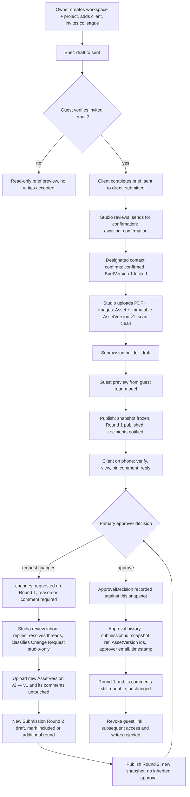
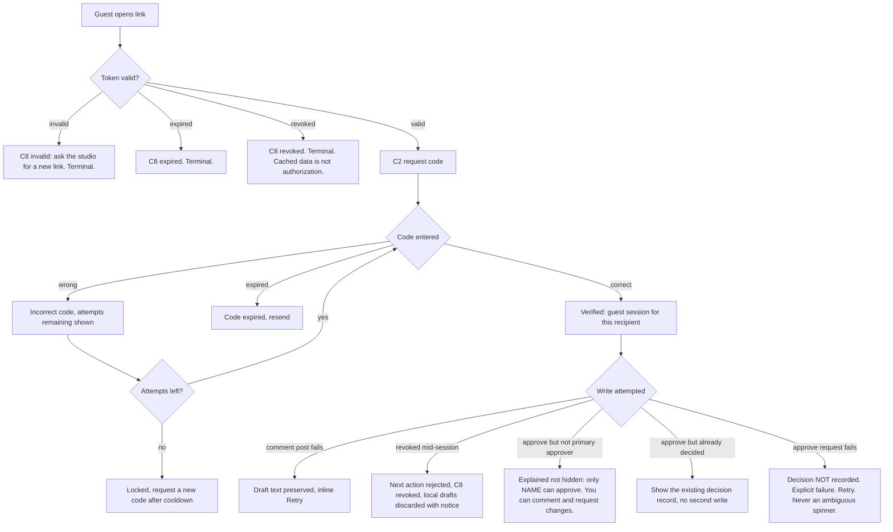
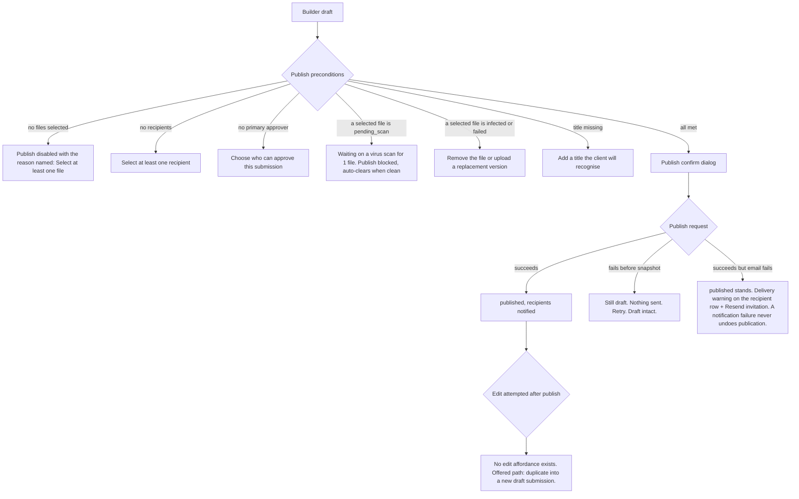

# Key user flows — Phase 1

**Status:** Draft — awaiting product owner selection (B8)

Each step names: **who acts → what they see → the state change that is persisted**. A step with no persisted state change says so, because builders must not invent one. Lifecycle names follow Product Knowledge §5.5.

---

## Flow 0 — The end-to-end acceptance scenario (§10.1) as one map

**Invariant checkpoints a builder must not route around:** J freezes the snapshot (§5.4.5); O never touches v1 or its threads (§5.4.7); Q carries no approval forward (§5.4.9); R points at one exact snapshot (§5.4.8); every guest step re-checks token scope, verification and revocation server-side (§5.4.10–11).

---

## Flow 1 — Guest: link → OTP → review → comment → approve

The primary flow. Phone-first. 375 px is the design target, not a fallback.

### Happy path

| # | Actor | Surface | What they see | Persisted state change |
|---|---|---|---|---|
| 1 | Client | Email client | "<Studio> has sent you Round 1 of Schematic Design for review" + one button | Notification delivery record only. No domain change. |
| 2 | Client | C1 Guest link entry | Project + submission context, stage, what's being asked, due date, file thumbnails, their masked email, "Verify your email to comment" | Token validated server-side (scope: this submission + this recipient). No domain change. GuestAccessLink `last_seen` may be recorded. |
| 3 | Client | C1 → C4 (optional) | Read-only canvas; write controls visible but gated | None. Server rejects any write. |
| 4 | Client | C2 OTP | "We emailed a 6-digit code to j•••@example.com" + expiry countdown. Email is **not editable**. | VerificationChallenge created (hashed code, 10 min TTL, 5 attempts — ADR-0002). |
| 5 | Client | C2 OTP | 6 digits entered, numeric keypad, paste/autofill supported | Challenge consumed → guest session established (HttpOnly cookie) for this recipient + submission. Verified identity = invited email. |
| 6 | Client | C4 Review canvas | The work fills the screen. Context collapsed to one line. Pager "1 of 7". Zoom/page controls. "Add comment". | None. |
| 7 | Client | C4 → C5 | Taps "Add comment" → crosshair → taps the plan → pin draft appears, movable | None yet — the pin is local until posted. |
| 8 | Client | C5 Thread sheet | Category required (Question / Change Request / Preference / Concern), then body | FeedbackThread + Comment created, anchored to `{assetVersionId, pageIndex, x, y}` with x,y ∈ [0,1]. ActivityEvent. Studio notified. |
| 9 | Studio | P12 Review inbox | Thread at its anchored location | Comment (studio reply). ActivityEvent. Client notified. |
| 10 | Client | C5 | Reply in the same thread | Comment appended. Thread stays `open`. |
| 11 | Approver | C4 → C6 | "Approve this submission" with the exact file list and version numbers, plus the plain non-contractual statement | None yet. |
| 12 | Approver | C6 | Optional note → Approve | **ApprovalDecision** (append-only): submission id, snapshot ref, stage, every AssetVersion id, verified email, display name, `approve`, note, timestamp. Submission → `approved`. ActivityEvent. Studio + client participants notified. |
| 13 | Approver | C6 success | Receipt: what, which submission, by whom, when with timezone, "copy emailed" | None. The record is immutable from here. |

### Failure and denial branches

**Request-changes branch (steps 11–13 alternative):**
1. Reviewer or Approver opens the decision sheet and chooses **Request changes**.
2. The control states which precondition is satisfied: "You've posted 3 comments" or "Add a reason to continue". An empty request is impossible in the UI and rejected by the server (§4.7).
3. On submit: `changes_requested` recorded against this submission, reason stored, published snapshot **unchanged**, ActivityEvent, studio notified.
4. Receipt names what happens next: "<Studio> has been notified. They'll respond or send a revised submission."

### Phone-specific notes for this flow
- Steps 6–10 are the whole product on a 375 px screen. The thread composer is a bottom sheet, not a sidebar; the pin stays visible above the sheet (sheet occupies at most 55% of viewport height, with the pin scrolled into the visible band when the sheet opens).
- Pinch-zoom and pin-placement must not conflict: placing a pin is an explicit armed mode entered by a button, not a long-press on the canvas.
- A 44 × 44 px minimum hit area for every pin, even when the rendered dot is 16 px.
- OTP step must survive app-switching to the mail app and back without losing the challenge.

---

## Flow 2 — Studio: build and send a submission

### Happy path

| # | Actor | Surface | What they see | Persisted state change |
|---|---|---|---|---|
| 1 | Member | P7 Project overview | Primary action "New submission" (project has clean assets) | Submission created with status `draft`, stage pre-filled from the project. |
| 2 | Member | P10 Builder · Files | Asset library picker. Each asset expands to its exact versions (v1, v2 …) with uploader and date. "Latest" is not a selectable concept. | SubmissionItem rows referencing exact AssetVersion ids as each file is selected (draft is autosaved). |
| 3 | Member | P10 Builder · Files | Drag to reorder; order number shown on each row | SubmissionItem `displayOrder` updated. |
| 4 | Member | P10 Builder · Context | Title, short context, "What we're asking you to decide", review instructions, stage (4 defaults or a custom label) | Draft fields autosaved. |
| 5 | Member | P10 Builder · Recipients | Project client contacts listed; check to invite; exactly one radio-selected Primary Approver | SubmissionRecipient rows with role. Exactly one approver enforced by the control and the server. |
| 6 | Member | P10 Builder · Settings | Optional due date (timezone-aware); studio-only round marker (included / additional) if an allowance is configured | Draft fields autosaved. Round marker is studio-only, never in a guest payload. |
| 7 | Member | P11 Guest preview | The real guest canvas rendered from the **guest read model**, inside a persistent "Preview — not published" frame; can preview as Reviewer or as Primary Approver with inert controls | None. |
| 8 | Member | P10 → Publish dialog | Checklist of exactly what will be frozen: N files at these versions, order, title, context, objective, instructions, stage, recipients + roles, due date. One sentence: "After publishing, this submission can't be edited. Changes mean a new submission." | None yet. |
| 9 | Member | Publishing | Progress, then the published state | **Snapshot frozen**: asset-version ids + metadata, order, title, context, stage, objective/instructions, recipients + roles, due date. Submission → `published`. Round number assigned. GuestAccessLink per recipient. ActivityEvent. Invitations emailed. |
| 10 | Member | P7 / P12 | Published round card with recipient delivery status and "Open review inbox" | None. |

### Failure and denial branches

**Upload sub-flow (precondition for step 2):**
1. Member drops files on P9 → per-file upload progress (presigned upload, bytes never through the app server).
2. Accepted type + under limits → AssetVersion created as `pending_scan`; the row shows "Checking file".
3. Scan clean → selectable in the builder. Scan infected → quarantined row, not previewable, not selectable, reason stated.
4. Replacing a file is an explicit "Upload new version" with a confirmation that states: v1 stays available and comments on v1 stay on v1.
5. Failure branches: too large (50 MB), PDF over 50 pages for in-browser review (B6 — **see open question 2**), unsupported type → download-only attachment, labelled and unselectable; network failure → per-file retry without restarting the batch.

---

## Flow 3 — Studio: respond, classify, revise, publish Round 2

| # | Actor | Surface | What they see | Persisted state change |
|---|---|---|---|---|
| 1 | Member | P6 Workspace home | Needs-attention row: "Changes requested · Villa Marine · Round 1" | None. |
| 2 | Member | P12 Review inbox | All threads for the round in one list, each with category, author, anchor (file + page) and status; the client's change-request reason in a banner | None. |
| 3 | Member | P12 | Clicks a thread → canvas scrolls/zooms to the pin on the exact AssetVersion | None. |
| 4 | Member | P12 | Replies to the client | Comment appended. Client notified. |
| 5 | Member | P12 | Marks a thread `resolved` | Thread status `open → resolved`. Messages preserved. ActivityEvent. |
| 6 | Member | P12 studio-only region | Inside the locked, labelled "Studio only — never shown to the client" region, classifies a Change Request as **Included** or **Potential scope change** | Studio-only field set. **Must not** appear in any guest payload (§5.4.12). No automatic scope or fee consequence (§4.6). |
| 7 | Member | P9 | Uploads a revised file as a **new version** | AssetVersion v2 created, immutable. v1 and all v1 threads untouched; no comment migration (§5.4.7). |
| 8 | Member | P10 | New submission draft; may start from Round 1's selection with versions **re-pinned explicitly**, never silently bumped to v2 | New Submission `draft`. Each SubmissionItem's version is shown and must be confirmed. |
| 9 | Member | P10 settings | Marks the round included or additional, against the configured allowance | Studio-only round marker. Display only; no fee logic. |
| 10 | Member | Publish | Round 2 `published`; approval state starts empty | New snapshot. **No inherited approval** (§5.4.9). Round 1 preserved in full. |

**Denial branch:** a member from another workspace reaching any of these URLs gets the studio permission-denied pattern that does not confirm the record exists.

---

## Flow 4 — Studio: retrieve approval evidence (§10.1 step 8)

1. Member opens P7 → Approval history, or P13 directly.
2. Sees the round timeline with each round's decision.
3. Opens the approved round's record: submission id, snapshot reference, design stage, every AssetVersion id with filename and version number, approver's verified email and display name, decision type, note, timestamp with timezone.
4. Can open each listed AssetVersion exactly as it was, and download the original.
5. No edit, delete or re-date affordance exists anywhere on this record.
6. Round 1 and its threads remain readable and unchanged (§10.1 step 9).

---

## Flow 5 — Revoke a guest link (§10.1 step 10)

1. Member opens the submission's recipients list (P12) or the brief's link status (P8).
2. Chooses **Revoke access** for one recipient → confirm dialog naming the consequence: "<name> will no longer be able to open this submission or add comments. Their existing comments stay on record."
3. On confirm: GuestAccessLink revoked. ActivityEvent. The recipient row shows "Access revoked · 24 Nov".
4. The guest's next action — page load, comment, or decision — is rejected server-side and lands on C8 revoked. Already-loaded data in their browser is **not** treated as continuing authorization (§7.2); the client app must re-validate on focus and on every write, and clear local drafts with a notice.
5. Un-revoking is not a Phase 1 affordance. Restoring access means inviting the contact to a new submission.
